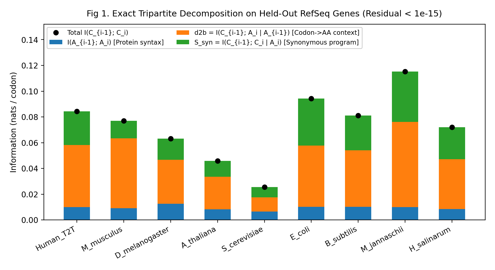
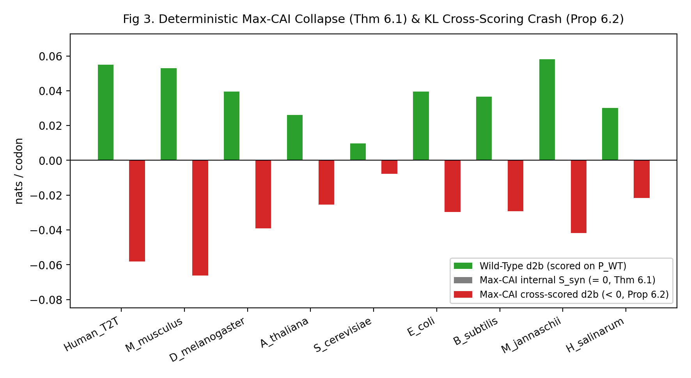
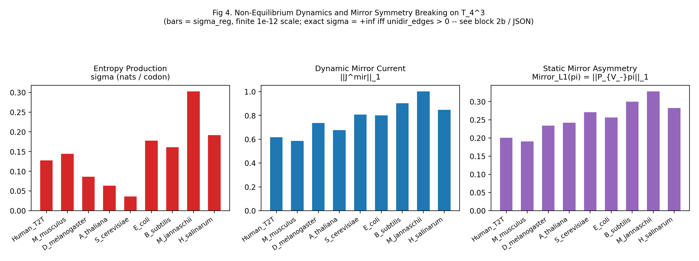
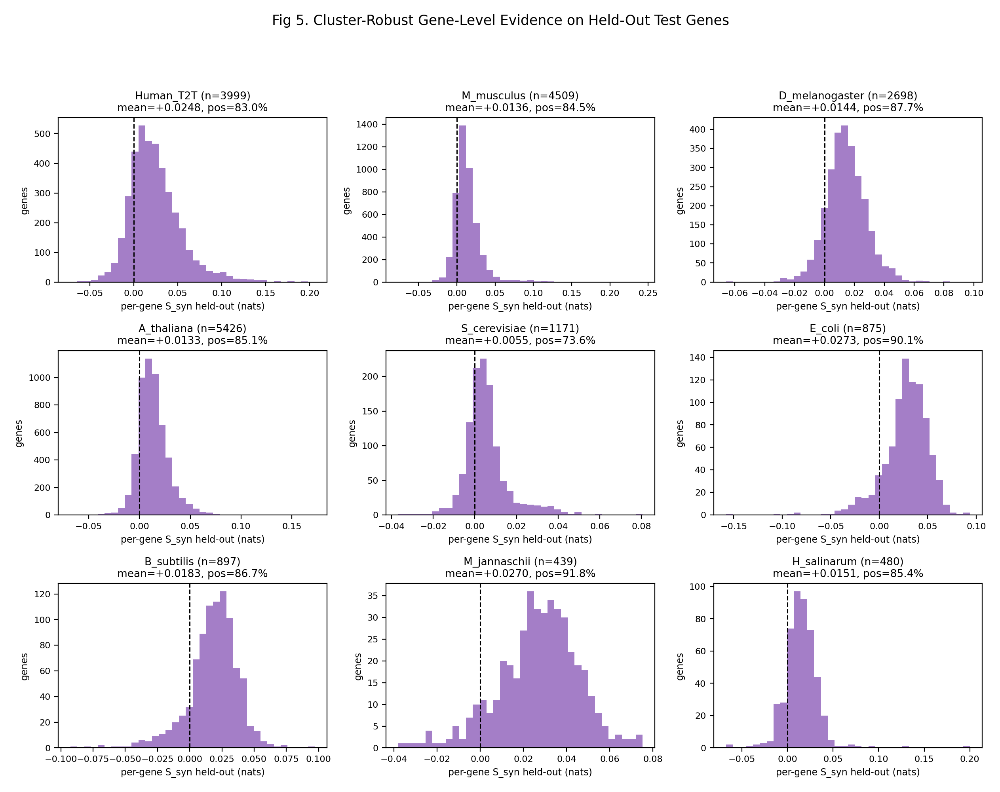
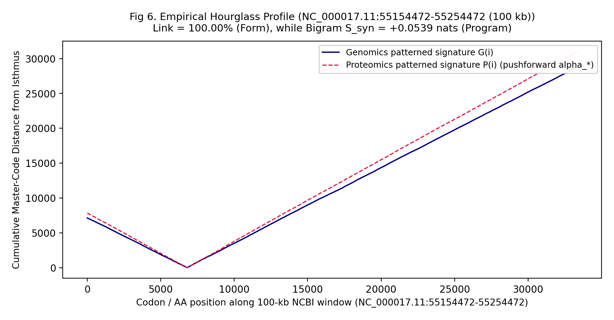
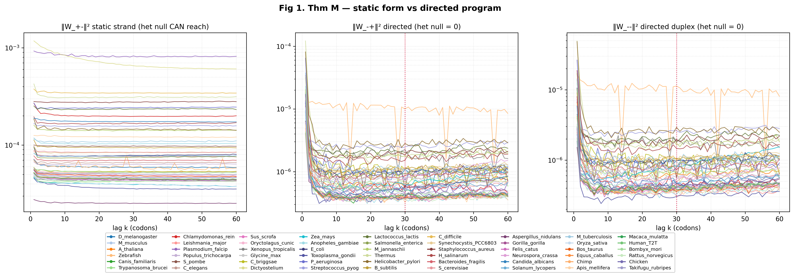
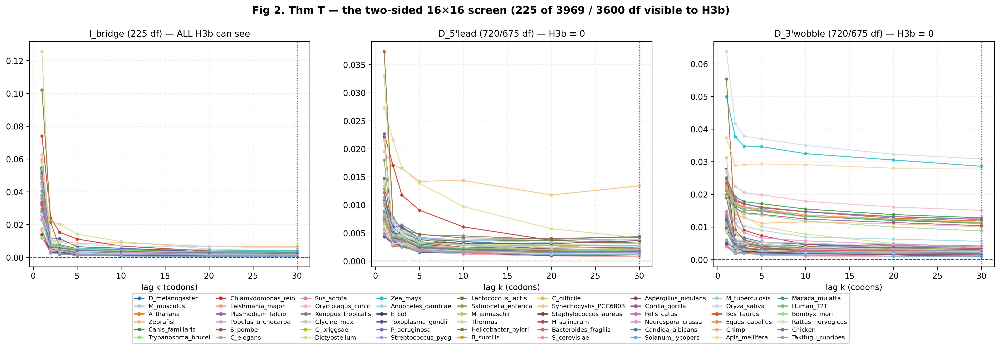
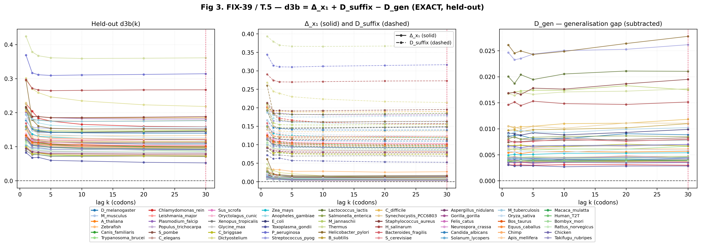
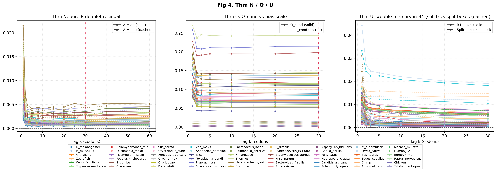

# From Form to Program, The Double-Stranded Codon Torus ($\mathbb{T}_4^3 = (\mathbb{Z}/4\mathbb{Z})^3$) & The Codon Memory Spectrum: Conditional Codon Syntax, Zero-RNG Null Towers, 16×16 Dinucleotide Screen & Synthetic mRNA Forensics

[](https://github.com/Dr-Logvinovich/codon-torus-syntax/actions/workflows/ci.yml)
[](https://doi.org/10.5281/zenodo.23479667)
[](https://doi.org/10.5281/zenodo.23695321)
[](https://doi.org/10.5281/zenodo.24242063)
[](https://orcid.org/0009-0007-2040-6955)
[](https://orcid.org/0000-0001-6446-2042)
[-2ea44f.svg)](cds_cache)
[](https://www.python.org/)
[](LICENSE)

> **Official Open-Science Verification Repository for the Three-Paper Genomic Information Theory & Double-Stranded Codon Torus Research Programme (Complete with 568 MB Pre-Cached NCBI RefSeq/GenBank Archives, Zero-RNG Proofs & Pre-Computed Audit Bundles across 54 Cellular Genomes / 141,272,088 Sense Codons).**
>
> * **Authors:** **Victor Logvinovich** (Master of Physical and Mathematical Sciences; Researcher in Pedagogical Sciences (Mathematics), Kobrin, Belarus; [ORCID: 0009-0007-2040-6955](https://orcid.org/0009-0007-2040-6955)) and **Jean-Claude Perez** (PhD in Mathematics and Computer Science, Retired IBM AI European Research Centre, Montpellier; Luc Montagnier Foundation; [ORCID: 0000-0001-6446-2042](https://orcid.org/0000-0001-6446-2042)).
> * **Paper I (`v14.8` — From Form to Program):** [https://doi.org/10.5281/zenodo.23479667](https://doi.org/10.5281/zenodo.23479667) *(Concept DOI: [10.5281/zenodo.23287684](https://doi.org/10.5281/zenodo.23287684))*
> * **Paper II (`v3.5` — The Double-Stranded Codon Torus):** [https://doi.org/10.5281/zenodo.23695321](https://doi.org/10.5281/zenodo.23695321) *(Concept DOI: [10.5281/zenodo.23508080](https://doi.org/10.5281/zenodo.23508080))*
> * **Paper III (`v2.4` — The Codon Memory Spectrum):** [https://doi.org/10.5281/zenodo.24242063](https://doi.org/10.5281/zenodo.24242063) *(Concept DOI: [10.5281/zenodo.24242062](https://doi.org/10.5281/zenodo.24242062))*

---

## Executive Trilogy Overview: From Empirical Syntax to Zero-RNG Operator Theory on $\mathbb{T}_4^3$

| Trilogy Stage | Primary Mathematical & Empirical Contributions | Autonomous Engine | Scale Audited |
| :--- | :--- | :---: | :--- |
| **Paper I (`v14.8`)**<br>*From Form to Program* | Operationalizes static **form** vs. dynamic **program** across a 10-null hierarchy (`H0`–`H7`); establishes the $L = 30$ codon (29-transition / 89-nt) invariant, two-scale phylogenetic transfer (132/132 mammal pairs + Primate–Rodent asymmetry), 14/14 human RefSeqGene intron–exon splicing confinement (`TP53`, `KRAS`, `BRCA1`), Venter `JCVI-syn1.0/3.0` forensics, viral "Genetic Trojans" (`HPV-16 E7`, `Adenovirus E3 RID-α`), and the `Max-CAI` crash. | [`super_codon_proof_v14_8.py`](super_codon_proof_v14_8.py) | 54 RefSeq cellular taxa + 13 frontier genomes + 14 human RefSeqGene loci |
| **Paper II (`v3.5`)**<br>*The Double-Stranded Codon Torus* | Proves that $\rho(c) = -Rc + 3\mathbf{1} \pmod 4$ is a fixed-point-free isometry on $\mathbb{T}_4^3 = (\mathbb{Z}/4\mathbb{Z})^3$ splitting $\mathbb{R}^{64} = V_+ \oplus V_-$ ($32 \oplus 32$); proves the duplex fibration $\alpha_{\text{dup}}(c) = (\alpha(c), \alpha(\rho(c)))$ ($64 \to 56$, collapsing synonymous dimension $43 \to 8$); proves antisense channel dominance ($74.1\%\text{–}88.5\%$ of $S_{\text{syn}}$); uncovers the 1,101-codon antisense ORF in Pfizer `BNT162b2` and 820-codon `+2` corridor in Moderna `mRNA-1273`; builds the **Corollary 4.4 Duplex-Safe Viterbi Compiler**. | [`codon_torus_real_audit_v3_bnt162b2.py`](codon_torus_real_audit_v3_bnt162b2.py) | 9 reference RefSeq genomes (9,834,024 held-out transitions) + 17q22 locus + 8 Spike-2P constructs |
| **Paper III (`v2.4`)**<br>*The Codon Memory Spectrum* | Replaces the entire Monte-Carlo null stack (`H4`–`H7` + 4 layer-shuffle towers) with exact polynomial-time **zero-RNG** expectations ($10^{-15}\text{–}10^{-20}$ accuracy); proves Klein four-group $V_4$ quadrant splitting ($1056 \oplus 1024 \oplus 1024 \oplus 992 = 4096$) and Table-12 commutator detection (*Candida albicans*); proves the rank-$\le 16$ two-sided $16\times 16$ dinucleotide screen ($93.75\%$ of sense df invisible to `H3b`); proves two finite-sample bias lemmas resolving $d_{3b}^{\text{phase}}(k=30) < 0$ while establishing $\Delta_{x_1}(k=30) > 0$ in `54/54` taxa; proves the $\sigma$-algebra bridge ($b_1 = 25$ topological invariant, self-dual $3\times 3$ matrix $M(B_{\text{anti}}) = M(B_{\text{sense}})^\top$). | [`codon_memory_spectrum_v2.py`](codon_memory_spectrum_v2.py)<br>[`replot_memory_v24.py`](results_memory_v24_full/replot_memory_v24.py) | All 54 cellular RefSeq genomes across lags $k = 1, \dots, 60$ (**281,207 genes**, **141,272,088 sense codons**, **423,816,264 nt**) |

---

## Complete Repository Architecture (100% Self-Contained & Offline-Ready)

Unlike standard bioinformatics repositories that require hours of external FTP downloads before a single test can run, this repository includes the **entire 568 MB local NCBI cache (`cds_cache/`, 103 SHA-256 verified genomic files)** and **all pre-computed verification outputs (`results_verified/` and `results_memory_v24_full/`)**:

| Path / Artifact | Category | Contents & Verification Scope |
| :--- | :---: | :--- |
| **[`code_logos_perez_v14_8.tex.pdf`](code_logos_perez_v14_8.tex.pdf)** | **Preprint I (34 pp.)** | *"From Form to Program: Medium-Range Conditional Codon Syntax Inside Real Genes — Strict Null-Model Evidence Across 54 Cellular RefSeq Taxa, a Codon-Mirror-Symmetry Control, Two-Scale Phylogenetic Transfer, Intron-Exon Compartment Confinement, Synthetic Genome Forensics, and the Biotech 'Max-CAI' Codon-Optimization Crash"* (`v14.8`). |
| **[`codon_torus_logos_perez_v3.tex.pdf`](codon_torus_logos_perez_v3.tex.pdf)** | **Preprint II (33 pp.)** | *"The Double-Stranded Codon Torus: Duplex Mirror Fibration of DNA Coding Space, Markovian Lumpability, and Information-Theoretic Consequences"* (`v3.5`). |
| **[`Codon_Memory_Spectrum_v2.pdf`](Codon_Memory_Spectrum_v2.pdf)** | **Preprint III (30 pp.)** | *"The Codon Memory Spectrum on the Double-Stranded Torus: Exact Zero-RNG Null Towers, Klein Four-Group Symmetry Breaking, the Two-Sided 16×16 Dinucleotide Screen, and the Algebra-to-Screen Bridge Across 54 RefSeq Genomes"* (`v2.4`). |
| **[`super_codon_proof_v14_8.py`](super_codon_proof_v14_8.py)** | **Verification Engine I** | Autonomous self-testing pipeline (`v14.6–v14.8`): 10-level null model hierarchy (`H0`–`H7`) across 54 cellular RefSeq taxa + SARS-CoV-2, 14-gene human RefSeqGene intron-exon compartment confinement (`TP53`, `KRAS`, `BRCA1`, etc.), 13 frontier genomes (Giant Viruses, 2.8 km boreholes, 122 °C archaea, Venter's `JCVI-syn1.0` & `JCVI-syn3.0`), viral "Genetic Trojans" (`HPV-16 E7`, `Adenovirus E3 RID-α`), organelle OS rewriting, and the `Max-CAI` crash test. |
| **[`codon_torus_real_audit_v3_bnt162b2.py`](codon_torus_real_audit_v3_bnt162b2.py)** | **Verification Engine II** | Simulation-free, **zero-RNG** analytic audit suite (`v3.2 / v3.5`): verifies exact chain-rule decompositions on the discrete torus $\mathbb{T}_4^3 = (\mathbb{Z}/4\mathbb{Z})^3$ to $< 10^{-15}\text{ nats/codon}$, the two-strand duplex fibration $\alpha_{\text{dup}}$ (`64 → 56`), Kemeny–Snell Markov lumpability ($G^2$), antisense program dominance (`74.1%–88.5%`), 6-frame duplex ORF forensics on **Pfizer BNT162b2** (3,825 nt) and **Moderna mRNA-1273** (3,828 nt / `OR134578.1`), and the constructive **Corollary 4.4 Duplex-Safe Viterbi Compiler**. |
| **[`codon_memory_spectrum_v2.py`](codon_memory_spectrum_v2.py)** | **Verification Engine III** | Self-testing, **100% zero-RNG** multi-lag analytic engine (`v2.4`, Theorems A–AA across lags $k = 1, \dots, 60$ codons on **54 cellular RefSeq genomes**: 281,207 deduplicated genes, 141,272,088 sense codons, 423,816,264 nt): closed-form expectations for `H4` in $\mathcal{O}(n+q^2)$, `H5` ($\lVert u_t \rVert_1 = 1$), `H6`, `H7`, and 4 layer-shuffle towers $\Lambda \in \{\text{het, aa, dup, mirror}\}$ (`2F` BLAS calls); Klein four-group $V_4$ quadrant split (`1056 ⊕ 1024 ⊕ 1024 ⊕ 992 = 4096`) & Table-12 commutator detector (*Candida albicans*); two-sided `16 × 16` dinucleotide screen (`225 + 675 + 675 + 2025 = 3600 df`); exact held-out identity $d_{3b} = \Delta_{x_1} + D_{\text{suffix}} - D_{\text{gen}}$ & finite-sample bias lemmas; and the $\sigma$-algebra bridge ($b_1 = 25$, self-dual `3 × 3` matrix $M(B_{\text{anti}}) = M(B_{\text{sense}})^\top$). |
| **[`run_all_audits.sh`](run_all_audits.sh)** | **1-Click Master Runner** | Executes all built-in mathematical unit tests, runs verification engines across all cached datasets, and generates all JSON/Markdown reports and publication figures in one command. |
| **[`cds_cache/`](cds_cache)** | **Local NCBI Cache (568 MB, 103 Files)** | **55** official RefSeq `*_cds_from_genomic.fna.gz` assemblies, **16** human RefSeqGene GenBank loci (`NG_*.gb` + `JCVI-syn1.0/3.0`), **13** Frontier Biosphere CDS archives, **19** viral/chimera/vaccine FASTA records (`NC_045512.2`, `OR134577.1`, `OR134578.1`, `mRNA-1273`), and the 100-kb human chromosome 17 window `NC_000017.11:55154472-55254472`. |
| **[`results_verified/`](results_verified)** | **Verified Outputs I & II** | Complete JSON, Markdown, and log outputs for all 5 audit stages of Papers I & II (`01_codon_torus_and_bnt162b2_v3_5` through `05_biosphere_55taxa_smoke`) plus all 8 publication figures (`PNG` & `PDF`). |
| **[`results_memory_v24_full/`](results_memory_v24_full)** | **Verified Outputs III (`v2.4`)** | Complete 54-taxon zero-RNG output bundle ([`memory_spectrum_v24.zip`](results_memory_v24_full/memory_spectrum_v24.zip)), execution log ([`run_memory_v24_all_cached.log`](results_memory_v24_full/run_memory_v24_all_cached.log)), 60-colour plotting engine ([`replot_memory_v24.py`](results_memory_v24_full/replot_memory_v24.py)), and 54-species biosphere figures ([`fig1`](results_memory_v24_full/fig1_klein_quadrants.png)–[`fig4`](results_memory_v24_full/fig4_tower_phase_boxes.png)). |

---

## How Cambridge's "Wet-Lab" Experiment in *Nature* Validated Our Mathematical Theory of DNA (And the "Fine Print" Patent Paradox)

For decades, synthetic biology and industrial mRNA design have relied on a zero-order assumption: if you replace every sense codon with its single "most frequent" human synonym (the **Max-CAI / Max-GC3** standard), the amino-acid sequence on paper remains 100% identical, so translation should only improve.

Our mathematical theorems on the discrete codon torus $\mathbb{T}_4^3 = (\mathbb{Z}/4\mathbb{Z})^3$ and independent experimental wet-lab findings in *Nature* have converged to prove why this assumption fails:

### 1. What Cambridge & Oxford's Wet-Lab Experiment Revealed in *Nature* (Mulroney et al., 2024)
In a landmark experimental study published in *Nature* ([Mulroney et al., *Nature* **625**, 189–194, 2024; DOI: `10.1038/s41586-023-06800-3`](https://doi.org/10.1038/s41586-023-06800-3)), researchers from the Universities of Cambridge and Oxford tested *in vitro*, in HeLa cells, in mice, and in human blood samples how ribosomes translate artificially modified, codon-optimized mRNA (`BNT162b2`):
* Using high-precision liquid chromatography–tandem mass spectrometry (**LC-MS/MS**) and immune assays (**$\text{IFN}\gamma$ ELISpot**), they experimentally demonstrated that the ribosome physically **stalls** during elongation on the synthetic mRNA strand.
* Because of ribosomal stalling at slippery sequences, the ribosome slips out of the `+0` reading frame by `+1` nucleotide (at a rate of $\sim 8\%$ of the main translated protein) and synthesizes off-target, out-of-frame **chimeric polypeptides** (`+1` frameshifted products) that elicit unintended off-target T-cell immune responses in both mice and vaccinated humans.
* Earlier, a comprehensive review in *Signal Transduction and Targeted Therapy* (*Nature* portfolio: [Fang et al., 2022; DOI: `10.1038/s41392-022-00950-y`](https://doi.org/10.1038/s41392-022-00950-y)) had already warned that commercial codon-optimization algorithms used in `BNT162b2` and `mRNA-1273` alter local translation kinetics and secondary structure in ways that can impair co-translational folding.

### 2. The "Fine Print" Paradox: Why Patent a Repair If Everything Works Flawlessly?
In the main text of [Mulroney et al. (2024)](https://doi.org/10.1038/s41586-023-06800-3), the authors state that no adverse clinical outcomes have been associated with these frameshifted polypeptides. Yet on **page 194** of the exact same *Nature* paper, under **Competing interests**, the fine print reads:
> *"T.E.M. and A.E.W. are inventors on a pending patent application (**2305297.0**) related to mRNA technology."*

If single-codon `Max-CAI` / `Max-GC3` optimization had no structural defect, there would be no need to file commercial UK Patent Application No. `2305297.0` to algorithmically recode mRNA sequences against ribosomal frameshifting. Without resolving ribosomal stalling and out-of-frame run-on translation, next-generation mRNA therapeutics (especially high-dose, repeat-dosing oncology and enzyme-replacement therapies) hit a fundamental biological barrier.

### 3. The Fundamental Mathematical Cause Uncovered in This Repository (Logvinovich & Perez, 2026)
Where wet-lab mass spectrometry observed the downstream symptom (localized stalling and `+1` frameshifting), our exact algebraic and information-theoretic audit across **54 RefSeq species** and **141,272,088 sense codons** uncovers the **two-part mathematical root cause**:

1. **Destruction of First-Order Pairwise Ribosomal Syntax (Theorem 6.1 & Proposition 6.2):**
   Living genes are not zero-order bags of independent codons; they are first-order Markovian programs $P(C_i \mid C_{i-1})$ calibrated to the physical geometry of the ribosomal exit tunnel ($L = 30$ codons $= 29$ transitions, the 8th Lucas number; $89$ nucleotide steps, the 11th Fibonacci number). When bioengineers apply greedy `Max-CAI` / `Max-GC3` optimization ($C_i = \phi(A_i)$), internal contextual synonymous information collapses identically to zero ($S_{\text{syn}} = S_{\text{syn}}^{(2)} = d_{2b} = 0$), and cross-scored conditional syntax $d_{2b}$ under the native human transition matrix $P_{\text{WT}}$ **crashes into strictly negative territory**:
   * Across **14 out of 14** benchmark human RefSeqGene loci (`TP53`, `BRCA1`, `KRAS`, `HBB`, `GAPDH`, etc.), `Max-CAI` crashes $d_{2b}$ from a wild-type mean of $+0.0427$ down to $-0.0589\text{ nats/codon}$ ($p = 2^{-14} = 6.1 \times 10^{-5}$).
   * In wild-type SARS-CoV-2 Spike (`NC_045512.2`), human conditional syntax is strictly positive ($d_{2b} = +0.0222$), whereas in **Pfizer `BNT162b2`** it crashes to $d_{2b} = -0.0549$ and in **Moderna `mRNA-1273`** it crashes to $d_{2b} = -0.0616$. Forcing incompatible adjacent tRNA pairs into the ribosomal A and P sites is the exact information-theoretic driver of ribosomal stalling.
2. **Demolition of Nature's 6-Frame "Safety Airbag" on the Duplex Torus (Theorem 4.3 & Corollary 4.4):**
   In nature, when a ribosome accidentally slips out of frame (`+1`, `+2`, or on the complementary antisense strand `-0`), why doesn't it synthesize a massive foreign protein? Because **nature designs across both strands of the DNA/RNA duplex simultaneously** (`82.5%` of human synonymous choice $S_{\text{syn}}$ is governed by the antisense amino-acid channel $A_i^\rho = \alpha(\rho(C_i))$).
   * Wild-type Spike (`NC_045512.2`) carries **145 hidden stop codons in shifted sense frame `+2`** (capping any `+2` frameshift error at $\le 42$ codons) and **63 stop codons in antisense frame `-0`** (carried by the wobble-A triplets $\rho^{-1}(\text{Stop}) = \{\text{TTA, CTA, TCA}\}$).
   * By inflating `GC3` to `81.1%–95.5%` and wiping out wobble-A and wobble-T bases, industrial codon optimizers **demolished the out-of-frame stop barriers**:
     * In **Moderna `mRNA-1273`**, protective stop codons in shifted sense frame `+2` plunge **72.5-fold** (from `145` down to just `2`), opening a continuous, unbroken stop-free corridor **820 codons (2,460 nt)** long!
     * In **Pfizer `BNT162b2`**, all `63` antisense stop barriers $\{\text{TTA, CTA, TCA}\}$ are wiped out to **0** (`0/0/0`), while `2` sense `CAT` Histidine codons ($\rho(\text{CAT}) = \text{ATG}$) are retained near the $3'$ end—opening a continuous **1,101-codon (3,303-nt) `ATG->End` antisense open reading frame** (`175..1275`)!
3. **100% Open-Source Constructive Fix (`Human_DuplexSafe_Viterbi_Spike_2P`, Corollary 4.4 & Proposition 6.3):**
   Instead of locking mRNA safety behind commercial patents, our repository provides a deterministic, zero-RNG **Duplex-Safe Viterbi Compiler** in pure Python + NumPy that preserves 100% of the Spike-2P amino-acid sequence while restoring strongly positive human ribosomal syntax ($d_{2b} = +0.2142$, $S_{\text{syn}} = +0.1557$, $d_{3b} = +0.3304$), eliminating all antisense frame `-0` `ATG` starts ($\text{CAT} = 0 \implies 0$ `ATG->End` ORFs), and restoring **30 stop barriers in antisense frame `-0`** and **39 stop barriers in shifted sense frame `+2`**.

---

## Methodological & Mathematical Protocol (Read First)

1. **Strict Separation of Static "Form" vs. Dynamic Sequential "Program":**
   Zero-order nucleotide frequencies, GC3 isochores, marginal codon usage (`CAI`), and single-stranded Chargaff/Perez 32-mirror-pair balances describe the **static compositional form** of a sequence (the 32-dimensional mirror-even subspace $V_+ \subset \mathbb{R}^{64}$ and time-symmetric Klein subspaces $W_{++} \oplus W_{+-} \subset \mathbb{R}^{4096}$). This programme measures the **dynamic sequential program**—the first-order and medium-range ($L = 30$ codons) conditional transition structure $P(C_i \mid C_{i-1})$ living on $V_-$, the directed Klein subspaces $W_{-+} \oplus W_{--}$, and the synonymous fiber bundle after all compositional, amino-acid, and strand-parity marginals are absorbed.
2. **100% Zero-RNG Analytic Proofs (`codon_torus_real_audit_v3_bnt162b2.py` & `codon_memory_spectrum_v2.py`):**
   Every theorem in Papers II and III is proved deductively in exact algebra and information theory and audited analytically via closed-form permutation expectations, held-out Dirichlet/backoff log-likelihoods, and contingency-table likelihood-ratio ($G^2$) statistics with exact degrees of freedom (`df = 3969, 3600, 2709, 2460, 2040, 2025, 1849, 1681, 860, 779, 675, 420, 400, 361, 225`). Zero random number generators are used in any proof path (`zero_random_generators_used = True`).
3. **Every Integer Is Derived (Anti-Numerology Policy):**
   Every integer appearing in the torus framework (`2, 3, 4, 6, 7, 8, 12, 13, 15, 16, 19, 20, 21, 23, 24, 25, 32, 40, 41, 42, 43, 45, 48, 54, 56, 57, 58, 60, 61, 62, 63, 64, 76, 180, 225, 240, 361, 400, 420, 675, 703, 720, 756, 779, 784, 812, 860, 992, 1024, 1056, 1681, 1722, 1849, 2025, 2040, 2280, 2304, 2460, 2700, 2709, 3600, 3969, 4096`) is derived explicitly from a set cardinality, group trace, bipartite Euler–Poincaré Betti number, matrix rank, simplex dimension $\sum_a (k_a - 1)$, or contingency degree-of-freedom count.

---

## Part I: The Double-Stranded Codon Torus $\mathbb{T}_4^3 = (\mathbb{Z}/4\mathbb{Z})^3$ & Exact Decompositions (`v3.2–v3.5`)

### 1. Duplex Geometry, Mirror Involution $\rho$, and the Two-Strand Fibration $\alpha_{\text{dup}}: 64 \to 56$
* **Discrete Torus & Fixed-Point-Free Involution (Theorem 2.5 & Corollary 2.6):** Under $e: \{\text{A,C,G,T}\} \to \mathbb{Z}/4\mathbb{Z}$, the 64 codons form the discrete torus $\mathbb{T}_4^3 = (\mathbb{Z}/4\mathbb{Z})^3$. Watson–Crick reverse complementation $\rho(c) = -Rc + 3\mathbf{1} \pmod 4$ is a fixed-point-free affine isometry in both Hamming ($d_H$) and Lee ($d_{\text{Lee}}$) metrics, partitioning $\mathbb{T}_4^3$ into **32 mirror orbits** and splitting $\mathbb{R}^{64} = V_+ \oplus V_-$ ($\dim V_+ = \dim V_- = 32$).
* **The 8-Doublet Theorem (Theorem 4.3):** While the single-strand genetic code $\alpha: \mathbb{T}_4^3 \to \mathcal{A}$ (`64 → 21`) leaves a **43-dimensional** synonymous simplex bundle (`41` on sense codons), evaluating the code on both strands via $\alpha_{\text{dup}}(c) = (\alpha(c), \alpha(\rho(c)))$ maps the sense wobble base onto the antisense leading base, partitioning $\mathbb{T}_4^3$ into **48 singletons** and **8 binary doublets** (`{TAA,TAG}`, `{CAA,CAG}`, `{TCG,TCT}`, `{CCG,CCT}` and their $\rho$-duals `{TTA,CTA}`, `{TTG,CTG}`, `{CGA,AGA}`, `{CGG,AGG}`) across **56 joint channels**, collapsing the duplex synonymous dimension from `43` to `64 − 56 = 8`.

### 2. Exact Tripartite, Quadripartite, and Two-Strand Decompositions Across 9 RefSeq Genomes (9,834,024 Held-Out Transitions)

For any joint distribution of consecutive codons $(C_{i-1}, C_i)$ with $A_i = \alpha(C_i)$ and $A_i^\rho = \alpha(\rho(C_i))$, total bigram mutual information decomposes with **zero stationarity assumptions** (Theorems 5.3, 5.4, 5.5):

$$
I(C_{i-1}; C_i) = \underbrace{I(A_{i-1}; A_i)}_{\text{Protein dipeptide syntax}} + \underbrace{I(C_{i-1}; A_i \mid A_{i-1})}_{d_{2b}\text{ (Codon}\to\text{AA context)}} + \underbrace{I(A_{i-1}; C_i \mid A_i) + I(C_{i-1}; C_i \mid A_{i-1}, A_i)}_{S_{\text{syn}} = I(C_{i-1}; C_i \mid A_i) = S_{\text{anti}} + S_{\text{dup}}}
$$




| Species (Held-Out Test Split) | Table | Test Genes | Test Trans | $I(C;C)$ | $I(A;A)$ | $d_{2b}$ | $S_{\text{syn}}$ | $S_{\text{syn}}^{(2)}$ | $S_{\text{anti}}$ (Antisense %) | Chain Residual | $\text{df}(G^2 / G_{(2)}^2 / \text{lump})$ | Gene $t$-stat (Pos %) |
| :--- | :---: | ---: | ---: | ---: | ---: | ---: | ---: | ---: | ---: | :---: | :---: | ---: |
| **`Human_T2T`** (`GCF_009914755.1`) | 1 | 3,999 | 2,342,893 | `+0.0842` | `+0.0099` | `+0.0483` | `+0.0260` | `+0.0222` | `+0.0215` (**82.5%**) | `4.2e-17` | `2460 / 1681 / 779` | `+52.58` (83.0%) |
| **`M_musculus`** (`GCF_000001635.27`) | 1 | 4,509 | 2,411,478 | `+0.0770` | `+0.0091` | `+0.0543` | `+0.0136` | `+0.0104` | `+0.0110` (**81.1%**) | `2.2e-16` | `2460 / 1681 / 779` | `+49.46` (84.5%) |
| **`D_melanogaster`** (`GCF_000001215.4`) | 1 | 2,698 | 1,493,418 | `+0.0632` | `+0.0125` | `+0.0343` | `+0.0164` | `+0.0103` | `+0.0134` (**81.8%**) | `1.9e-16` | `2460 / 1681 / 779` | `+54.63` (87.7%) |
| **`A_thaliana`** (`GCF_000001735.4`) | 1 | 5,426 | 2,186,312 | `+0.0458` | `+0.0082` | `+0.0253` | `+0.0123` | `+0.0083` | `+0.0099` (**80.4%**) | `2.8e-17` | `2460 / 1681 / 779` | `+64.57` (85.1%) |
| **`S_cerevisiae`** (`GCF_000146045.2`) | 1 | 1,171 | 563,029 | `+0.0254` | `+0.0065` | `+0.0111` | `+0.0078` | `+0.0053` | `+0.0062` (**79.0%**) | `3.5e-17` | `2460 / 1681 / 779` | `+17.43` (73.6%) |
| **`E_coli`** (`GCF_000005845.2`) | 11 | 875 | 272,548 | `+0.0943` | `+0.0103` | `+0.0475` | `+0.0366` | `+0.0204` | `+0.0304` (**83.2%**) | `2.8e-17` | `2460 / 1680 / 779` | `+33.85` (90.1%) |
| **`B_subtilis`** (`GCF_000009045.1`) | 11 | 897 | 251,034 | `+0.0811` | `+0.0102` | `+0.0439` | `+0.0269` | `+0.0179` | `+0.0200` (**74.1%**) | `1.9e-16` | `2460 / 1681 / 779` | `+27.98` (86.7%) |
| **`M_jannaschii`** (`GCF_000007745.1`) | 11 | 439 | 147,216 | `+0.1152` | `+0.0101` | `+0.0660` | `+0.0392` | `+0.0255` | `+0.0338` (**86.4%**) | `3.1e-16` | `2456 / 1676 / 779` | `+30.51` (91.8%) |
| **`H_salinarum`** (`GCF_000015585.1`) | 11 | 480 | 166,096 | `+0.0721` | `+0.0085` | `+0.0387` | `+0.0249` | `+0.0125` | `+0.0221` (**88.5%**) | `6.9e-17` | `2455 / 1671 / 779` | `+17.09` (85.4%) |







---

## Part II: Six-Frame Duplex Forensics on Pfizer `BNT162b2` & Moderna `mRNA-1273` vs. Corollary 4.4 Duplex-Safe Viterbi Compiler (`v3.5`)

By **Corollary 4.4**, under $\rho(c) = -Rc + 3\mathbf{1} \pmod 4$, the sense preimages of the termination codons $\text{Stop} = \{\text{TAA, TAG, TGA}\}$ in antiparallel antisense frame `-0` are exclusively the three wobble-A codons $\rho^{-1}(\text{Stop}) = F_{\text{Leu,Stop}} \cup F_{\text{Ser,Stop}} = \{\text{TTA, CTA, TCA}\}$, while the sense preimage of the canonical antisense start codon `ATG` is the wobble-T Histidine singleton $\rho^{-1}(\{\text{ATG}\}) = F_{\text{His,Met}} = \{\text{CAT}\}$.


| Spike-2P Construct (`SHA-256` Verified) | Codons (Len nt) | GC3 | CpG / 100nt | $H_{\text{cod}}$ (bits) | Cross $d_{2b}$ (`Human_T2T`) | Cross $S_{\text{syn}}$ | $\sigma_{\text{dup}}$ (nats) | Sense `{TTA,CTA,TCA}` (`-0` Stops) | Sense `CAT` (`-0 ATG`) | Sense Stops (`+0/+1/+2`) | Antisense Stops (`-0/-1/-2`) | Max Unbroken Antisense Span | Frame `-0` `ATG->End` ORF |
| :--- | :---: | ---: | ---: | ---: | ---: | ---: | ---: | :---: | :---: | :---: | :---: | :---: | :---: |
| **1. `WT_SARS2_Spike_NC045512`** (`sha256=7d5621cd3b3e`) | 1,274 (3,822) | `0.2665` | `0.76` | `5.5173` | **`+0.0222`** | `+0.0619` | `17.8925` | `28/9/26` (**63**) | `13` | `1 / 55 / 145` | `63 / 64 / 134` | `106c` (`-1`) | `79c` (`650..728`) |
| **2. `BNT162b2_Full_Spike_2P`** (Pfizer 3,825 nt, `sha256=4a4a21a52bba`) | 1,275 (3,825) | `0.8105` | `5.52` | `4.9006` | **`-0.0549`** | `+0.0300` | `21.2378` | `0/0/0` (**0**) | **`2`** | `2 / 59 / 20` | **`0`** `/ 43 / 72` | **`1,275c` (`-0`)** | **`1,101c` (`175..1275`)** |
| **3. `mRNA1273_Full_Spike_2P`** (Moderna 3,828 nt, `sha256=e895ebf67081`) | 1,276 (3,828) | `0.9552` | `7.21` | `4.4700` | **`-0.0616`** | `+0.1154` | `25.0785` | `1/1/2` (**4**) | **`0`** | `3 / 76 /` **`2`** | `4 / 36 / 54` | `458c` (`-0`) | **`0c` (`0..0`)** |
| **4. `mRNA1273_NCBI_OR134578`** (NCBI Vector 3,819 nt, `sha256=b249652999cb`) | 1,273 (3,819) | `0.9425` | `7.18` | `4.5336` | **`-0.0635`** | `+0.1059` | `24.3469` | `1/1/2` (**4**) | **`0`** | `2 / 76 /` **`5`** | `4 / 36 / 54` | `458c` (`-0`) | **`0c` (`0..0`)** |
| **5. `Human_MaxCAI_Spike_2P`** (Theorem 6.1 Deterministic $\phi$) | 1,274 (3,822) | `0.9670` | `6.60` | `4.1578` | **`-0.0647`** | `+0.1213` | `26.4177` | `0/0/0` (**0**) | `0` | `1 / 79 /` **`0`** | **`0`** `/ 32 / 61` | `1,274c` (`-0`) | `0c` (`0..0`) |
| **6. `Human_MaxGC3_Spike_2P`** (Deterministic `GC3=1.0000`) | 1,274 (3,822) | `1.0000` | `6.60` | `4.1578` | **`-0.0666`** | `+0.1339` | `26.4180` | `0/0/0` (**0**) | `0` | `1 / 79 /` **`0`** | **`0`** `/ 32 / 61` | `1,274c` (`-0`) | `0c` (`0..0`) |
| **7. `Human_Markov_H2b_Spike_2P`** (Unconstrained Viterbi, Prop. 6.3) | 1,274 (3,822) | `0.6588` | `3.25` | `5.6133` | **`+0.2194`** | `+0.1553` | `19.7486` | `22/0/5` (**27**) | `9` | `1 / 41 / 40` | `27 / 54 / 86` | `197c` (`-0`) | `103c` (`620..722`) |
| **8. `Human_DuplexSafe_Viterbi_Spike_2P`** (**Corollary 4.4 Compiler**) | 1,274 (3,822) | `0.6769` | `3.51` | `5.5910` | **`+0.2142`** | **`+0.1557`** | **`19.7983`** | `23/1/6` (**30**) | **`0`** | `1 / 41 /` **`39`** | **`30`** `/ 47 / 87` | **`174c` (`-0`)** | **`0c` (`0..0`)** |

---

## Part III: Multi-Scale Biosphere, Intron–Exon Splicing, Synthetic Cells & Viral Trojans (`v14.5–v14.8`)

### 1. Universal Biosphere Invariant Across 54 Cellular RefSeq Taxa ($0.1416 \le \text{GC3} \le 0.9177$)
Evaluated against the 10-level null hierarchy (`H0`–`H7`), all 52 guard-passing cellular assemblies pass all 7 strict bootstrap criteria (`d2b`, `d3`, `d3b`, `ΔH4(30)`, `Δ5`, `Δ6`, `Δ7` $> 0$ at 95% CI), and all 55 cached assemblies are verified in [`results_verified/05_biosphere_55taxa_smoke/report_smoke.md`](results_verified/05_biosphere_55taxa_smoke/report_smoke.md).

### 2. 14/14 Human RefSeqGene Intron–Exon Confinement & `TP53` / `RAS` Oncogenic Hotspots (`v14.6`)
Full report in [`results_verified/02_intron_exon_p53_ras_v14_6/p53_intron_exon_audit.md`](results_verified/02_intron_exon_p53_ras_v14_6/p53_intron_exon_audit.md). Across all 14 human genes (`TP53`, `TP63`, `TP73`, `BRCA1`, `PTEN`, `RB1`, `GAPDH`, `ACTB`, `HBB`, `KRAS`, `NRAS`, `HRAS`, `MYC`, `APOE`), concatenated coding exons have $d_{3b} > 0$ (mean $+0.1721\text{ nats/codon}$, `0.00` internal stops/100 codons) while excised introns ($-0.3097$, contrast $+0.48181\text{ nats/codon}$) and whole unspliced pre-mRNAs across all 3 reading frames (contrast $+0.41616\text{ nats/codon}$) are strictly negative (`14/14`, $p = 2^{-14} = 6.1 \times 10^{-5}$). In `TP53`, the mutable DNA-binding core (exons 5–8, codons 125–300, where 86% of somatic cancer mutations cluster) carries $2.34\times$ higher $d_{2b}$ ($+0.0989$ vs. $+0.0423$) and $1.78\times$ higher $d_{3b}$ ($+0.1454$ vs. $+0.0816$) than flanking exons.

### 3. 13-Genome Frontier Biosphere & Venter's `JCVI-syn1.0` / `JCVI-syn3.0` Forensics (`v14.7`)
Full report in [`results_verified/03_frontier_and_jcvi_syn_v14_7/frontier_audit.md`](results_verified/03_frontier_and_jcvi_syn_v14_7/frontier_audit.md). All 4 giant DNA viruses (*Mimivirus*, *Megavirus*, *Pandoravirus*, *Pithovirus*), all 4 deep-biosphere extremophiles (*Desulforudis audaxviator* at 2.8 km depth, *Methanopyrus kandleri* at $122^\circ\text{C}$, *Aquifex aeolicus*, *Pyrococcus furiosus*), and the Asgard archaeon *Prometheoarchaeum syntrophicum* MK-D1 pass `STRICT_7/7_PASS`. Blind cross-scoring under wild-type *Mycoplasma mycoides* isolates the foreign engineered vector genes (`MMSYN1_0915 lacZ` $d_{3b} = -0.4564$, `MMSYN1_0918 HIS3` $-0.4286$, `MMSYN1_0914 bla` $-0.2353$) in `JCVI-syn1.0` and confirms `0/412` disrupted essential genes in `JCVI-syn3.0` (while all 10 intergenic watermark cassettes $\ge 600\text{ nt}$ collapse to $d_{3b} \in [-0.4559, -0.1964]$).

### 4. Biotech `Max-CAI` Crash Test Across 14 Human Genes & Viral "Genetic Trojan" Scanner (`v14.8`)
Full report in [`results_verified/04_viral_trojan_and_maxcai_crash_v14_8/chimera_hgt_trojan_audit.md`](results_verified/04_viral_trojan_and_maxcai_crash_v14_8/chimera_hgt_trojan_audit.md):

| Human Gene (`RefSeqGene`) | Internal Codons | Wild-Type $d_{2b}$ | Biotech `Max-CAI` $d_{2b}$ | Wild-Type $d_{3b}$ | `H0_Random` Syn $d_{3b}$ | `Markov_H2b` Compiled $d_{3b}$ | Wild-Type $H_{\text{cod}}$ (bits) | `Max-CAI` $H_{\text{cod}}$ (bits) | Audit Verdict |
| :--- | ---: | ---: | ---: | ---: | ---: | ---: | ---: | ---: | :--- |
| **`TP53`** (`NG_017013.2`) | 392 | `+0.0677` | **`-0.0340`** | `+0.1110` | `+0.0436` | `+0.0736` | `5.6085` | `4.1227` | `MAX-CAI CRASHES d2b/Ent` |
| **`TP63`** (`NG_007550.1`) | 679 | `+0.0599` | **`-0.0220`** | `+0.0991` | `+0.0467` | `+0.0863` | `5.6621` | `4.1744` | `MAX-CAI CRASHES d2b/Ent` |
| **`TP73`** (`NG_017035.2`) | 635 | `+0.0380` | **`-0.0494`** | `+0.2313` | `+0.0210` | `+0.0968` | `5.3497` | `4.1577` | `MAX-CAI CRASHES d2b/Ent` |
| **`BRCA1`** (`NG_005905.2`) | 1,862 | `+0.0337` | **`-0.0478`** | `+0.1026` | `+0.0684` | `+0.1118` | `5.5674` | `4.0837` | `MAX-CAI CRASHES d2b/Ent` |
| **`PTEN`** (`NG_007466.2`) | 402 | `+0.0280` | **`-0.0418`** | `+0.1172` | `+0.1161` | `+0.1127` | `5.5320` | `4.1891` | `MAX-CAI CRASHES d2b/Ent` |
| **`RB1`** (`NG_009009.1`) | 927 | `-0.0006` | **`-0.0466`** | `+0.1053` | `+0.0721` | `+0.1228` | `5.6121` | `4.1349` | `MAX-CAI CRASHES d2b/Ent` |
| **`KRAS`** (`NG_007524.2`) | 188 | `+0.0279` | **`-0.0447`** | `+0.1435` | `+0.0978` | `+0.1292` | `5.3338` | `4.1025` | `MAX-CAI CRASHES d2b/Ent` |
| **`NRAS`** (`NG_007572.1`) | 188 | `+0.0787` | **`-0.0658`** | `+0.1013` | `+0.1343` | `+0.1340` | `5.3983` | `4.1214` | `MAX-CAI CRASHES d2b/Ent` |
| **`HRAS`** (`NG_007666.1`) | 188 | `+0.0511` | **`-0.0763`** | `+0.2447` | `+0.0607` | `+0.1464` | `5.1002` | `4.1281` | `MAX-CAI CRASHES d2b/Ent` |
| **`GAPDH`** (`NG_007073.2`) | 334 | `+0.1168` | **`-0.0904`** | `+0.2258` | `+0.1072` | `+0.1227` | `5.2701` | `4.1029` | `MAX-CAI CRASHES d2b/Ent` |
| **`ACTB`** (`NG_007992.1`) | 374 | `+0.0134` | **`-0.0754`** | `+0.2699` | `+0.0329` | `+0.1143` | `5.1021` | `4.1835` | `MAX-CAI CRASHES d2b/Ent` |
| **`HBB`** (`NG_000007.3`) | 146 | `+0.0814` | **`-0.1138`** | `+0.1958` | `+0.0513` | `+0.1415` | `4.8268` | `3.9313` | `MAX-CAI CRASHES d2b/Ent` |
| **`MYC`** (`NG_007161.2`) | 453 | `+0.0164` | **`-0.0612`** | `+0.1991` | `+0.0687` | `+0.1202` | `5.4529` | `4.0533` | `MAX-CAI CRASHES d2b/Ent` |
| **`APOE`** (`NG_007084.2`) | 316 | `-0.0139` | **`-0.0559`** | `+0.2681` | `+0.0371` | `+0.0686` | `4.6922` | `3.7820` | `MAX-CAI CRASHES d2b/Ent` |
| **14-Gene Panel Mean** | — | **`+0.0427`** | **`-0.0589`** | **`+0.1725`** | **`+0.0684`** | **`+0.1129`** | **`5.3220`** | **`4.0905`** | **`14/14 CRASH (p = 6.1e-5)`** |

---

## Part IV: The Codon Memory Spectrum on the Double-Stranded Torus — Exact Zero-RNG Null Towers, Klein $V_4$ Symmetry Breaking, the 16×16 Dinucleotide Screen & Algebra-to-Screen Bridge Across 54 RefSeq Genomes (Paper III, `v2.4`)

Building on Papers I and II, **Preprint III ([`Codon_Memory_Spectrum_v2.pdf`](Codon_Memory_Spectrum_v2.pdf), DOI: [`10.5281/zenodo.24242063`](https://doi.org/10.5281/zenodo.24242063))** and its self-testing engine **[`codon_memory_spectrum_v2.py`](codon_memory_spectrum_v2.py) (`v2.4`)** construct a complete, **deterministic (zero-RNG) multi-lag theory of sequential memory** across lags $k = 1, \dots, 60$ codons, executed across **all 54 cellular NCBI RefSeq genomes** (**281,207** deduplicated genes, **141,272,088** sense codons, **423,816,264** nucleotides after strict reading-frame, `ACGT` alphabet, internal-stop, and one-gene-one-vote longest-isoform filtering).

### 1. Exact Zero-RNG Replacement of the Monte-Carlo Stack & Resolution–Horizon Trade-Off (Theorems A, B.1, C.2, D, H, K, N)
* **Closed-Form Analytic Expectations (`Theorems 3.1, 3.4, 3.5, 3.7`):** Every stochastic control in the ten-null stack is replaced by an exact polynomial-time formula verified against exhaustive $m!$ and $n_g!$ permutation enumeration to $10^{-15}\text{–}10^{-20}$:
  * **H4 Block Permutations (`Theorem A`):** Exact expectation over all $m!$ block permutations at block length $L$ computed in $\mathcal{O}(n + q^2)$ bilinear time:

$$
\mathbb{E}_{\pi}[\text{LL}(s_\pi)] = \text{LL}(s) - D_g(L) + N_g(L), \qquad N_g(L) = \frac{c_{\text{end}}^\top \ell\, c_{\text{start}} - \sum_r \ell_{b_r, a_r}}{m} + \mathbf{1}_{\{n > mL\}}\frac{c_{\text{end}}^\top \ell_{\cdot, s_{mL}}}{m}
$$

  * **Between-Gene Heterogeneity Null (`Theorem C.2`):** Exact hypergeometric within-gene permutation tensor $E_{\text{het}}^{(k)} = C^\top (w^{(k)} \odot C) - \text{diag}(C^\top w^{(k)})$.
  * **Zero-RNG H5, H6, and H7 (`Theorem D`):** Exact forward Markov propagation $u_t = u_{t-1} Q^{(a_{t-1}, a_t)}$ with step-by-step mass conservation $\lVert u_t \rVert_1 = 1$ to $< 10^{-12}$ for `H5`, and closed-form hypergeometric fiber expectations for synonymous (`H6`, $\Lambda = \alpha$) and 32-mirror-orbit (`H7`, $\Lambda = M_{32}$) shuffles on an identical gene cohort:

$$
\mathbb{E}_{H5}[\text{LL}] = \sum_{t \ge 1} u_{t-1}^\top r^{(a_{t-1}, a_t)}, \qquad \mathbb{E}_{\Lambda}[\text{LL}] = \sum_{a \neq b} M_{ab} W_{ab} + \sum_{a:\, N_a \ge 2} M_{aa}\left(\frac{N_a}{N_a - 1}W_{aa} - \frac{d_a}{N_a - 1}\right)
$$

  * Across all 54 taxa, **all 162 exact zero-RNG controls ($\Delta_5, \Delta_6, \Delta_7$) have gene-level 95% confidence intervals bounded strictly above zero (`54/54`)**, reproducing Paper I's Monte-Carlo estimates to within `1.6%–1.9%`.
  * **Exact Layer-Shuffle Towers (`Theorems H, K, N`):** For all four partitions $\Lambda \in \{\text{het, aa, dup, mirror}\}$, $E_\Lambda^{(k)}$ is computed in `2F` BLAS calls without $F^2$ loops or clipping ($E_{\Lambda, xy}^{(k)} > 0$ whenever $B_{xy}^{(k)} > 0$). Under $\Lambda = \text{dup}$, both $D_{\text{AA,sym}}$ and $D_{\text{anti,sym}}$ annihilate identically ($< 10^{-16}$), localizing the entire residual on pairs touching the 8 binary doublets $\mathcal{D}_8$.
* **Coarse-Graining Expands the Detectable Markov Horizon (`Theorem B.1`):** Along the quotient chains $\text{codon}_{64} \to \text{mirror}_{32} \to \text{aa}_{20}$ and $\text{codon}_{64} \to \text{wobble}_4 \to \text{gc3}_2$, reducing alphabet cardinality $m \in \{64, 32, 20, 4, 2\}$ monotonically lowers the incremental BIC penalty $\Delta\tau_m(p) = \frac{1}{2N}m^{p-1}(m-1)^2 \log N$, expanding the BIC-selected Markov order $p^*(\text{codon}_{64}) \le p^*(\text{mirror}_{32}) \le p^*(\text{aa}_{20}) \le p^*(\text{wobble}_4) \le p^*(\text{gc3}_2)$ across **`54/54` taxa**, while four eukaryotic genomes (**Zebrafish** `p* = 4/6/4/12/20`, ***Xenopus tropicalis*** `4/6/4/12/16`, ***Dictyostelium*** `2/3/2/8/18`, ***Chlamydomonas*** `2/3/2/6/13`) break the $p^* = 1$ BIC barrier directly on the raw 64-codon and 20-AA alphabets.

### 2. Klein Four-Group $V_4$ Symmetry Breaking & Parameter-Free Codon-Reassignment Detector (Theorems M, L, Q, Q.2)
* **Orthogonal Quadrant Split (`Theorem 4.1`):** The Klein four-group $V_4 = \{\text{id}, \mathcal{T}, \mathcal{R}, \mathcal{S}\}$ generated by time reversal $(\mathcal{T}M)_{xy} = M_{yx}$ and antiparallel duplex inversion $(\mathcal{R}M)_{xy} = M_{\rho(y), \rho(x)}$ has traces `(4096, 64, 64, 0)` and splits pair space $\mathbb{R}^{64\times 64}$ into four orthogonal subspaces:

$$
\mathbb{R}^{64\times 64} = W_{++} \oplus W_{+-} \oplus W_{-+} \oplus W_{--}, \qquad \dim = (1056,\, 1024,\, 1024,\, 992)
$$

* **Heterogeneity Cannot Fake Direction (`Theorem 4.2`):** Because $c_g c_g^\top - \text{diag}(c_g)$ is symmetric, $\mathcal{T}E_{\text{het}}^{(k)} = E_{\text{het}}^{(k)}$ for every lag $k$, so $\lVert W_{-+}(E_{\text{het}}^{(k)}) \rVert_F^2 = \lVert W_{--}(E_{\text{het}}^{(k)}) \rVert_F^2 = 0$ identically (measured $< 10^{-35}$ across all lags in all 54 taxa). Any non-zero energy in $W_{-+} \oplus W_{--}$ is therefore a **model-free certificate of directed within-gene sequential order**.
* **Exact Commutator Fingerprint of Genetic-Code Reassignment (`Theorem 4.3` & `Corollary 4.4`):** While $\Lambda = \alpha_{\text{dup}}$ and $\Lambda = M_{32}$ commute identically with $V_4$, the single-strand amino-acid projection on Table 1/11 ($C = 21$, $S_2 = 569/72$) satisfies:

$$
\lVert [D_{\text{AA}}, R] \rVert_F^2 = 2C - 2S_2 = \frac{943}{36} \approx 26.194444, \qquad \lVert [\Pi_{\text{AA}}, \mathcal{R}] \rVert_{\text{HS}}^2 = 2C^2 - 2S_2^2 = \frac{1962383}{2592} \approx 757.092207
$$

  On Table 12 (***Candida albicans***, `CTG`: Leu $\to$ Ser, $S_2 = 6427/840$), these invariants jump to `11213/420 ≈ 26.697619` and `269863271/352800 ≈ 764.918569`, automatically isolating *C. albicans* from all 53 Table-1/11 genomes without species labels:

| Structural / Topological Invariant | 53 Biosphere Taxa (NCBI Tables 1 / 11) | *Candida albicans* (NCBI Table 12: `CTG → Ser`) | Mathematical Status |
| :--- | :---: | :---: | :--- |
| **Trace $S_2(\text{AA}) = \text{Tr}(D_{\text{AA}} R D_{\text{AA}} R)$** | `569 / 72 ≈ 7.902778` | **`6427 / 840 ≈ 7.651190`** | Exact rational trace (`Theorem 4.3`) |
| **Operator Commutator $\lVert [D_{\text{AA}}, R] \rVert_F^2$** | `943 / 36 ≈ 26.194444` | **`11213 / 420 ≈ 26.697619`** | Parameter-free Table-12 detector (`Corollary 4.4`) |
| **Superoperator Commutator $\lVert [\Pi_{\text{AA}}, \mathcal{R}] \rVert_{\text{HS}}^2$** | `1962383 / 2592 ≈ 757.092207` | **`269863271 / 352800 ≈ 764.918569`** | Parameter-free Table-12 detector (`Corollary 4.4`) |
| **Unsplit 4-Fold Prefix Boxes $\lvert \mathcal{B}_4 \rvert$** | `8` (includes `CT`) | **`7`** (`CT` split by `CTG = Ser`) | Box partition (`Theorem 6.8`) |
| **Right Prefix–AA Forest $G_{O,A}$ ($\lvert O \vee A \rvert / \lvert O \wedge A \rvert$)** | `23 atoms / 13 components` (`b₁ = 0`) | **`24 atoms / 12 components`** (`b₁ = 0`) | Acyclic forest on all 8 NCBI tables (`Theorem 8.1`) |
| **Right $\sigma$-Algebra Tower / Increments $d_R$** | `16 → 23 → 58 → 61` / `(15, 42, 3)` | **`16 → 24 → 59 → 61` / `(15, 43, 2)`** | Sylvester tower (`Theorem 8.2`) |
| **Left $\sigma$-Algebra Tower / Increments $d_L$** | `16 → 57 → 61` / `(15, 41, 4)` | **`16 → 58 → 61` / `(15, 42, 3)`** | Matches $d_R = (15, 42, 3)$ on Table 12 (`Theorem 8.4`) |
| **Left Suffix–AA Graph $G_{S,A}$ ($\lvert S \vee A \rvert / \lvert S \wedge A \rvert / b_1$)** | `57 edges / 4 components /` **`b₁ = 25`** | `58 edges / 3 components /` **`b₁ = 25`** | **Exact Euler–Poincaré topological invariant (`Theorem 8.4`)** |
| **Binary Duplex Doublets $\lvert \mathcal{D}_8 \rvert$** | `8 doublets` (`16 codons`) | **`6 doublets`** (`12 codons`) | Duplex fibration (`Theorem 4.3` & `FIX-48`) |



### 3. The Two-Sided 16×16 Dinucleotide Screen, Bias Lemmas & Central Methodological Correction to $d_{3b}$ (Theorems R, S, T, T.4, T.5, U, V, W, X; Lemmas 7.1–7.2)
* **Semigroup Bottleneck & Four-Layer Screen Split (`Theorems 6.1, 6.3` & `Proposition 6.4`):** Order-2 nucleotide trigram kernels (`H3b` and `H3b_phase`) factor at every lag $k$ through a screen operator $Q_k = Q_1^k$ of $\text{rank}(Q_k) \le 16$ with at least 48 zero eigenvalues. Writing $X = (X_1, S(X))$ ($3'$ suffix dinucleotide $S \in \{0,\dots,15\}$) and $Y = (O(Y), Y_3)$ ($5'$ prefix dinucleotide $O \in \{0,\dots,15\}$), total codon-pair mutual information splits into four non-negative layers partitioning the exact same **`3600 = 60²` sense degrees of freedom** (`3969 = 63²` full torus) as the duplex partition (`361 + 779 + 2040 + 420 = 3600`):

$$
I(X; Y) = \underbrace{I(S; O)}_{I_{\text{bridge}}\, (225\text{ df})} + \underbrace{I(X_1; O \mid S)}_{D_{5'\text{lead}}\, (675\text{ df})} + \underbrace{I(S; Y_3 \mid O)}_{D_{3'\text{wobble}}\, (675\text{ df})} + \underbrace{I(X_1; Y_3 \mid S, O)}_{D_{1\leftrightarrow 3}\, (2025\text{ df})}
$$

  **`H3b` sees only $I_{\text{bridge}}$ (`225 / 3600 = 6.25%` of sense df); the remaining `3375 / 3600 = 93.75%` is identically invisible.** Under antiparallel duality $(X, Y) \mapsto (\rho(Y), \rho(X))$, $D_{5'\text{lead}}(B_{\text{sense}}) = D_{3'\text{wobble}}(B_{\text{anti}})$ swap identically (`Theorem 6.6`): **leading-base memory on the sense strand is wobble (synonymous) memory on the antisense strand**.
* **Exact Held-Out Identity, Stop Leakage & Central Correction (`Theorems 6.7, 6.9` & `Lemmas 7.1–7.2`):** On held-out test genes, the residual $d_{3b}(k)$ obeys the exact three- and five-term identities (verified to $\le 1.1 \times 10^{-16}\text{ nats/codon}$ across `54 × 7` lags):

$$
d_{3b}(k) = \underbrace{I_{\text{te}}(X_1; Y \mid S)}_{\Delta_{x_1} = D_{5'\text{lead}} + D_{1\leftrightarrow 3} \ge 0} + \underbrace{\sum_s \frac{n_s}{N} D_{\text{KL}}\!\left(P_{\text{suf,te}}(\cdot\mid s) \,\middle\|\, Q_k(\cdot\mid s)\right)}_{D_{\text{suffix}} = D_{3'\text{wobble}} + D_{\text{bridge,KL}} + D_{\text{wobble,KL}} \ge 0} - \underbrace{\sum_x \frac{n_x}{N} D_{\text{KL}}\!\left(P_{\text{te}}(\cdot\mid x) \,\middle\|\, P_{\text{tr}}(\cdot\mid x)\right)}_{D_{\text{gen}} \ge 0}
$$

  1. **Why `56.7%–89.9%` of $d_{3b}(k=1)$ is Null Misfit (`Theorem W`):** The homogeneous `H3b` kernel averages over all three reading frames and assigns positive probability mass to `TAA/TAG/TGA` in prefix boxes `TA/TG`, incurring a stop-codon leakage penalty $D_{\text{stop}} > 0$ (`64.6%` of $D_{\text{wobble,KL}}$ in Human) plus bridge KL misfit. Making the trigram null phase-aware (`H3b_phase`) drives $D_{\text{stop}}^{\text{phase}} \to 0$ and removes `56.7%–89.9%` of headline $d_{3b}(k=1)$:

| Component of Held-Out $d_{3b}(k=1)$ in `Human_T2T` | Value (`nats/codon`) | Share of $d_{3b}(1)$ | Physical / Information-Theoretic Meaning |
| :--- | ---: | ---: | :--- |
| **$D_{\text{bridge,KL}}$** (KL misfit vs. `H3b` bridge $A_1$) | `+0.056109` | `46.0%` | Removable homogeneous trigram bridge misfit |
| **$D_{\text{stop}}$** (Stop-codon leakage inside $D_{\text{wobble,KL}}$) | `+0.023945` | `19.6%` | Frame-averaged `TAA/TAG/TGA` leakage (`→ 0` under `H3b_phase`) |
| **$D_{3'\text{wobble}} = I(S; Y_3 \mid O)$** (MI layer) | `+0.021309` | `17.5%` | Model-free sense wobble memory at fixed sense codon box |
| **$D_{\text{syn}}$** (Pure synonymous KL inside $D_{\text{wobble,KL}}$) | `+0.009435` | `7.7%` | Intra-box synonymous marginal departure from frame-averaged `H3b` |
| **$D_{5'\text{lead}} = I(X_1; O \mid S)$** (MI layer, part of $\Delta_{x_1}$) | `+0.007138` | `5.8%` | Model-free sense leading-base (= antisense wobble) memory |
| **$D_{1\leftrightarrow 3} = I(X_1; Y_3 \mid S, O)$** (MI layer, part of $\Delta_{x_1}$) | `+0.004319` | `3.5%` | Model-free cross-strand wobble–wobble coupling |
| **$D_{\text{AA-split}}$** (Split-box AA KL inside $D_{\text{wobble,KL}}$) | `+0.003668` | `3.0%` | Intra-box amino-acid split departure in the 8 split boxes |
| **$-D_{\text{gen}}$** (Subtracted train $\to$ test generalisation gap) | `-0.003926` | `-3.2%` | Finite-sample conditional KL divergence $P_{\text{te}} \parallel P_{\text{tr}}$ |
| **Total Held-Out $d_{3b}(k=1)$** | **`+0.121996`** | **`100.0%`** | Exact 5-term sum (numerical residual $\le 1.1 \times 10^{-16}$) |
| **of which Model-Free MI Layers ($\Delta_{x_1} + D_{3'\text{wobble}}$)** | **`+0.032766`** | **`26.9%`** | Invisible to any screen-factored kernel (`3375 / 3600 = 93.75%` of sense df) |
| **of which $\Delta_{x_1} = D_{5'\text{lead}} + D_{1\leftrightarrow 3}$ alone** | **`+0.011457`** | **`9.4%`** | **Strictly positive in `54/54` taxa at every lag $k = 1, \dots, 30$** |

  2. **Why $d_{3b}^{\text{phase}}(k=30)$ Turns Slightly Negative in 10/54 Small-Cohort Taxa (`Lemmas 7.1–7.2` & `Corollary 7.3`):** Each screen layer carries a plug-in Miller–Madow floor $\text{df}_l / (2N_{\text{te}})$, while the subtracted train-to-test generalisation gap scales as $\mathbb{E}[D_{\text{gen}}] \simeq (1 + r^{-1})q(q-1)/(2N_{\text{te}}) = 4575/(2N_{\text{te}})$. At $k = 30$, where $Q_k$ mixes to rank 1, small-cohort prokaryotes ($n_{\text{common}} \in [283, 849]$, $D_{\text{gen}} \in [0.010, 0.028]$) have $D_{\text{gen}} > \Delta_{x_1} + D_{\text{suffix}}^{\text{phase}}$, making $d_{3b}^{\text{phase}}(k=30) < 0$ in 10/54 taxa as a mathematical prediction.
  3. **The Irreducible Model-Free Invariant is $\Delta_{x_1}$:** The model-free leading-base excess $\Delta_{x_1}(k) = D_{5'\text{lead}} + D_{1\leftrightarrow 3}$ is **strictly positive in `54/54` taxa at every reported lag including $k = 30$** (`+0.002351` to `+0.026840 nats/codon`).




### 4. The Algebra-to-Screen $\sigma$-Algebra Bridge & Euler–Poincaré Topological Invariance (Theorems Y, Z, AA, AA.2)
* **Right-Codon Forest vs. Left-Codon 25-Cycle Graph (`Theorems 8.1–8.4`):** The right-codon prefix–AA bipartite incidence graph $G_{O,A}$ is an **acyclic forest** on all 8 NCBI translation tables ($\lvert O \rvert + \lvert A \rvert = \lvert O \vee A \rvert + \lvert O \wedge A \rvert$; `16 + 20 = 23 + 13` on Table 1/11 sense codons, right tower `16 → 23 → 58 → 61`, increments $d_R = (15, 42, 3)$). By contrast, the left-codon suffix–AA graph $G_{S,A}$ (left tower `16 → 57 → 61`, increments $d_L = (15, 41, 4)$) has **cycle rank (first Betti number) $b_1(G_{S,A}) = 25$**, which remains an **exact topological invariant** under Table 12 reassignment (`CTG`: Leu $\to$ Ser shifts $\lvert S \vee A \rvert: 57 \to 58$ and $\lvert S \wedge A \rvert: 4 \to 3$, preserving $b_1 = 57 - 36 + 4 = 58 - 36 + 3 = 25$).
* **Kemeny–Snell Lumpability Split & Self-Dual 3×3 Matrix (`Theorem 8.3`):** The lumpability defect $d_{2b}$ splits into a 703-df suffix-screen term and a 76-df leading-doublet term:

$$
d_{2b} = \underbrace{I(S; A' \mid A)}_{703\text{ df}\, (90.24\%)} + \underbrace{I(X; A' \mid A, S)}_{76\text{ df}\, (9.76\%)}, \qquad 703 + 76 = 779\text{ df}
$$

  and the `3 × 3` bi-filtration matrix $M_{ij} = I(\mathcal{L}_{i+1}; \mathcal{R}_{j+1} \mid \mathcal{L}_i, \mathcal{R}_j)$ with degree-of-freedom outer product $d_L d_R^\top$ (summing to `3600`) satisfies **exact transpose self-duality** under antiparallel inversion:

$$
M(B_{\text{anti}}) = M(B_{\text{sense}})^\top \qquad (\text{measured error } \le 2.1 \times 10^{-17}\text{ nats/codon across } 54\times 7\text{ lags})
$$



### 5. Core 15-Taxon & 54-Taxon Biosphere Synthesis (`codon_memory_spectrum_v2.py`, `v2.4`)

| Taxon (Core Panel) | Sense Codons | $I(C_t; C_{t+1})$ | $I_{\text{bridge}}$ (225 df) | $D_{5'\text{lead}}$ (675 df) | $D_{3'\text{wob}}$ (675 df) | $D_{1\leftrightarrow 3}$ (2025 df) | $d_{3b}(1)$ | $d_{3b}^{\text{ph}}(1)$ | $\Delta_{x_1}(1)$ | $\Delta_{x_1}(30)$ | Exact $\Delta_5$ ($t_5$) | Exact $\Delta_6$ ($t_6$) | Exact $\Delta_7$ ($t_7$) | $p^*(64/20/32/4/2)$ |
| :--- | ---: | ---: | ---: | ---: | ---: | ---: | ---: | ---: | ---: | ---: | ---: | ---: | ---: | :---: |
| **`Human_T2T`** | 3,676,511 | `0.086422` | `0.053656` | `0.007138` | `0.021309` | `0.004319` | `0.121996` | `0.032618` | `0.011457` | **`0.005244`** | `0.100608` (`47.99`) | `0.123296` (`132.1`) | `0.107648` (`125.5`) | `1/2/2/6/13` |
| **`M_musculus`** | 3,617,009 | `0.077166` | `0.058513` | `0.006104` | `0.009378` | `0.003171` | `0.108119` | `0.017903` | `0.009274` | **`0.003544`** | `0.114505` (`64.15`) | `0.126734` (`142.1`) | `0.108318` (`137.5`) | `1/2/2/6/12` |
| **`D_melanogaster`** | 2,417,716 | `0.068393` | `0.037846` | `0.010984` | `0.012627` | `0.006936` | `0.150576` | `0.028929` | `0.017919` | **`0.007281`** | `0.067986` (`25.94`) | `0.083633` (`90.46`) | `0.058190` (`80.14`) | `1/2/2/5/12` |
| **`A_thaliana`** | 2,312,268 | `0.049015` | `0.029613` | `0.006670` | `0.008448` | `0.004283` | `0.099626` | `0.017684` | `0.010953` | **`0.004097`** | `0.046169` (`34.61`) | `0.067886` (`92.50`) | `0.052524` (`87.02`) | `1/2/1/5/10` |
| **`S_cerevisiae`** | 2,917,561 | `0.025442` | `0.011829` | `0.005753` | `0.003950` | `0.003911` | `0.120700` | `0.012235` | `0.009664` | **`0.004206`** | `0.015422` (`7.48`) | `0.026619` (`70.38`) | `0.022187` (`64.76`) | `1/2/2/4/11` |
| **`E_coli`** | 1,325,818 | `0.094335` | `0.032612` | `0.022065` | `0.027729` | `0.011929` | `0.217000` | `0.060140` | `0.033994` | **`0.006728`** | `0.070960` (`17.38`) | `0.140563` (`81.57`) | `0.090813` (`74.35`) | `1/2/1/4/9` |
| **`B_subtilis`** | 1,224,712 | `0.081785` | `0.051507` | `0.012864` | `0.010843` | `0.006571` | `0.157629` | `0.027011` | `0.019435` | **`0.006650`** | `0.079973` (`40.75`) | `0.114522` (`74.92`) | `0.087799` (`71.67`) | `1/2/1/4/8` |
| **`M_jannaschii`** | 660,207 | `0.115217` | `0.059526` | `0.021747` | `0.022021` | `0.011922` | `0.226796` | `0.049112` | `0.033670` | **`0.010756`** | `0.120647` (`35.33`) | `0.175315` (`67.16`) | `0.130475` (`65.50`) | `1/1/1/4/8` |
| **`H_salinarum`** | 805,027 | `0.072106` | `0.031950` | `0.012185` | `0.019034` | `0.008936` | `0.296795` | `0.032199` | `0.021121` | **`0.009461`** | `0.052908` (`5.92`) | `0.096909` (`65.01`) | `0.074507` (`60.86`) | `1/2/1/4/10` |
| **`C_elegans`** | 1,816,768 | `0.055034` | `0.033405` | `0.007909` | `0.008549` | `0.005171` | `0.099570` | `0.020446` | `0.013080` | **`0.004846`** | `0.044227` (`24.08`) | `0.070897` (`89.54`) | `0.057863` (`83.25`) | `1/2/1/5/10` |
| **`Zebrafish`** | 3,181,075 | `0.119531` | `0.062506` | `0.019508` | `0.021600` | `0.015916` | `0.133105` | `0.057573` | `0.035425` | **`0.026840`** | `0.129242` (`35.68`) | `0.170162` (`51.51`) | `0.147133` (`53.75`) | **`4/6/4/12/20`** |
| **`Chicken`** | 3,717,539 | `0.089309` | `0.051725` | `0.007561` | `0.025116` | `0.004907` | `0.125146` | `0.038148` | `0.012468` | **`0.004714`** | `0.105552` (`55.05`) | `0.128960` (`144.4`) | `0.111073` (`137.4`) | `1/2/2/6/13` |
| **`Thermus`** | 648,938 | `0.200707` | `0.125559` | `0.033025` | `0.027451` | `0.014673` | `0.424124` | `0.075005` | `0.047698` | **`0.010390`** | `0.288507` (`34.34`) | `0.374024` (`100.1`) | `0.280462` (`89.39`) | `1/2/1/4/11` |
| **`Dictyostelium`** | 2,899,589 | `0.104838` | `0.044022` | `0.027319` | `0.023165` | `0.010332` | `0.300912` | `0.071206` | `0.037651` | **`0.008825`** | `0.025970` (`5.83`) | `0.070996` (`75.72`) | `0.077528` (`64.79`) | **`2/3/2/8/18`** |
| **`P_aeruginosa`** | 1,852,135 | `0.110723` | `0.054119` | `0.022602` | `0.024679` | `0.009324` | `0.368807` | `0.058612` | `0.031926` | **`0.004810`** | `0.132308` (`24.00`) | `0.191056` (`135.5`) | `0.123805` (`116.1`) | `1/2/1/5/11` |

---

## One-Click Reproduction (Zero Downloads Required — Uses Pre-Populated `cds_cache/`)

Clone the repository and run the master verification script `run_all_audits.sh`:

```bash
git clone [https://github.com/Dr-Logvinovich/codon-torus-syntax.git](https://github.com/Dr-Logvinovich/codon-torus-syntax.git)
cd codon-torus-syntax
bash run_all_audits.sh
```

Or run individual modules directly:

```bash
# 1. Built-in unit tests (8 NCBI genetic code tables, 32 mirror orbits, 56 duplex channels, chain-rule < 1e-15):
python3 super_codon_proof_v14_8.py --self-test
python3 -c "import codon_torus_real_audit_v3_bnt162b2 as ct; print(ct.self_test_torus_theorems())"

# 2. Double-Stranded Codon Torus Audit (9 RefSeq genomes + 17q22 locus + BNT162b2 & mRNA-1273 forensics):
python3 codon_torus_real_audit_v3_bnt162b2.py --cds-dir cds_cache --out-dir results_verified/01_codon_torus_and_bnt162b2_v3_5 --bnt162b2-audit

# 3. 14-Gene Human RefSeqGene Intron-Exon, Splicing & TP53/RAS Oncogenic Hotspot Audit (v14.6):
python3 super_codon_proof_v14_8.py --intron-exon-audit --intron-exon-genes TP53,TP63,TP73,BRCA1,PTEN,RB1,GAPDH,ACTB,HBB,KRAS,NRAS,HRAS,MYC,APOE --cds-dir cds_cache --out-dir results_verified/02_intron_exon_p53_ras_v14_6

# 4. 13-Genome Frontier Biosphere & Venter JCVI-syn1.0/3.0 Forensics Audit (v14.7):
python3 super_codon_proof_v14_8.py --frontier-audit --cds-dir cds_cache --out-dir results_verified/03_frontier_and_jcvi_syn_v14_7

# 5. Viral "Genetic Trojan" Scanner, Organelle OS Rewriting & Biotech Max-CAI Crash Test (v14.8):
python3 super_codon_proof_v14_8.py --chimera-audit --cds-dir cds_cache --out-dir results_verified/04_viral_trojan_and_maxcai_crash_v14_8

# 6. Paper III Deterministic Self-Tests (Theorems A-AA, all 8 NCBI tables, exhaustive permutation fixtures, 3-period de Bruijn B(4,6) null):
python3 codon_memory_spectrum_v2.py --self-test

# 7. Paper III Full 54-Taxon Biosphere Multi-Lag Memory Spectrum Audit (lags k = 1..60, zero RNG):
python3 codon_memory_spectrum_v2.py --cds-dir cds_cache --out-dir results_memory_v24_full --all-cached --max-genes 6000 --max-lag 60 --kernel-mode backoff
```

---

## Citation (BibTeX)

```bibtex
@misc{LogvinovichPerez2026FormToProgram,
  author       = {Logvinovich, Victor and Perez, Jean-Claude},
  title        = {{From Form to Program: Medium-Range Conditional Codon Syntax Inside Real Genes}},
  year         = {2026},
  month        = oct,
  version      = {v14.8},
  doi          = {10.5281/zenodo.23479667},
  url          = {[https://doi.org/10.5281/zenodo.23479667](https://doi.org/10.5281/zenodo.23479667)},
  note         = {Concept DOI: 10.5281/zenodo.23287684; GitHub Repository: [https://github.com/Dr-Logvinovich/codon-torus-syntax](https://github.com/Dr-Logvinovich/codon-torus-syntax), ORCID: 0009-0007-2040-6955, 0000-0001-6446-2042}
}

@misc{LogvinovichPerez2026CodonTorus,
  author       = {Logvinovich, Victor and Perez, Jean-Claude},
  title        = {{The Double-Stranded Codon Torus: Duplex Mirror Fibration of DNA Coding Space, Markovian Lumpability, and Information-Theoretic Consequences}},
  year         = {2026},
  month        = oct,
  version      = {v3.5},
  doi          = {10.5281/zenodo.23695321},
  url          = {[https://doi.org/10.5281/zenodo.23695321](https://doi.org/10.5281/zenodo.23695321)},
  note         = {Concept DOI: 10.5281/zenodo.23508080; GitHub Repository: [https://github.com/Dr-Logvinovich/codon-torus-syntax](https://github.com/Dr-Logvinovich/codon-torus-syntax), ORCID: 0009-0007-2040-6955, 0000-0001-6446-2042}
}

@misc{LogvinovichPerez2026MemorySpectrum,
  author       = {Logvinovich, Victor and Perez, Jean-Claude},
  title        = {{The Codon Memory Spectrum on the Double-Stranded Torus: Exact Zero-RNG Null Towers, Klein Four-Group Symmetry Breaking, the Two-Sided 16x16 Dinucleotide Screen, and the Algebra-to-Screen Bridge Across 54 RefSeq Genomes}},
  year         = {2026},
  month        = nov,
  version      = {v2.4},
  doi          = {10.5281/zenodo.24242063},
  url          = {[https://doi.org/10.5281/zenodo.24242063](https://doi.org/10.5281/zenodo.24242063)},
  note         = {Concept DOI: 10.5281/zenodo.24242062; GitHub Repository: [https://github.com/Dr-Logvinovich/codon-torus-syntax](https://github.com/Dr-Logvinovich/codon-torus-syntax), ORCID: 0009-0007-2040-6955, 0000-0001-6446-2042}
}
```

## Key External References on Ribosomal Stalling & mRNA Codon Optimization

1. **Mulroney, T. E., Pöyry, T., Yam-Puc, J. C., et al., & Willis, A. E. (2024).** $N^1$-methylpseudouridylation of mRNA causes $+1$ ribosomal frameshifting. *Nature*, **625**(7993), 189–194. DOI: [10.1038/s41586-023-06800-3](https://doi.org/10.1038/s41586-023-06800-3) *(See also Competing Interests, p. 194: UK Patent Application No. 2305297.0)*.
2. **Fang, E., Liu, X., Li, M., et al., & Li, J. (2022).** Advances in COVID-19 mRNA vaccine development. *Signal Transduction and Targeted Therapy* (*Nature* portfolio), **7**(1), 94. DOI: [10.1038/s41392-022-00950-y](https://doi.org/10.1038/s41392-022-00950-y).

## License

This project is licensed under the **MIT License** (code & scripts) and **CC BY 4.0** (manuscripts & figures) — see the [`LICENSE`](LICENSE) file for details.
