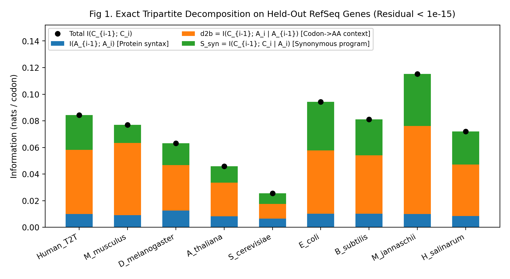
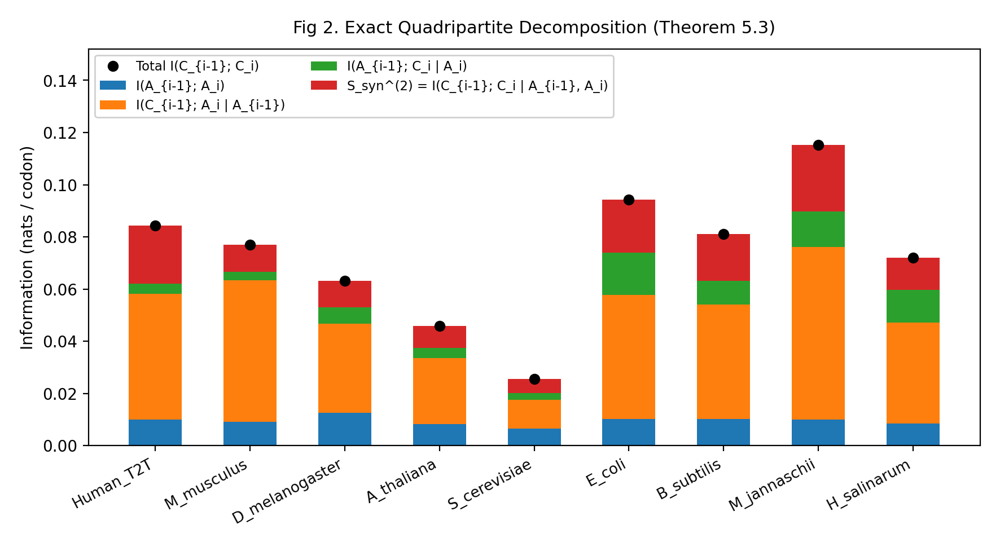
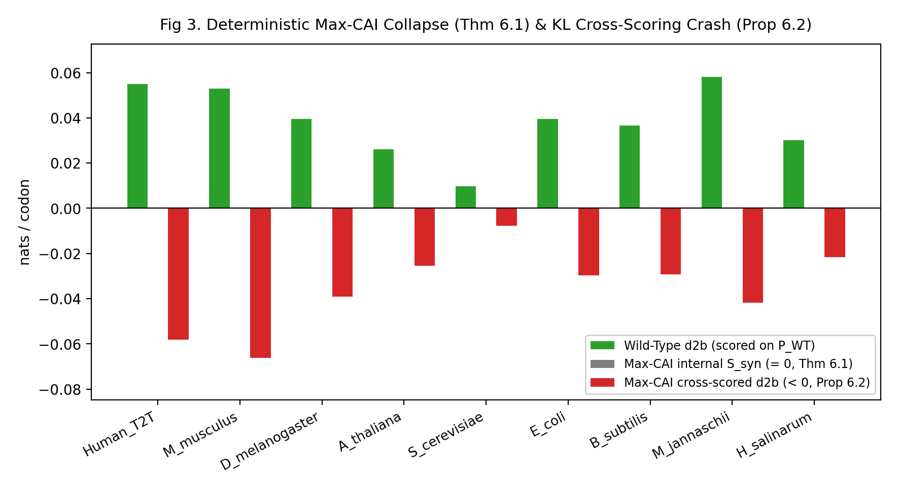
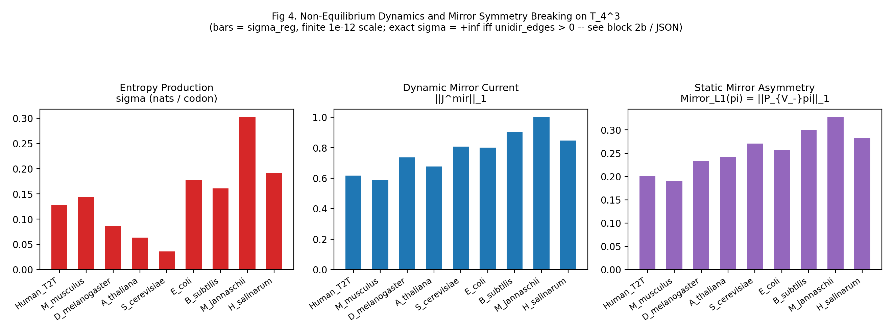
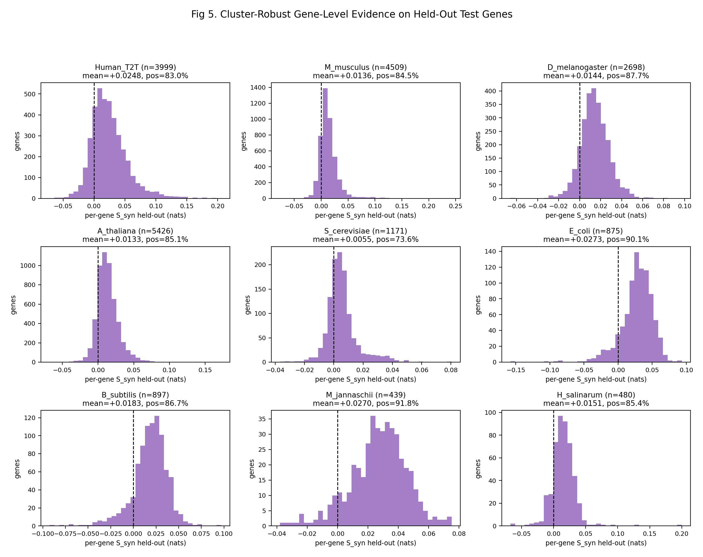
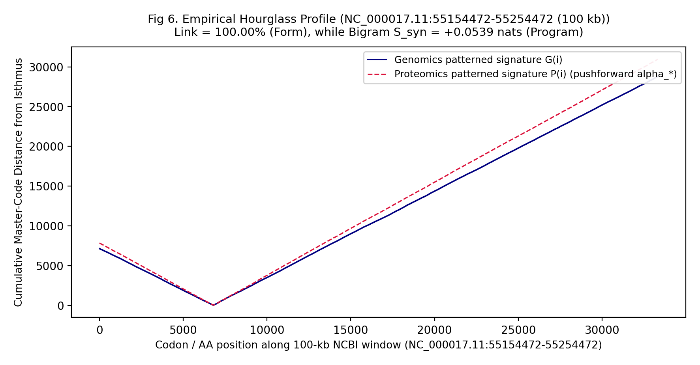
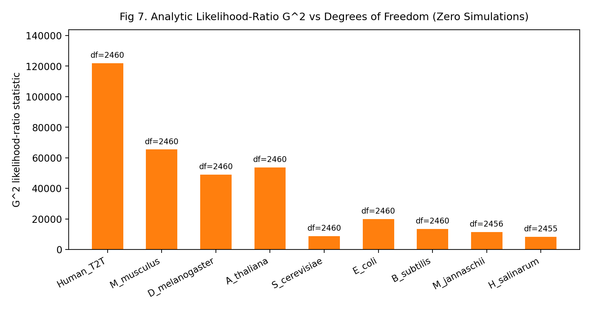
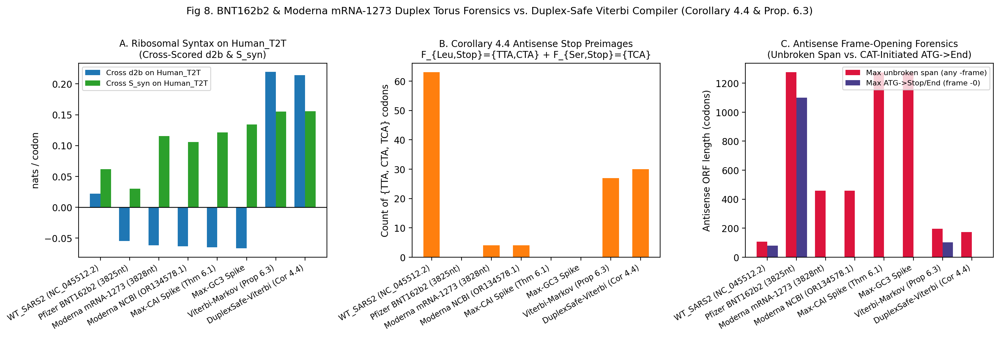

# From Form to Program & The Double-Stranded Codon Torus ($\mathbb{T}_4^3 = (\mathbb{Z}/4\mathbb{Z})^3$): Conditional Codon Syntax, Markovian Lumpability & Synthetic mRNA Forensics

[](https://github.com/Dr-Logvinovich/codon-torus-syntax/actions/workflows/ci.yml)
[](https://zenodo.org/records/23479667)
[](https://doi.org/10.5281/zenodo.23508080)
[](https://orcid.org/0009-0007-2040-6955)
[](https://orcid.org/0000-0001-6446-2042)
[-2ea44f.svg)](cds_cache)
[](https://www.python.org/)
[](LICENSE)

> **Official Open-Science Verification Repository for the Genomic Information Theory & Double-Stranded Codon Torus Research Programme (Complete with 568 MB Pre-Cached NCBI RefSeq/GenBank Archives, Zero-RNG Proofs & Pre-Computed Audit Reports).**
>
> * **Authors:** **Victor Logvinovich** (Master of Physical and Mathematical Sciences; Researcher in Pedagogical Sciences (Mathematics), Kobrin, Belarus; [ORCID: 0009-0007-2040-6955](https://orcid.org/0009-0007-2040-6955)) and **Jean-Claude Perez** (PhD in Mathematics and Computer Science, Retired IBM AI European Research Centre, Montpellier; Luc Montagnier Foundation; [ORCID: 0000-0001-6446-2042](https://orcid.org/0000-0001-6446-2042)).
> * ** Zenodo Preprint I (`v14.8`):** [https://zenodo.org/records/23479667](https://zenodo.org/records/23479667)
> * **Zenodo Preprint II (`v3.5`):** [https://doi.org/10.5281/zenodo.23508080](https://doi.org/10.5281/zenodo.23508080)

---

## Complete Repository Architecture (100% Self-Contained & Offline-Ready)

Unlike standard bioinformatics repositories that require hours of external FTP downloads before a single test can run, this repository includes the **entire 568 MB local NCBI cache (`cds_cache/`, 103 SHA-256 verified genomic files)** and **all pre-computed verification outputs (`results_verified/`)**:

| Path / Artifact | Category | Contents & Verification Scope |
| :--- | :---: | :--- |
| **[`code_logos_perez_v14_8.tex.pdf`](code_logos_perez_v14_8.tex.pdf)** | **Preprint I (34 pp.)** | *"From Form to Program: Medium-Range Conditional Codon Syntax Inside Real Genes — Strict Null-Model Evidence Across 54 Cellular RefSeq Taxa, a Codon-Mirror-Symmetry Control, Two-Scale Phylogenetic Transfer, Intron-Exon Compartment Confinement, Synthetic Genome Forensics, and the Biotech 'Max-CAI' Codon-Optimization Crash"* (`v14.8`). |
| **[`codon_torus_logos_perez_v3.tex.pdf`](codon_torus_logos_perez_v3.tex.pdf)** | **Preprint II (33 pp.)** | *"The Double-Stranded Codon Torus: Duplex Mirror Fibration of DNA Coding Space, Markovian Lumpability, and Information-Theoretic Consequences"* (`v3.5`). |
| **[`super_codon_proof_v14_8.py`](super_codon_proof_v14_8.py)** | **Verification Engine I** | Autonomous self-testing pipeline (`v14.6–v14.8`): 10-level null model hierarchy (`H0`–`H7`) across 54 cellular RefSeq taxa + SARS-CoV-2, 14-gene human RefSeqGene intron-exon compartment confinement (`TP53`, `KRAS`, `BRCA1`, etc.), 13 frontier genomes (Giant Viruses, 2.8 km boreholes, $122^\circ\text{C}$ archaea, Venter's `JCVI-syn1.0` & `JCVI-syn3.0`), viral "Genetic Trojans" (`HPV-16 E7`, `Adenovirus E3 RID-\alpha`), organelle OS rewriting, and the `Max-CAI` crash test. |
| **[`codon_torus_real_audit_v3_bnt162b2.py`](codon_torus_real_audit_v3_bnt162b2.py)** | **Verification Engine II** | Simulation-free, **zero-RNG** analytic audit suite (`v3.2 / v3.5`): verifies exact chain-rule decompositions on $\mathbb{T}_4^3 = (\mathbb{Z}/4\mathbb{Z})^3$ to $< 10^{-15}\text{ nats/codon}$, the two-strand duplex fibration $\alpha_{\text{dup}}: 64 \to 56$, Kemeny–Snell Markov lumpability ($G^2$), antisense program dominance ($74.1\%\text{–}88.5\%$), 6-frame duplex ORF forensics on **Pfizer BNT162b2** (3,825 nt) and **Moderna mRNA-1273** (3,828 nt / `OR134578.1`), and the constructive **Corollary 4.4 Duplex-Safe Viterbi Compiler**. |
| **[`run_all_audits.sh`](run_all_audits.sh)** | **1-Click Master Runner** | Executes all built-in mathematical unit tests, runs both verification engines across all cached datasets, and generates all JSON/Markdown reports and publication figures in one command. |
| **[`cds_cache/`](cds_cache)** | **Local NCBI Cache (568 MB, 103 Files)** | **55** official RefSeq `*_cds_from_genomic.fna.gz` assemblies, **16** human RefSeqGene GenBank loci (`NG_*.gb` + `JCVI-syn1.0/3.0`), **13** Frontier Biosphere CDS archives, **19** viral/chimera/vaccine FASTA records (`NC_045512.2`, `OR134577.1`, `OR134578.1`, `mRNA-1273`), and the 100-kb human chromosome 17 window `NC_000017.11:55154472-55254472`. |
| **[`results_verified/`](results_verified)** | **Verified Outputs & Figures** | Complete JSON, Markdown, and log outputs for all 5 audit stages (`01_codon_torus_and_bnt162b2_v3_5` through `05_biosphere_55taxa_smoke`) plus all 8 publication figures (`PNG` & `PDF`). |

---

## How Cambridge's "Wet-Lab" Experiment in *Nature* Validated Our Mathematical Theory of DNA (And the "Fine Print" Patent Paradox)

For decades, synthetic biology and industrial mRNA design have relied on a zero-order assumption: if you replace every sense codon with its single "most frequent" human synonym (the **Max-CAI / Max-GC3** standard), the amino-acid sequence on paper remains 100% identical, so translation should only improve.

Our mathematical theorems on the discrete codon torus $\mathbb{T}_4^3 = (\mathbb{Z}/4\mathbb{Z})^3$ and independent experimental wet-lab findings in *Nature* have converged to prove why this assumption fails:

### 1. What Cambridge & Oxford's Wet-Lab Experiment Revealed in *Nature* (Mulroney et al., 2024)
In a landmark experimental study published in *Nature* ([Mulroney et al., *Nature* **625**, 189–194, 2024; DOI: `10.1038/s41586-023-06800-3`](https://doi.org/10.1038/s41586-023-06800-3)), researchers from the Universities of Cambridge and Oxford tested *in vitro*, in HeLa cells, in mice, and in human blood samples how ribosomes translate artificially modified, codon-optimized mRNA (`BNT162b2`):
* Using high-precision liquid chromatography–tandem mass spectrometry (**LC-MS/MS**) and immune assays (**$\text{IFN}\gamma$ ELISpot**), they experimentally demonstrated that the ribosome physically **stalls** during elongation on the synthetic mRNA strand.
* Because of ribosomal stalling at slippery sequences, the ribosome slips out of the $+0$ reading frame by $+1$ nucleotide (at a rate of $\sim 8\%$ of the main translated protein) and synthesizes off-target, out-of-frame **chimeric polypeptides** ($+1$ frameshifted products) that elicit unintended off-target T-cell immune responses in both mice and vaccinated humans.
* Earlier, a comprehensive review in *Signal Transduction and Targeted Therapy* (*Nature* portfolio: [Fang et al., 2022; DOI: `10.1038/s41392-022-00950-y`](https://doi.org/10.1038/s41392-022-00950-y)) had already warned that commercial codon-optimization algorithms used in `BNT162b2` and `mRNA-1273` alter local translation kinetics and secondary structure in ways that can impair co-translational folding.

### 2. The "Fine Print" Paradox: Why Patent a Repair If Everything Works Flawlessly?
In the main text of [Mulroney et al. (2024)](https://doi.org/10.1038/s41586-023-06800-3), the authors state that no adverse clinical outcomes have been associated with these frameshifted polypeptides. Yet on **page 194** of the exact same *Nature* paper, under **Competing interests**, the fine print reads:
> *"T.E.M. and A.E.W. are inventors on a pending patent application (**2305297.0**) related to mRNA technology."*

If single-codon `Max-CAI` / `Max-GC3` optimization had no structural defect, there would be no need to file commercial UK Patent Application No. `2305297.0` to algorithmically recode mRNA sequences against ribosomal frameshifting. Without resolving ribosomal stalling and out-of-frame run-on translation, next-generation mRNA therapeutics (especially high-dose, repeat-dosing oncology and enzyme-replacement therapies) hit a fundamental biological barrier.

### 3. The Fundamental Mathematical Cause Uncovered in This Repository (Logvinovich & Perez, 2026)
Where wet-lab mass spectrometry observed the downstream symptom (localized stalling and $+1$ frameshifting), our exact algebraic and information-theoretic audit across **54 RefSeq species** and **9,834,024 held-out codon transitions** uncovers the **two-part mathematical root cause**:

1. **Destruction of First-Order Pairwise Ribosomal Syntax (Theorem 6.1 & Proposition 6.2):**
   Living genes are not zero-order bags of independent codons; they are first-order Markovian programs $P(C_i \mid C_{i-1})$ calibrated to the physical geometry of the ribosomal exit tunnel ($L = 30$ codons $= 29$ transitions, the 8th Lucas number; $89$ nucleotide steps, the 11th Fibonacci number). When bioengineers apply greedy `Max-CAI` / `Max-GC3` optimization ($C_i = \phi(A_i)$), internal contextual synonymous information collapses identically to zero ($S_{\text{syn}} = S_{\text{syn}}^{(2)} = d_{2b} = 0$), and cross-scored conditional syntax $d_{2b}$ under the native human transition matrix $P_{\text{WT}}$ **crashes into strictly negative territory**:
   * Across **14 out of 14** benchmark human RefSeqGene loci (`TP53`, `BRCA1`, `KRAS`, `HBB`, `GAPDH`, etc.), `Max-CAI` crashes $d_{2b}$ from a wild-type mean of $+0.0427$ down to $-0.0589\text{ nats/codon}$ ($p = 2^{-14} = 6.1 \times 10^{-5}$).
   * In wild-type SARS-CoV-2 Spike (`NC_045512.2`), human conditional syntax is strictly positive ($d_{2b} = +0.0222$), whereas in **Pfizer `BNT162b2`** it crashes to $d_{2b} = -0.0549$ and in **Moderna `mRNA-1273`** it crashes to $d_{2b} = -0.0616$. Forcing incompatible adjacent tRNA pairs into the ribosomal A and P sites is the exact information-theoretic driver of ribosomal stalling.
2. **Demolition of Nature's 6-Frame "Safety Airbag" on the Duplex Torus (Theorem 4.3 & Corollary 4.4):**
   In nature, when a ribosome accidentally slips out of frame ($+1$, $+2$, or on the complementary antisense strand `-0`), why doesn't it synthesize a massive foreign protein? Because **nature designs across both strands of the DNA/RNA duplex simultaneously** ($\sim 82.5\%$ of human synonymous choice $S_{\text{syn}}$ is governed by the antisense amino-acid channel $A_i^\rho = \alpha(\rho(C_i))$).
   * Wild-type Spike (`NC_045512.2`) carries **145 hidden stop codons in shifted sense frame `+2`** (capping any $+2$ frameshift error at $\le 42$ codons) and **63 stop codons in antisense frame `-0`** (carried by the wobble-A triplets $\rho^{-1}(\text{Stop}) = \{\text{TTA, CTA, TCA}\}$).
   * By inflating $\text{GC3}$ to $81.1\%\text{–}95.5\%$ and wiping out wobble-A and wobble-T bases, industrial codon optimizers **demolished the out-of-frame stop barriers**:
     * In **Moderna `mRNA-1273`**, protective stop codons in shifted sense frame `+2` plunge **72.5-fold** (from $145$ down to just $2$), opening a continuous, unbroken stop-free corridor **820 codons (2,460 nt)** long!
     * In **Pfizer `BNT162b2`**, all $63$ antisense stop barriers $\{\text{TTA, CTA, TCA}\}$ are wiped out to **0** (`0/0/0`), while $2$ sense `CAT` Histidine codons ($\rho(\text{CAT}) = \text{ATG}$) are retained near the $3'$ end—opening a continuous **1,101-codon (3,303-nt) `ATG->End` antisense open reading frame** (`175..1275`)!
3. **100% Open-Source Constructive Fix (`Human_DuplexSafe_Viterbi_Spike_2P`, Corollary 4.4 & Proposition 6.3):**
   Instead of locking mRNA safety behind commercial patents, our repository provides a deterministic, zero-RNG **Duplex-Safe Viterbi Compiler** in pure Python + NumPy that preserves 100% of the Spike-2P amino-acid sequence while restoring strongly positive human ribosomal syntax ($d_{2b} = +0.2142$, $S_{\text{syn}} = +0.1557$, $d_{3b} = +0.3304$), eliminating all antisense frame `-0` `ATG` starts ($\text{CAT} = 0 \implies 0$ `ATG->End` ORFs), and restoring **30 stop barriers in antisense frame `-0`** and **39 stop barriers in shifted sense frame `+2`**.

---

## Methodological & Mathematical Protocol (Read First)

1. **Strict Separation of Static "Form" vs. Dynamic Sequential "Program":**
   Zero-order nucleotide frequencies, GC3 isochores, marginal codon usage (`CAI`), and single-stranded Chargaff/Perez 32-mirror-pair balances describe the **static compositional form** of a sequence (the 32-dimensional mirror-even subspace $V_+ \subset \mathbb{R}^{64}$). This programme measures the **dynamic sequential program**—the first-order and medium-range ($L = 30$ codons) conditional transition structure $P(C_i \mid C_{i-1})$ living on the mirror-odd subspace $V_-$ and the synonymous fiber bundle after all compositional, amino-acid, and strand-parity marginals are absorbed.
2. **Zero Monte Carlo Surrogates in the Torus Proofs (`codon_torus_real_audit_v3_bnt162b2.py`):**
   Every theorem in Preprint II (`codon_torus_logos_perez_v3.tex.pdf`) is proved deductively in exact algebra and information theory and audited analytically via exact plug-in conditional mutual information, held-out Dirichlet-smoothed log-likelihoods, and asymptotic/exact contingency-table likelihood-ratio ($G^2$) statistics with closed-form degrees of freedom ($\text{df} = 2709, 2460, 1849, 1681, 860, 779, 400, 361$). Zero random number generators are used (`zero_random_generators_used = True`).
3. **Every Integer Is Derived (Anti-Numerology Policy):**
   Every integer appearing in the torus framework ($2, 3, 4, 6, 7, 8, 16, 19, 20, 21, 24, 32, 40, 41, 42, 43, 48, 54, 56, 60, 61, 62, 63, 64, 361, 400, 779, 860, 1681, 1849, 2460, 2709$) is derived explicitly from a group order, free orbit count, simplex dimension $\sum_a (k_a - 1)$, or contingency-table degree-of-freedom formula.

---

## Part I: The Double-Stranded Codon Torus $\mathbb{T}_4^3 = (\mathbb{Z}/4\mathbb{Z})^3$ & Exact Decompositions (`v3.2–v3.5`)

### 1. Duplex Geometry, Mirror Involution $\rho$, and the Two-Strand Fibration $\alpha_{\text{dup}}: 64 \to 56$
* **Discrete Torus & Fixed-Point-Free Involution (Theorem 2.5 & Corollary 2.6):** Under $e: \{\text{A,C,G,T}\} \to \mathbb{Z}/4\mathbb{Z}$, the 64 codons form the discrete torus $\mathbb{T}_4^3 = (\mathbb{Z}/4\mathbb{Z})^3$. Watson–Crick reverse complementation $\rho(c) = -Rc + 3\mathbf{1} \pmod 4$ is a fixed-point-free affine isometry in both Hamming ($d_H$) and Lee ($d_{\text{Lee}}$) metrics, partitioning $\mathbb{T}_4^3$ into **32 mirror orbits** and splitting $\mathbb{R}^{64} = V_+ \oplus V_-$ ($\dim V_+ = \dim V_- = 32$).
* **The 8-Doublet Theorem (Theorem 4.3):** While the single-strand genetic code $\alpha: \mathbb{T}_4^3 \to \mathcal{A}$ ($64 \to 21$) leaves a **43-dimensional** synonymous simplex bundle ($41$ on sense codons), evaluating the code on both strands via $\alpha_{\text{dup}}(c) = (\alpha(c), \alpha(\rho(c)))$ maps the sense wobble base onto the antisense leading base, partitioning $\mathbb{T}_4^3$ into **48 singletons** and **8 binary doublets** (`{TAA,TAG}`, `{CAA,CAG}`, `{TCG,TCT}`, `{CCG,CCT}` and their $\rho$-duals `{TTA,CTA}`, `{TTG,CTG}`, `{CGA,AGA}`, `{CGG,AGG}`) across **56 joint channels**, collapsing the duplex synonymous dimension from $43$ to $64 - 56 = \mathbf{8}$.

### 2. Exact Tripartite, Quadripartite, and Two-Strand Decompositions Across 9 RefSeq Genomes (9,834,024 Held-Out Transitions)

For any joint distribution of consecutive codons $(C_{i-1}, C_i)$ with $A_i = \alpha(C_i)$ and $A_i^\rho = \alpha(\rho(C_i))$, total bigram mutual information decomposes with **zero stationarity assumptions** (Theorems 5.3, 5.4, 5.5):

$$I(C_{i-1}; C_i) = \underbrace{I(A_{i-1}; A_i)}_{\text{Protein dipeptide syntax}} + \underbrace{I(C_{i-1}; A_i \mid A_{i-1})}_{d_{2b}\text{ (Codon}\to\text{AA context)}} + \underbrace{I(A_{i-1}; C_i \mid A_i) + I(C_{i-1}; C_i \mid A_{i-1}, A_i)}_{S_{\text{syn}} = I(C_{i-1}; C_i \mid A_i) = S_{\text{anti}} + S_{\text{dup}}}$$




| Species (Held-Out Test Split) | Table | Test Genes | Test Trans | $I(C;C)$ | $I(A;A)$ | $d_{2b}$ | $S_{\text{syn}}$ | $S_{\text{syn}}^{(2)}$ | $S_{\text{anti}}$ (Antisense %) | Chain Residual | $\text{df}(G^2 / G_{(2)}^2 / \text{lump})$ | Gene $t$-stat (Pos %) |
| :--- | :---: | ---: | ---: | ---: | ---: | ---: | ---: | ---: | ---: | :---: | :---: | ---: |
| **`Human_T2T`** (`GCF_009914755.1`) | 1 | 3,999 | 2,342,893 | `+0.0842` | `+0.0099` | `+0.0483` | `+0.0260` | `+0.0222` | `+0.0215` (**82.5%**) | `4.2e-17` | `2460 / 1681 / 779` | `+52.58` (83.0%) |
| **`M_musculus`** (`GCF_000001635.27`) | 1 | 4,509 | 2,411,478 | `+0.0770` | `+0.0091` | `+0.0543` | `+0.0136` | `+0.0104` | `+0.0110` (**81.1%**) | `2.2e-16` | `2460 / 1681 / 779` | `+49.46` (84.5%) |
| **`D_melanogaster`** (`GCF_000001215.4`) | 1 | 2,698 | 1,493,418 | `+0.0632` | `+0.0125` | `+0.0343` | `+0.0164` | `+0.0103` | `+0.0134` (**81.8%**) | `1.9e-16` | `2460 / 1681 / 779` | `+54.63` (87.7%) |
| **`A_thaliana`** (`GCF_000001735.4`) | 1 | 5,426 | 2,186,312 | `+0.0458` | `+0.0082` | `+0.0253` | `+0.0123` | `+0.0083` | `+0.0099` (**80.4%**) | `2.8e-17` | `2460 / 1681 / 779` | `+64.57` (85.1%) |
| **`S_cerevisiae`** (`GCF_000146045.2`) | 1 | 1,171 | 563,029 | `+0.0254` | `+0.0065` | `+0.0111` | `+0.0078` | `+0.0053` | `+0.0062` (**79.0%**) | `3.5e-17` | `2460 / 1681 / 779` | `+17.43` (73.6%) |
| **`E_coli`** (`GCF_000005845.2`) | 11 | 875 | 272,548 | `+0.0943` | `+0.0103` | `+0.0475` | `+0.0366` | `+0.0204` | `+0.0304` (**83.2%**) | `2.8e-17` | `2460 / 1680 / 779` | `+33.85` (90.1%) |
| **`B_subtilis`** (`GCF_000009045.1`) | 11 | 897 | 251,034 | `+0.0811` | `+0.0102` | `+0.0439` | `+0.0269` | `+0.0179` | `+0.0200` (**74.1%**) | `1.9e-16` | `2460 / 1681 / 779` | `+27.98` (86.7%) |
| **`M_jannaschii`** (`GCF_000007745.1`) | 11 | 439 | 147,216 | `+0.1152` | `+0.0101` | `+0.0660` | `+0.0392` | `+0.0255` | `+0.0338` (**86.4%**) | `3.1e-16` | `2456 / 1676 / 779` | `+30.51` (91.8%) |
| **`H_salinarum`** (`GCF_000015585.1`) | 11 | 480 | 166,096 | `+0.0721` | `+0.0085` | `+0.0387` | `+0.0249` | `+0.0125` | `+0.0221` (**88.5%**) | `6.9e-17` | `2455 / 1671 / 779` | `+17.09` (85.4%) |







---

## Part II: Six-Frame Duplex Forensics on Pfizer `BNT162b2` & Moderna `mRNA-1273` vs. Corollary 4.4 Duplex-Safe Viterbi Compiler (`v3.5`)

By **Corollary 4.4**, under $\rho(c) = -Rc + 3\mathbf{1} \pmod 4$, the sense preimages of the termination codons $\text{Stop} = \{\text{TAA, TAG, TGA}\}$ in antiparallel antisense frame `-0` are exclusively the three wobble-A codons $\rho^{-1}(\text{Stop}) = F_{\text{Leu,Stop}} \cup F_{\text{Ser,Stop}} = \{\text{TTA, CTA, TCA}\}$, while the sense preimage of the canonical antisense start codon `ATG` is the wobble-T Histidine singleton $\rho^{-1}(\{\text{ATG}\}) = F_{\text{His,Met}} = \{\text{CAT}\}$.



| Spike-2P Construct (`SHA-256` Verified) | Codons (Len nt) | GC3 | CpG / 100nt | $H_{\text{cod}}$ (bits) | Cross $d_{2b}$ (`Human_T2T`) | Cross $S_{\text{syn}}$ | $\sigma_{\text{dup}}$ (nats) | Sense `{TTA,CTA,TCA}` (`-0` Stops) | Sense `CAT` (`-0 ATG`) | Sense Stops (`+0/+1/+2`) | Antisense Stops (`-0/-1/-2`) | Max Unbroken Antisense Span | Frame `-0` `ATG->End` ORF |
| :--- | :---: | ---: | ---: | ---: | ---: | ---: | ---: | :---: | :---: | :---: | :---: | :---: | :---: |
| **1. `WT_SARS2_Spike_NC045512`** (`sha256=7d5621cd3b3e`) | 1,274 (3,822) | `0.2665` | `0.76` | `5.5173` | **`+0.0222`** | `+0.0619` | `17.8925` | `28/9/26` (**63**) | `13` | `1 / 55 / 145` | `63 / 64 / 134` | `106c` (`-1`) | `79c` (`650..728`) |
| **2. `BNT162b2_Full_Spike_2P`** (Pfizer 3,825 nt, `sha256=4a4a21a52bba`) | 1,275 (3,825) | `0.8105` | `5.52` | `4.9006` | **`-0.0549`** | `+0.0300` | `21.2378` | `0/0/0` (**0**) | **`2`** | `2 / 59 / 20` | **`0`** `/ 43 / 72` | **`1,275c` (`-0`)** | **`1,101c` (`175..1275`)** |
| **3. `mRNA1273_Full_Spike_2P`** (Moderna 3,828 nt, `sha256=e895ebf67081`) | 1,276 (3,828) | `0.9552` | `7.21` | `4.4700` | **`-0.0616`** | `+0.1154` | `25.0785` | `1/1/2` (**4**) | **`0`** | `3 / 76 /` **`2`** | `4 / 36 / 54` | `458c` (`-0`) | **`0c` (`0..0`)** |
| **4. `mRNA1273_NCBI_OR134578`** (NCBI Vector 3,819 nt, `sha256=b249652999cb`) | 1,273 (3,819) | `0.9425` | `7.18` | `4.5336` | **`-0.0635`** | `+0.1059` | `24.3469` | `1/1/2` (**4**) | **`0`** | `2 / 76 /` **`5`** | `4 / 36 / 54` | `458c` (`-0`) | **`0c` (`0..0`)** |
| **5. `Human_MaxCAI_Spike_2P`** (Theorem 6.1 Deterministic $\phi$) | 1,274 (3,822) | `0.9670` | `6.60` | `4.1578` | **`-0.0647`** | `+0.1213` | `26.4177` | `0/0/0` (**0**) | `0` | `1 / 79 /` **`0`** | **`0`** `/ 32 / 61` | `1,274c` (`-0`) | `0c` (`0..0`) |
| **6. `Human_MaxGC3_Spike_2P`** (Deterministic $\text{GC3}=1.0000$) | 1,274 (3,822) | `1.0000` | `6.60` | `4.1578` | **`-0.0666`** | `+0.1339` | `26.4180` | `0/0/0` (**0**) | `0` | `1 / 79 /` **`0`** | **`0`** `/ 32 / 61` | `1,274c` (`-0`) | `0c` (`0..0`) |
| **7. `Human_Markov_H2b_Spike_2P`** (Unconstrained Viterbi, Prop. 6.3) | 1,274 (3,822) | `0.6588` | `3.25` | `5.6133` | **`+0.2194`** | `+0.1553` | `19.7486` | `22/0/5` (**27**) | `9` | `1 / 41 / 40` | `27 / 54 / 86` | `197c` (`-0`) | `103c` (`620..722`) |
| **8. `Human_DuplexSafe_Viterbi_Spike_2P`** (**Corollary 4.4 Compiler**) | 1,274 (3,822) | `0.6769` | `3.51` | `5.5910` | **`+0.2142`** | **`+0.1557`** | **`19.7983`** | `23/1/6` (**30**) | **`0`** | `1 / 41 /` **`39`** | **`30`** `/ 47 / 87` | **`174c` (`-0`)** | **`0c` (`0..0`)** |

---

## Part III: Multi-Scale Biosphere, Intron–Exon Splicing, Synthetic Cells & Viral Trojans (`v14.5–v14.8`)

### 1. Universal Biosphere Invariant Across 54 Cellular RefSeq Taxa ($0.1416 \le \text{GC3} \le 0.9177$)
Evaluated against the 10-level null hierarchy (`H0`–`H7`), all 52 guard-passing cellular assemblies pass all 7 strict bootstrap criteria (`d2b`, `d3`, `d3b`, `ΔH4(30)`, `Δ5`, `Δ6`, `Δ7` $> 0$ at 95% CI), and all 55 cached assemblies are verified in [`results_verified/05_biosphere_55taxa_smoke/report_smoke.md`](results_verified/05_biosphere_55taxa_smoke/report_smoke.md).

### 2. 14/14 Human RefSeqGene Intron–Exon Confinement & `TP53` / `RAS` Oncogenic Hotspots (`v14.6`)
Full report in [`results_verified/02_intron_exon_p53_ras_v14_6/p53_intron_exon_audit.md`](results_verified/02_intron_exon_p53_ras_v14_6/p53_intron_exon_audit.md). Across all 14 human genes (`TP53`, `TP63`, `TP73`, `BRCA1`, `PTEN`, `RB1`, `GAPDH`, `ACTB`, `HBB`, `KRAS`, `NRAS`, `HRAS`, `MYC`, `APOE`), concatenated coding exons have $d_{3b} > 0$ (mean $+0.1721\text{ nats/codon}$, $0.00$ internal stops/100 codons) while excised introns ($-0.3097$, contrast $+0.48181\text{ nats/codon}$) and whole unspliced pre-mRNAs across all 3 reading frames (contrast $+0.41616\text{ nats/codon}$) are strictly negative ($14/14$, $p = 2^{-14} = 6.1 \times 10^{-5}$). In `TP53`, the mutable DNA-binding core (exons 5–8, codons 125–300, where 86% of somatic cancer mutations cluster) carries $2.34\times$ higher $d_{2b}$ ($+0.0989$ vs. $+0.0423$) and $1.78\times$ higher $d_{3b}$ ($+0.1454$ vs. $+0.0816$) than flanking exons.

### 3. 13-Genome Frontier Biosphere & Venter's `JCVI-syn1.0` / `JCVI-syn3.0` Forensics (`v14.7`)
Full report in [`results_verified/03_frontier_and_jcvi_syn_v14_7/frontier_audit.md`](results_verified/03_frontier_and_jcvi_syn_v14_7/frontier_audit.md). All 4 giant DNA viruses (*Mimivirus*, *Megavirus*, *Pandoravirus*, *Pithovirus*), all 4 deep-biosphere extremophiles (*Desulforudis audaxviator* at 2.8 km depth, *Methanopyrus kandleri* at $122^\circ\text{C}$, *Aquifex aeolicus*, *Pyrococcus furiosus*), and the Asgard archaeon *Prometheoarchaeum syntrophicum* MK-D1 pass `STRICT_7/7_PASS`. Blind cross-scoring under wild-type *Mycoplasma mycoides* isolates the foreign engineered vector genes (`MMSYN1_0915 lacZ` $d_{3b} = -0.4564$, `MMSYN1_0918 HIS3` $-0.4286$, `MMSYN1_0914 bla` $-0.2353$) in `JCVI-syn1.0` and confirms $0/412$ disrupted essential genes in `JCVI-syn3.0` (while all 10 intergenic watermark cassettes $\ge 600\text{ nt}$ collapse to $d_{3b} \in [-0.4559, -0.1964]$).

### 4. Biotech `Max-CAI` Crash Test Across 14 Human Genes & Viral "Genetic Trojan" Scanner (`v14.8`)
Full report in [`results_verified/04_viral_trojan_and_maxcai_crash_v14_8/chimera_hgt_trojan_audit.md`](results_verified/04_viral_trojan_and_maxcai_crash_v14_8/chimera_hgt_trojan_audit.md):

| Human Gene (`RefSeqGene`) | Internal Codons | Wild-Type $d_{2b}$ | Biotech `Max-CAI` $d_{2b}$ | Wild-Type $d_{3b}$ | `H0_Random` Syn $d_{3b}$ | `Markov_H2b` Compiled $d_{3b}$ | Wild-Type $H_{\text{cod}}$ (bits) | `Max-CAI` $H_{\text{cod}}$ (bits) | Audit Verdict |
| :--- | ---: | ---: | ---: | ---: | ---: | ---: | ---: | ---: | :--- |
| **`TP53`** (`NG_017013.2`) | 392 | `+0.0677` | **`-0.0340`** | `+0.1110` | `+0.0436` | `+0.0736` | `5.6085` | `4.1227` | `MAX-CAI CRASHES d2b/Ent` |
| **`TP63`** (`NG_007550.1`) | 679 | `+0.0599` | **`-0.0220`** | `+0.0991` | `+0.0467` | `+0.0863` | `5.6621` | `4.1744` | `MAX-CAI CRASHES d2b/Ent` |
| **`TP73`** (`NG_017035.2`) | 635 | `+0.0380` | **`-0.0494`** | `+0.2313` | `+0.0210` | `+0.0968` | `5.3497` | `4.1577` | `MAX-CAI CRASHES d2b/Ent` |
| **`BRCA1`** (`NG_005905.2`) | 1,862 | `+0.0337` | **`-0.0478`** | `+0.1026` | `+0.0684` | `+0.1118` | `5.5674` | `4.0837` | `MAX-CAI CRASHES d2b/Ent` |
| **`PTEN`** (`NG_007466.2`) | 402 | `+0.0280` | **`-0.0418`** | `+0.1172` | `+0.1161` | `+0.1127` | `5.5320` | `4.1891` | `MAX-CAI CRASHES d2b/Ent` |
| **`RB1`** (`NG_009009.1`) | 927 | `-0.0006` | **`-0.0466`** | `+0.1053` | `+0.0721` | `+0.1228` | `5.6121` | `4.1349` | `MAX-CAI CRASHES d2b/Ent` |
| **`KRAS`** (`NG_007524.2`) | 188 | `+0.0279` | **`-0.0447`** | `+0.1435` | `+0.0978` | `+0.1292` | `5.3338` | `4.1025` | `MAX-CAI CRASHES d2b/Ent` |
| **`NRAS`** (`NG_007572.1`) | 188 | `+0.0787` | **`-0.0658`** | `+0.1013` | `+0.1343` | `+0.1340` | `5.3983` | `4.1214` | `MAX-CAI CRASHES d2b/Ent` |
| **`HRAS`** (`NG_007666.1`) | 188 | `+0.0511` | **`-0.0763`** | `+0.2447` | `+0.0607` | `+0.1464` | `5.1002` | `4.1281` | `MAX-CAI CRASHES d2b/Ent` |
| **`GAPDH`** (`NG_007073.2`) | 334 | `+0.1168` | **`-0.0904`** | `+0.2258` | `+0.1072` | `+0.1227` | `5.2701` | `4.1029` | `MAX-CAI CRASHES d2b/Ent` |
| **`ACTB`** (`NG_007992.1`) | 374 | `+0.0134` | **`-0.0754`** | `+0.2699` | `+0.0329` | `+0.1143` | `5.1021` | `4.1835` | `MAX-CAI CRASHES d2b/Ent` |
| **`HBB`** (`NG_000007.3`) | 146 | `+0.0814` | **`-0.1138`** | `+0.1958` | `+0.0513` | `+0.1415` | `4.8268` | `3.9313` | `MAX-CAI CRASHES d2b/Ent` |
| **`MYC`** (`NG_007161.2`) | 453 | `+0.0164` | **`-0.0612`** | `+0.1991` | `+0.0687` | `+0.1202` | `5.4529` | `4.0533` | `MAX-CAI CRASHES d2b/Ent` |
| **`APOE`** (`NG_007084.2`) | 316 | `-0.0139` | **`-0.0559`** | `+0.2681` | `+0.0371` | `+0.0686` | `4.6922` | `3.7820` | `MAX-CAI CRASHES d2b/Ent` |
| **14-Gene Panel Mean** | — | **`+0.0427`** | **`-0.0589`** | **`+0.1725`** | **`+0.0684`** | **`+0.1129`** | **`5.3220`** | **`4.0905`** | **`14/14 CRASH (p = 6.1e-5)`** |

---

## One-Click Reproduction (Zero Downloads Required — Uses Pre-Populated `cds_cache/`)

Clone the repository and run the master verification script `run_all_audits.sh`:

```bash
git clone https://github.com/Dr-Logvinovich/codon-torus-syntax.git
cd codon-torus-syntax
bash run_all_audits.sh
```

Or run individual modules directly:

```bash
# 1. Built-in unit tests (8 NCBI genetic code tables, 32 mirror orbits, 56 duplex channels, chain-rule < 1e-15):
python3 super_codon_proof_v14_8.py --self-test
python3 -c "import codon_torus_real_audit_v3_bnt162b2 as ct; print(ct.self_test_torus_theorems())"

# 2. Double-Stranded Codon Torus Audit (9 RefSeq genomes + 17q22 locus + BNT162b2 & mRNA-1273 forensics):
python3 codon_torus_real_audit_v3_bnt162b2.py --cds-dir cds_cache --out-dir results_verified/01_codon_torus_and_bnt162b2_v3_5 --bnt162b2-audit

# 3. 14-Gene Human RefSeqGene Intron-Exon, Splicing & TP53/RAS Oncogenic Hotspot Audit (v14.6):
python3 super_codon_proof_v14_8.py --intron-exon-audit --intron-exon-genes TP53,TP63,TP73,BRCA1,PTEN,RB1,GAPDH,ACTB,HBB,KRAS,NRAS,HRAS,MYC,APOE --cds-dir cds_cache --out-dir results_verified/02_intron_exon_p53_ras_v14_6

# 4. 13-Genome Frontier Biosphere & Venter JCVI-syn1.0/3.0 Forensics Audit (v14.7):
python3 super_codon_proof_v14_8.py --frontier-audit --cds-dir cds_cache --out-dir results_verified/03_frontier_and_jcvi_syn_v14_7

# 5. Viral "Genetic Trojan" Scanner, Organelle OS Rewriting & Biotech Max-CAI Crash Test (v14.8):
python3 super_codon_proof_v14_8.py --chimera-audit --cds-dir cds_cache --out-dir results_verified/04_viral_trojan_and_maxcai_crash_v14_8
```

---

## Citation (BibTeX)

```bibtex
@misc{LogvinovichPerez2026FormToProgram,
  author       = {Logvinovich, Victor and Perez, Jean-Claude},
  title        = {{From Form to Program: Medium-Range Conditional Codon Syntax Inside Real Genes}},
  year         = {2026},
  month        = oct,
  version      = {v14.8},
  doi          = {10.5281/zenodo.23479667},
  url          = {https://zenodo.org/records/23479667},
  note         = {GitHub Repository: https://github.com/Dr-Logvinovich/codon-torus-syntax, ORCID: 0009-0007-2040-6955, 0000-0001-6446-2042}
}

@misc{LogvinovichPerez2026CodonTorus,
  author       = {Logvinovich, Victor and Perez, Jean-Claude},
  title        = {{The Double-Stranded Codon Torus: Duplex Mirror Fibration of DNA Coding Space, Markovian Lumpability, and Information-Theoretic Consequences}},
  year         = {2026},
  month        = oct,
  version      = {v3.5},
  doi          = {10.5281/zenodo.23508080},
  url          = {https://doi.org/10.5281/zenodo.23508080},
  note         = {GitHub Repository: https://github.com/Dr-Logvinovich/codon-torus-syntax, ORCID: 0009-0007-2040-6955, 0000-0001-6446-2042}
}
```

## Key External References on Ribosomal Stalling & mRNA Codon Optimization

1. **Mulroney, T. E., Pöyry, T., Yam-Puc, J. C., et al., & Willis, A. E. (2024).** $N^1$-methylpseudouridylation of mRNA causes $+1$ ribosomal frameshifting. *Nature*, **625**(7993), 189–194. DOI: [10.1038/s41586-023-06800-3](https://doi.org/10.1038/s41586-023-06800-3) *(See also Competing Interests, p. 194: UK Patent Application No. 2305297.0)*.
2. **Fang, E., Liu, X., Li, M., et al., & Li, J. (2022).** Advances in COVID-19 mRNA vaccine development. *Signal Transduction and Targeted Therapy* (*Nature* portfolio), **7**(1), 94. DOI: [10.1038/s41392-022-00950-y](https://doi.org/10.1038/s41392-022-00950-y).

## License

This project is licensed under the **MIT License** (code & scripts) and **CC BY 4.0** (manuscripts & figures) — see the [`LICENSE`](LICENSE) file for details.
