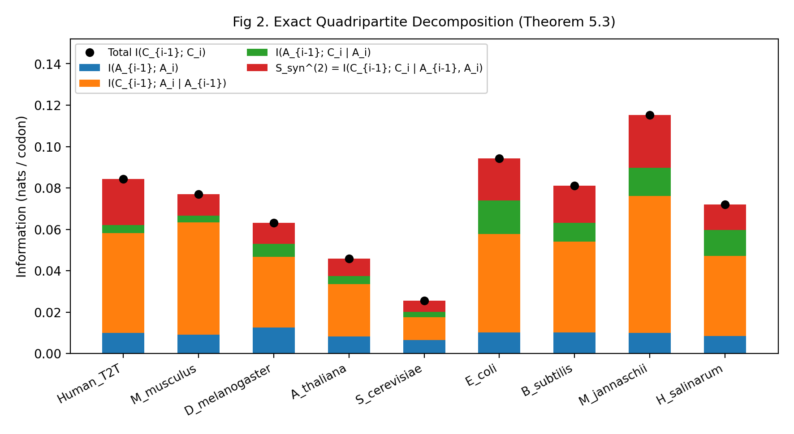
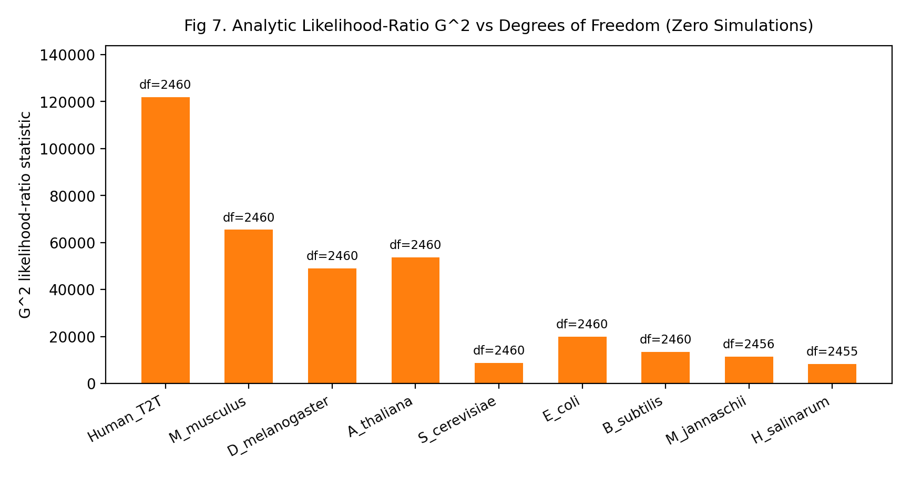
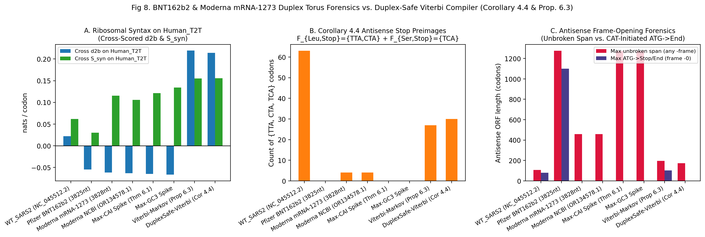
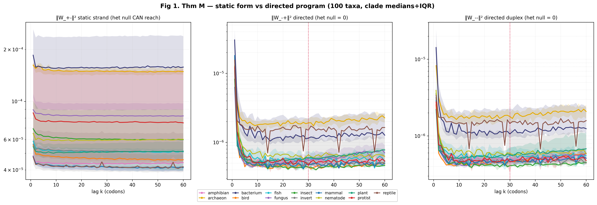
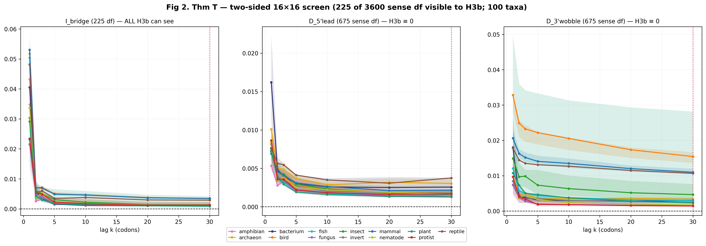
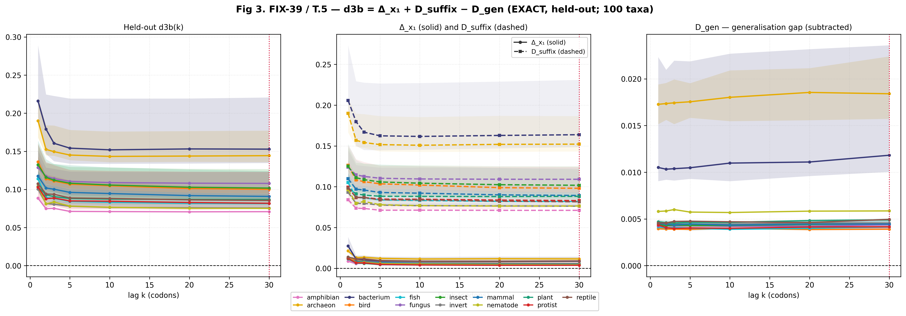
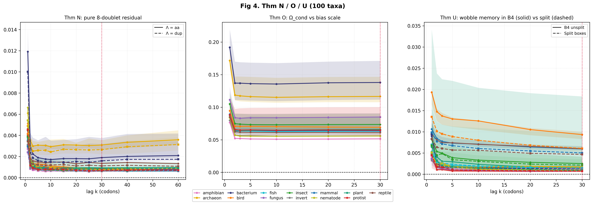
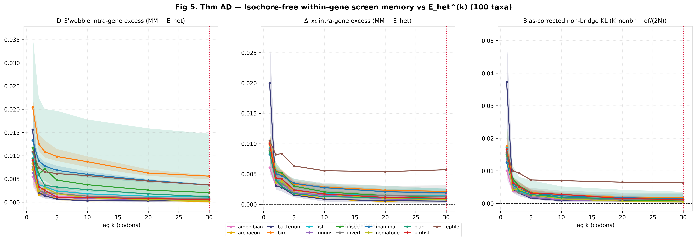
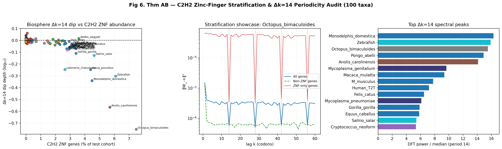
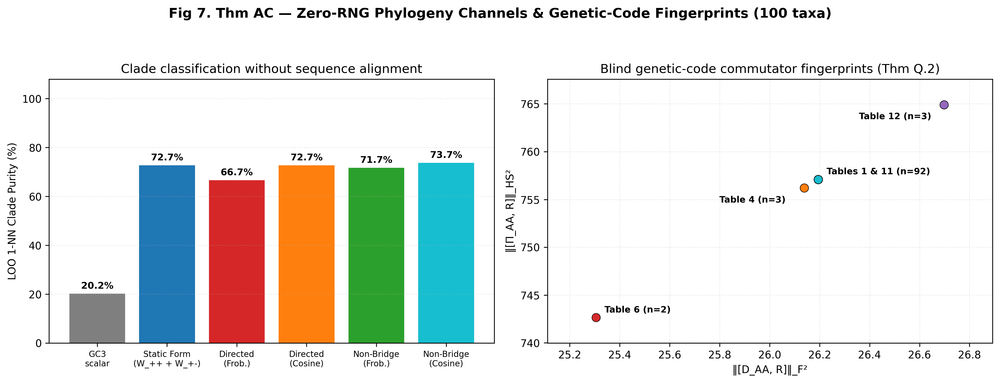

# From Form to Program, The Double-Stranded Codon Torus (𝕋₄³ = (ℤ/4ℤ)³) & The Codon Memory Spectrum: Zero-RNG Null Towers, Isochore-Free Screen Memory, C2H2 Zinc-Finger Periodicity, Alignment-Free Phylogeny & Synthetic mRNA Forensics

[](https://github.com/Dr-Logvinovich/codon-torus-syntax/actions/workflows/ci.yml)
[](https://doi.org/10.5281/zenodo.23479667)
[](https://doi.org/10.5281/zenodo.23695321)
[](https://doi.org/10.5281/zenodo.24242062)
[](https://orcid.org/0009-0007-2040-6955)
[](https://orcid.org/0000-0001-6446-2042)
[](cds_cache)
[](https://www.python.org/)
[](LICENSE)

> **Official Open-Science Verification Repository for the Three-Paper Genomic Information Theory & Double-Stranded Codon Torus Research Programme (Complete with Pre-Cached NCBI RefSeq/GenBank Archives, Zero-RNG Analytic Proofs & Verified Audit Bundles across 100 Cellular Genomes, 13 Clades, 5 NCBI Genetic Codes / 521,837 Genes / 265,535,126 Sense Codons / 796,605,378 Nucleotides).**
>
> * **Authors:** **Victor Logvinovich** (Master of Physical and Mathematical Sciences; Researcher in Mathematics Education, Kobrin, Belarus; [ORCID: 0009-0007-2040-6955](https://orcid.org/0009-0007-2040-6955)) and **Jean-Claude Perez** (PhD in Mathematics and Computer Science, Retired IBM AI European Research Centre, Montpellier; Luc Montagnier Foundation; [ORCID: 0000-0001-6446-2042](https://orcid.org/0000-0001-6446-2042)).
> * **Paper I (`v14.8` — From Form to Program):** [https://doi.org/10.5281/zenodo.23479667](https://doi.org/10.5281/zenodo.23479667) *(Concept DOI: [10.5281/zenodo.23287684](https://doi.org/10.5281/zenodo.23287684))*
> * **Paper II (`v3.5` — The Double-Stranded Codon Torus):** [https://doi.org/10.5281/zenodo.23695321](https://doi.org/10.5281/zenodo.23695321) *(Concept DOI: [10.5281/zenodo.23508080](https://doi.org/10.5281/zenodo.23508080))*
> * **Paper III (`v3.1` — The Codon Memory Spectrum, 100-Genome Biosphere Edition):** [https://doi.org/10.5281/zenodo.24242062](https://doi.org/10.5281/zenodo.24242062) *(All-Versions Concept DOI; full PDF included in [`Codon_Memory_Spectrum_v3.tex.pdf`](Codon_Memory_Spectrum_v3.tex.pdf))*

---

## Executive Trilogy Overview: From Empirical Syntax to Biosphere-Scale Operator Theory on 𝕋₄³ = (ℤ/4ℤ)³

| Trilogy Stage | Primary Mathematical & Empirical Contributions | Autonomous Engine | Scale Audited |
| :--- | :--- | :---: | :--- |
| **Paper I (`v14.8`)**<br>*From Form to Program* | Operationalizes static **form** vs. dynamic **program** across a 10-null hierarchy (`H0`–`H7`); establishes the `L = 30` codon (29-transition / 89-nt) invariant, two-scale phylogenetic transfer (132/132 mammal pairs + Primate–Rodent asymmetry), 14/14 human RefSeqGene intron–exon splicing confinement (`TP53`, `KRAS`, `BRCA1`), Venter `JCVI-syn1.0/3.0` forensics, viral "Genetic Trojans" (`HPV-16 E7`, `Adenovirus E3 RID-α`), and the `Max-CAI` crash. | [`super_codon_proof_v14_8.py`](super_codon_proof_v14_8.py) | 54 RefSeq cellular taxa + 13 frontier genomes + 14 human RefSeqGene loci |
| **Paper II (`v3.5`)**<br>*The Double-Stranded Codon Torus* | Proves that `ρ(c) = −Rc + 3·1 (mod 4)` is a fixed-point-free isometry on `𝕋₄³ = (ℤ/4ℤ)³` splitting `ℝ⁶⁴ = V₊ ⊕ V₋` (`32 ⊕ 32`); proves the duplex fibration `α_dup(c) = (α(c), α(ρ(c)))` (`64 → 56`, collapsing synonymous dimension `43 → 8`); proves antisense channel dominance (`74.1%–88.5%` of `S_syn`); uncovers the 1,101-codon antisense ORF in Pfizer `BNT162b2` and 820-codon `+2` corridor in Moderna `mRNA-1273`; builds the **Corollary 4.4 Duplex-Safe Viterbi Compiler**. | [`codon_torus_real_audit_v3_bnt162b2.py`](codon_torus_real_audit_v3_bnt162b2.py) | 9 reference RefSeq genomes (9,834,024 held-out transitions) + 17q22 locus + 8 Spike-2P constructs |
| **Paper III (`v3.1`)**<br>*The Codon Memory Spectrum* | Replaces the entire Monte-Carlo stack (`H4`–`H7` + 4 layer-shuffle towers) with exact polynomial-time **zero-RNG** expectations (`10⁻¹⁵–10⁻²⁰`); proves Klein `V₄` splitting (`1056 ⊕ 1024 ⊕ 1024 ⊕ 992`) and blind commutator classification across **5 NCBI genetic codes** (Tables 1, 4, 6, 11, 12; topological jump `b₁: 25 → 26` on Table 4); proves the rank-`≤ 16` `16 × 16` dinucleotide screen (`93.75%` invisible to `H3b`) and two finite-sample bias lemmas (`3.7%`/`8.4%` fit on minimal *Mycoplasma*); proves **Theorem AD** (isochore-free within-gene memory & bias-corrected screen-KL chain rules: `100/100` positive `K_nonbr^MM`), **Theorem AB** (causal sequence-only C2H2 zinc-finger resolution of `Δk = 14` dips across 6 animal lineages, `92.4%–113.1%` explained, + `19/19` therian mammals vs. `0/1` monotreme), and **Theorem AC** (alignment-free phylogeny: `72.7%` directed cosine, `73.7%` non-bridge cosine vs. `20.2%` GC3). | [`codon_memory_spectrum_v3.py`](codon_memory_spectrum_v3.py)<br>*(unified engine + built-in `--replot-only` renderer)* | **100 cellular RefSeq genomes** across 13 clades & 5 genetic codes, lags `k = 1, ..., 60` (**521,837 genes**, **265,535,126 sense codons**, **796,605,378 nt**, deterministic `--gene-order hash`) |

---

## Complete Repository Architecture (100% Self-Contained & Offline-Ready)

Unlike standard bioinformatics repositories that require hours of external FTP downloads before a single test can run, this repository ships with the **full local NCBI cache (`cds_cache/`)** covering all **100 cellular RefSeq genomes**, all frontier/RefSeqGene/vaccine records, and **all pre-computed verification outputs (`results_verified/` and `results_memory_v31_100/`)**:

| Path / Artifact | Category | Contents & Verification Scope |
| :--- | :---: | :--- |
| **[`code_logos_perez_v14_8.tex.pdf`](code_logos_perez_v14_8.tex.pdf)** | **Preprint I (34 pp.)** | *"From Form to Program: Medium-Range Conditional Codon Syntax Inside Real Genes — Strict Null-Model Evidence Across 54 Cellular RefSeq Taxa, a Codon-Mirror-Symmetry Control, Two-Scale Phylogenetic Transfer, Intron-Exon Compartment Confinement, Synthetic Genome Forensics, and the Biotech 'Max-CAI' Codon-Optimization Crash"* (`v14.8`). |
| **[`codon_torus_logos_perez_v3.tex.pdf`](codon_torus_logos_perez_v3.tex.pdf)** | **Preprint II (33 pp.)** | *"The Double-Stranded Codon Torus: Duplex Mirror Fibration of DNA Coding Space, Markovian Lumpability, and Information-Theoretic Consequences"* (`v3.5`). |
| **[`Codon_Memory_Spectrum_v3.tex.pdf`](Codon_Memory_Spectrum_v3.tex.pdf)** | **Preprint III (46 pp.)** | *"The Codon Memory Spectrum on the Double-Stranded Torus: Exact Zero-RNG Null Towers, Klein Four-Group Symmetry Breaking, Isochore-Free Screen Memory, Causal C2H2 Zinc-Finger Periodicity, and Alignment-Free Phylogeny Across 100 RefSeq Genomes and Five Genetic Codes"* (`v3.1`). |
| **[`super_codon_proof_v14_8.py`](super_codon_proof_v14_8.py)** | **Verification Engine I** | Autonomous self-testing pipeline (`v14.6–v14.8`): 10-level null model hierarchy (`H0`–`H7`) across 54 cellular RefSeq taxa + SARS-CoV-2, 14-gene human RefSeqGene intron-exon compartment confinement (`TP53`, `KRAS`, `BRCA1`, etc.), 13 frontier genomes (Giant Viruses, 2.8 km boreholes, 122 °C archaea, Venter's `JCVI-syn1.0` & `JCVI-syn3.0`), viral "Genetic Trojans" (`HPV-16 E7`, `Adenovirus E3 RID-α`), organelle OS rewriting, and the `Max-CAI` crash test. |
| **[`codon_torus_real_audit_v3_bnt162b2.py`](codon_torus_real_audit_v3_bnt162b2.py)** | **Verification Engine II** | Simulation-free, **zero-RNG** analytic audit suite (`v3.2 / v3.5`): verifies exact chain-rule decompositions on `𝕋₄³ = (ℤ/4ℤ)³` to `< 10⁻¹⁵ nats/codon`, the two-strand duplex fibration `α_dup: 64 → 56`, Kemeny–Snell Markov lumpability (`G²`), antisense program dominance (`74.1%–88.5%`), 6-frame duplex ORF forensics on **Pfizer BNT162b2** (3,825 nt) and **Moderna mRNA-1273** (3,828 nt / `OR134578.1`), and the constructive **Corollary 4.4 Duplex-Safe Viterbi Compiler**. |
| **[`codon_memory_spectrum_v3.py`](codon_memory_spectrum_v3.py)** | **Verification Engine III (`v3.1`)** | Unified self-testing, **100% zero-RNG** multi-lag analytic engine & publication figure renderer (`Theorems A–AD`, deterministic `--gene-order hash`, built-in `--replot-only` & `--plot-mode both`): executes across **100 cellular RefSeq genomes** (13 clades, 5 NCBI genetic codes: Tables 1, 4, 6, 11, 12; 521,837 genes, 265,535,126 sense codons, 796,605,378 nt) with closed-form expectations for `H4`–`H7` and 4 layer-shuffle towers, Klein `V₄` quadrant split, `16 × 16` dinucleotide screen, bias-corrected isochore-free screen-KL chain rules (**Theorem AD**), sequence-only C2H2 zinc-finger stratification (**Theorem AB**), alignment-free cosine/Frobenius phylogeny & blind multi-code classification (**Theorem AC**). |
| **[`run_all_audits.sh`](run_all_audits.sh)** | **1-Click Master Runner** | Executes built-in mathematical unit tests, runs verification engines across cached datasets, and generates JSON/Markdown reports and publication figures. |
| **[`cds_cache/`](cds_cache)** | **Local NCBI Cache (Full Biosphere)** | All **100** official RefSeq cellular `*_cds_from_genomic.fna.gz` assemblies (`BIOSPHERE_100` + `manifest_v30.json`), **16** human RefSeqGene GenBank loci (`NG_*.gb` + `JCVI-syn1.0/3.0`), **13** Frontier Biosphere CDS archives, **19** viral/chimera/vaccine FASTA records (`NC_045512.2`, `OR134577.1`, `OR134578.1`, `mRNA-1273`), and the 100-kb human chromosome 17 window `NC_000017.11:55154472-55254472`. |
| **[`results_verified/`](results_verified)** | **Verified Outputs I & II** | Complete JSON, Markdown, and log outputs for all 5 audit stages of Papers I & II (`01_codon_torus_and_bnt162b2_v3_5` through `05_biosphere_55taxa_smoke`) plus all 8 publication figures (`PNG` & `PDF`). |
| **[`results_memory_v31_100/`](results_memory_v31_100)** | **Verified Outputs III (`v3.1`)** | Complete 100-taxon zero-RNG output bundle (`memory_spectrum_v30.json`, `memory_spectrum_v30.md`) and all 11 publication figures (`300 DPI`) in [`results_memory_v31_100/figures/`](results_memory_v31_100/figures) (clade-median + IQR overlays [`fig1`](results_memory_v31_100/figures/fig1_klein_quadrants_clades.png)–[`fig4`](results_memory_v31_100/figures/fig4_tower_phase_boxes_clades.png), companion 100-line overlays, and discovery panels [`fig5`](results_memory_v31_100/figures/fig5_thmAD_isochore_free_screen.png)–[`fig7`](results_memory_v31_100/figures/fig7_thmAC_phylogeny_codes.png)). |
| **[`Cadon_DNA.mp4`](Cadon_DNA.mp4)** | **Visual Explainer** | Programmatic scientific animation illustrating the double-stranded codon torus `𝕋₄³`, `TP53` splicing syntax, and six-frame duplex barriers on `BNT162b2` / `mRNA-1273`. |

---

## How Cambridge's "Wet-Lab" Experiment in *Nature* Validated Our Mathematical Theory of DNA (And the "Fine Print" Patent Paradox)

For decades, synthetic biology and industrial mRNA design have relied on a zero-order assumption: if you replace every sense codon with its single "most frequent" human synonym (the **Max-CAI / Max-GC3** standard), the amino-acid sequence on paper remains 100% identical, so translation should only improve.

Our mathematical theorems on the discrete codon torus `𝕋₄³ = (ℤ/4ℤ)³` and independent experimental wet-lab findings in *Nature* have converged to prove why this assumption fails:

### 1. What Cambridge & Oxford's Wet-Lab Experiment Revealed in *Nature* (Mulroney et al., 2024)
In a landmark experimental study published in *Nature* ([Mulroney et al., *Nature* **625**, 189–194, 2024; DOI: `10.1038/s41586-023-06800-3`](https://doi.org/10.1038/s41586-023-06800-3)), researchers from the Universities of Cambridge and Oxford tested *in vitro*, in HeLa cells, in mice, and in human blood samples how ribosomes translate artificially modified, codon-optimized mRNA (`BNT162b2`):
* Using high-precision liquid chromatography–tandem mass spectrometry (**LC-MS/MS**) and immune assays (**IFNγ ELISpot**), they experimentally demonstrated that the ribosome physically **stalls** during elongation on the synthetic mRNA strand.
* Because of ribosomal stalling at slippery sequences, the ribosome slips out of the `+0` reading frame by `+1` nucleotide (at a rate of `~8%` of the main translated protein) and synthesizes off-target, out-of-frame **chimeric polypeptides** (`+1` frameshifted products) that elicit unintended off-target T-cell immune responses in both mice and vaccinated humans.
* Earlier, a comprehensive review in *Signal Transduction and Targeted Therapy* (*Nature* portfolio: [Fang et al., 2022; DOI: `10.1038/s41392-022-00950-y`](https://doi.org/10.1038/s41392-022-00950-y)) had already warned that commercial codon-optimization algorithms used in `BNT162b2` and `mRNA-1273` alter local translation kinetics and secondary structure in ways that can impair co-translational folding.

### 2. The "Fine Print" Paradox: Why Patent a Repair If Everything Works Flawlessly?
In the main text of [Mulroney et al. (2024)](https://doi.org/10.1038/s41586-023-06800-3), the authors state that no adverse clinical outcomes have been associated with these frameshifted polypeptides. Yet on **page 194** of the exact same *Nature* paper, under **Competing interests**, the fine print reads:
> *"T.E.M. and A.E.W. are inventors on a pending patent application (**2305297.0**) related to mRNA technology."*

If single-codon `Max-CAI` / `Max-GC3` optimization had no structural defect, there would be no need to file commercial UK Patent Application No. `2305297.0` to algorithmically recode mRNA sequences against ribosomal frameshifting. Without resolving ribosomal stalling and out-of-frame run-on translation, next-generation mRNA therapeutics (especially high-dose, repeat-dosing oncology and enzyme-replacement therapies) hit a fundamental biological barrier.

### 3. The Fundamental Mathematical Cause Uncovered in This Repository (Logvinovich & Perez, 2026)
Where wet-lab mass spectrometry observed the downstream symptom (localized stalling and `+1` frameshifting), our exact algebraic and information-theoretic audit across **100 cellular RefSeq species** and **265,535,126 sense codons** uncovers the **two-part mathematical root cause**:

1. **Destruction of First-Order Pairwise Ribosomal Syntax (Theorem 6.1 & Proposition 6.2):**
   Living genes are not zero-order bags of independent codons; they are first-order Markovian programs `P(C_i | C_{i-1})` calibrated to the physical geometry of the ribosomal exit tunnel (`L = 30` codons `= 29` transitions, `89` nucleotide steps). When bioengineers apply greedy `Max-CAI` / `Max-GC3` optimization (`C_i = φ(A_i)`), internal contextual synonymous information collapses identically to zero (`S_syn = S_syn⁽²⁾ = d₂b = 0`), and cross-scored conditional syntax `d₂b` under the native human transition matrix `P_WT` **crashes into strictly negative territory**:
   * Across **14 out of 14** benchmark human RefSeqGene loci (`TP53`, `BRCA1`, `KRAS`, `HBB`, `GAPDH`, etc.), `Max-CAI` crashes `d₂b` from a wild-type mean of `+0.0427` down to `-0.0589 nats/codon` (`p = 2⁻¹⁴ = 6.1 × 10⁻⁵`).
   * In wild-type SARS-CoV-2 Spike (`NC_045512.2`), human conditional syntax is strictly positive (`d₂b = +0.0222`), whereas in **Pfizer `BNT162b2`** it crashes to `d₂b = -0.0549` and in **Moderna `mRNA-1273`** it crashes to `d₂b = -0.0616`. Forcing incompatible adjacent tRNA pairs into the ribosomal A and P sites is the exact information-theoretic driver of ribosomal stalling.
2. **Demolition of Nature's 6-Frame "Safety Airbag" on the Duplex Torus (Theorem 4.3 & Corollary 4.4):**
   In nature, when a ribosome accidentally slips out of frame (`+1`, `+2`, or on the complementary antisense strand `-0`), why doesn't it synthesize a massive foreign protein? Because **nature designs across both strands of the DNA/RNA duplex simultaneously** (`82.5%` of human synonymous choice `S_syn` is governed by the antisense amino-acid channel `A_i^ρ = α(ρ(C_i))`).
   * Wild-type Spike (`NC_045512.2`) carries **145 hidden stop codons in shifted sense frame `+2`** (capping any `+2` frameshift error at `≤ 42` codons) and **63 stop codons in antisense frame `-0`** (carried by the wobble-A triplets `ρ⁻¹(Stop) = {TTA, CTA, TCA}`).
   * By inflating `GC3` to `81.1%–95.5%` and wiping out wobble-A and wobble-T bases, industrial codon optimizers **demolished the out-of-frame stop barriers**:
     * In **Moderna `mRNA-1273`**, protective stop codons in shifted sense frame `+2` plunge **72.5-fold** (from `145` down to just `2`), opening a continuous, unbroken stop-free corridor **820 codons (2,460 nt)** long!
     * In **Pfizer `BNT162b2`**, all `63` antisense stop barriers `{TTA, CTA, TCA}` are wiped out to **0** (`0/0/0`), while `2` sense `CAT` Histidine codons (`ρ(CAT) = ATG`) are retained near the `3'` end—opening a continuous **1,101-codon (3,303-nt) `ATG->End` antisense open reading frame** (`175..1275`)!
3. **100% Open-Source Constructive Fix (`Human_DuplexSafe_Viterbi_Spike_2P`, Corollary 4.4 & Proposition 6.3):**
   Instead of locking mRNA safety behind commercial patents, our repository provides a deterministic, zero-RNG **Duplex-Safe Viterbi Compiler** in pure Python + NumPy that preserves 100% of the Spike-2P amino-acid sequence while restoring strongly positive human ribosomal syntax (`d₂b = +0.2142`, `S_syn = +0.1557`, `d₃b = +0.3304`), eliminating all antisense frame `-0` `ATG` starts (`CAT = 0 ⟹ 0` `ATG->End` ORFs), and restoring **30 stop barriers in antisense frame `-0`** and **39 stop barriers in shifted sense frame `+2`**. Furthermore, our new **Theorem AC–AD** biosphere audit defines a sharp **two-scale Human–Mouse translational boundary** for preclinical mRNA engineering: local codon-pair syntax transfers nearly intact (`Mouse → Human` captures `96.9%` of Human's own `d₂b`), whereas murine models undergo `2–3×` mesoscopic Bernardi isochore erosion at lag `k = 30`.

---

## Methodological & Mathematical Protocol (Read First)

1. **Strict Separation of Static "Form" vs. Dynamic Sequential "Program":**
   Zero-order nucleotide frequencies, GC3 isochores, marginal codon usage (`CAI`), and single-stranded Chargaff/Perez 32-mirror-pair balances describe the **static compositional form** of a sequence (the 32-dimensional mirror-even subspace `V₊ ⊂ ℝ⁶⁴` and time-symmetric Klein subspaces `W₊₊ ⊕ W₊₋ ⊂ ℝ⁴⁰⁹⁶`). This programme measures the **dynamic sequential program**—the first-order and medium-range (`k = 1, ..., 60` codons) conditional transition structure `P(C_i | C_{i-1})` living on `V₋`, the directed Klein subspaces `W₋₊ ⊕ W₋₋`, and the isochore-stripped non-bridge screen complement after all compositional, amino-acid, and strand-parity marginals are absorbed.
2. **100% Zero-RNG Analytic Proofs (`codon_torus_real_audit_v3_bnt162b2.py` & `codon_memory_spectrum_v3.py`):**
   Every theorem in Papers II and III is proved deductively in exact algebra and information theory and audited analytically via closed-form permutation expectations, deterministic SHA-256 hash gene-cap ordering (`--gene-order hash`), held-out Dirichlet/backoff log-likelihoods, and contingency-table likelihood-ratio (`G²`) statistics with exact degrees of freedom. Zero random number generators are used in any proof path (`zero_random_generators_used = True`).
3. **Every Integer Is Derived (Anti-Numerology Policy):**
   Every integer appearing in the torus framework (`2, 3, 4, 6, 7, 8, 10, 12, 13, 15, 16, 19, 20, 21, 23, 24, 25, 26, 32, 40, 41, 42, 43, 45, 48, 54, 56, 57, 58, 59, 60, 61, 62, 63, 64, 76, 180, 225, 240, 361, 400, 420, 675, 703, 720, 756, 779, 784, 812, 860, 992, 1024, 1056, 1681, 1722, 1849, 2025, 2040, 2280, 2304, 2460, 2700, 2709, 3375, 3600, 3721, 3844, 3969, 4096`) is derived explicitly from a set cardinality, group trace, bipartite Euler–Poincaré Betti number, matrix rank, simplex dimension `∑_a (k_a − 1)`, or contingency degree-of-freedom count.

---

## Part I: The Double-Stranded Codon Torus 𝕋₄³ = (ℤ/4ℤ)³ & Exact Decompositions (`v3.2–v3.5`)

### 1. Duplex Geometry, Mirror Involution `ρ`, and the Two-Strand Fibration `α_dup: 64 → 56`
* **Discrete Torus & Fixed-Point-Free Involution (Theorem 2.5 & Corollary 2.6):** Under `e: {A,C,G,T} → ℤ/4ℤ`, the 64 codons form the discrete torus `𝕋₄³ = (ℤ/4ℤ)³`. Watson–Crick reverse complementation `ρ(c) = −Rc + 3·1 (mod 4)` is a fixed-point-free affine isometry in both Hamming (`d_H`) and Lee (`d_Lee`) metrics, partitioning `𝕋₄³` into **32 mirror orbits** and splitting `ℝ⁶⁴ = V₊ ⊕ V₋` (`dim V₊ = dim V₋ = 32`).
* **The 8-Doublet Theorem (Theorem 4.3):** While the single-strand genetic code `α: 𝕋₄³ → 𝒜` (`64 → 21`) leaves a **43-dimensional** synonymous simplex bundle (`41` on sense codons), evaluating the code on both strands via `α_dup(c) = (α(c), α(ρ(c)))` maps the sense wobble base onto the antisense leading base, partitioning `𝕋₄³` into **48 singletons** and **8 binary doublets** (`{TAA,TAG}`, `{CAA,CAG}`, `{TCG,TCT}`, `{CCG,CCT}` and their `ρ`-duals `{TTA,CTA}`, `{TTG,CTG}`, `{CGA,AGA}`, `{CGG,AGG}`) across **56 joint channels**, collapsing the duplex synonymous dimension from `43` to `64 − 56 = 8`.

### 2. Exact Tripartite, Quadripartite, and Two-Strand Decompositions Across 9 RefSeq Genomes (9,834,024 Held-Out Transitions)

For any joint distribution of consecutive codons `(C_{i-1}, C_i)` with `A_i = α(C_i)` and `A_i^ρ = α(ρ(C_i))`, total bigram mutual information decomposes with **zero stationarity assumptions** (Theorems 5.3, 5.4, 5.5):

$$
I(C_{i-1}; C_i) = \underbrace{I(A_{i-1}; A_i)}_{\text{Protein dipeptide syntax}} + \underbrace{I(C_{i-1}; A_i \mid A_{i-1})}_{d_{2b}\text{ (Codon to AA context)}} + \underbrace{I(A_{i-1}; C_i \mid A_i) + I(C_{i-1}; C_i \mid A_{i-1}, A_i)}_{S_{\text{syn}} = I(C_{i-1}; C_i \mid A_i) = S_{\text{anti}} + S_{\text{dup}}}
$$




| Species (Held-Out Test Split) | Table | Test Genes | Test Trans | `I(C;C)` | `I(A;A)` | `d₂b` | `S_syn` | `S_syn⁽²⁾` | `S_anti` (Antisense %) | Chain Residual | `df(G² / G₍₂₎² / lump)` | Gene `t`-stat (Pos %) |
| :--- | :---: | ---: | ---: | ---: | ---: | ---: | ---: | ---: | ---: | :---: | :---: | ---: |
| **`Human_T2T`** (`GCF_009914755.1`) | 1 | 3,999 | 2,342,893 | `+0.0842` | `+0.0099` | `+0.0483` | `+0.0260` | `+0.0222` | `+0.0215` (**82.5%**) | `4.2e-17` | `2460 / 1681 / 779` | `+52.58` (83.0%) |
| **`M_musculus`** (`GCF_000001635.27`) | 1 | 4,509 | 2,411,478 | `+0.0770` | `+0.0091` | `+0.0543` | `+0.0136` | `+0.0104` | `+0.0110` (**81.1%**) | `2.2e-16` | `2460 / 1681 / 779` | `+49.46` (84.5%) |
| **`D_melanogaster`** (`GCF_000001215.4`) | 1 | 2,698 | 1,493,418 | `+0.0632` | `+0.0125` | `+0.0343` | `+0.0164` | `+0.0103` | `+0.0134` (**81.8%**) | `1.9e-16` | `2460 / 1681 / 779` | `+54.63` (87.7%) |
| **`A_thaliana`** (`GCF_000001735.4`) | 1 | 5,426 | 2,186,312 | `+0.0458` | `+0.0082` | `+0.0253` | `+0.0123` | `+0.0083` | `+0.0099` (**80.4%**) | `2.8e-17` | `2460 / 1681 / 779` | `+64.57` (85.1%) |
| **`S_cerevisiae`** (`GCF_000146045.2`) | 1 | 1,171 | 563,029 | `+0.0254` | `+0.0065` | `+0.0111` | `+0.0078` | `+0.0053` | `+0.0062` (**79.0%**) | `3.5e-17` | `2460 / 1681 / 779` | `+17.43` (73.6%) |
| **`E_coli`** (`GCF_000005845.2`) | 11 | 875 | 272,548 | `+0.0943` | `+0.0103` | `+0.0475` | `+0.0366` | `+0.0204` | `+0.0304` (**83.2%**) | `2.8e-17` | `2460 / 1680 / 779` | `+33.85` (90.1%) |
| **`B_subtilis`** (`GCF_000009045.1`) | 11 | 897 | 251,034 | `+0.0811` | `+0.0102` | `+0.0439` | `+0.0269` | `+0.0179` | `+0.0200` (**74.1%**) | `1.9e-16` | `2460 / 1681 / 779` | `+27.98` (86.7%) |
| **`M_jannaschii`** (`GCF_000007745.1`) | 11 | 439 | 147,216 | `+0.1152` | `+0.0101` | `+0.0660` | `+0.0392` | `+0.0255` | `+0.0338` (**86.4%**) | `3.1e-16` | `2456 / 1676 / 779` | `+30.51` (91.8%) |
| **`H_salinarum`** (`GCF_000015585.1`) | 11 | 480 | 166,096 | `+0.0721` | `+0.0085` | `+0.0387` | `+0.0249` | `+0.0125` | `+0.0221` (**88.5%**) | `6.9e-17` | `2455 / 1671 / 779` | `+17.09` (85.4%) |




---

## Part II: Six-Frame Duplex Forensics on Pfizer `BNT162b2` & Moderna `mRNA-1273` vs. Corollary 4.4 Duplex-Safe Viterbi Compiler (`v3.5`)

By **Corollary 4.4**, under `ρ(c) = −Rc + 3·1 (mod 4)`, the sense preimages of the termination codons `Stop = {TAA, TAG, TGA}` in antiparallel antisense frame `-0` are exclusively the three wobble-A codons `ρ⁻¹(Stop) = F_{Leu,Stop} ∪ F_{Ser,Stop} = {TTA, CTA, TCA}`, while the sense preimage of the canonical antisense start codon `ATG` is the wobble-T Histidine singleton `ρ⁻¹({ATG}) = F_{His,Met} = {CAT}`.



| Spike-2P Construct (`SHA-256` Verified) | Codons (Len nt) | GC3 | CpG / 100nt | `H_cod` (bits) | Cross `d₂b` (`Human_T2T`) | Cross `S_syn` | `σ_dup` (nats) | Sense `{TTA,CTA,TCA}` (`-0` Stops) | Sense `CAT` (`-0 ATG`) | Sense Stops (`+0/+1/+2`) | Antisense Stops (`-0/-1/-2`) | Max Unbroken Antisense Span | Frame `-0` `ATG->End` ORF |
| :--- | :---: | ---: | ---: | ---: | ---: | ---: | ---: | :---: | :---: | :---: | :---: | :---: | :---: |
| **1. `WT_SARS2_Spike_NC045512`** (`sha256=7d5621cd3b3e`) | 1,274 (3,822) | `0.2665` | `0.76` | `5.5173` | **`+0.0222`** | `+0.0619` | `17.8925` | `28/9/26` (**63**) | `13` | `1 / 55 / 145` | `63 / 64 / 134` | `106c` (`-1`) | `79c` (`650..728`) |
| **2. `BNT162b2_Full_Spike_2P`** (Pfizer 3,825 nt, `sha256=4a4a21a52bba`) | 1,275 (3,825) | `0.8105` | `5.52` | `4.9006` | **`-0.0549`** | `+0.0300` | `21.2378` | `0/0/0` (**0**) | **`2`** | `2 / 59 / 20` | **`0`** `/ 43 / 72` | **`1,275c` (`-0`)** | **`1,101c` (`175..1275`)** |
| **3. `mRNA1273_Full_Spike_2P`** (Moderna 3,828 nt, `sha256=e895ebf67081`) | 1,276 (3,828) | `0.9552` | `7.21` | `4.4700` | **`-0.0616`** | `+0.1154` | `25.0785` | `1/1/2` (**4**) | **`0`** | `3 / 76 /` **`2`** | `4 / 36 / 54` | `458c` (`-0`) | **`0c` (`0..0`)** |
| **4. `mRNA1273_NCBI_OR134578`** (NCBI Vector 3,819 nt, `sha256=b249652999cb`) | 1,273 (3,819) | `0.9425` | `7.18` | `4.5336` | **`-0.0635`** | `+0.1059` | `24.3469` | `1/1/2` (**4**) | **`0`** | `2 / 76 /` **`5`** | `4 / 36 / 54` | `458c` (`-0`) | **`0c` (`0..0`)** |
| **5. `Human_MaxCAI_Spike_2P`** (Theorem 6.1 Deterministic `φ`) | 1,274 (3,822) | `0.9670` | `6.60` | `4.1578` | **`-0.0647`** | `+0.1213` | `26.4177` | `0/0/0` (**0**) | `0` | `1 / 79 /` **`0`** | **`0`** `/ 32 / 61` | `1,274c` (`-0`) | `0c` (`0..0`) |
| **6. `Human_MaxGC3_Spike_2P`** (Deterministic `GC3=1.0000`) | 1,274 (3,822) | `1.0000` | `6.60` | `4.1578` | **`-0.0666`** | `+0.1339` | `26.4180` | `0/0/0` (**0**) | `0` | `1 / 79 /` **`0`** | **`0`** `/ 32 / 61` | `1,274c` (`-0`) | `0c` (`0..0`) |
| **7. `Human_Markov_H2b_Spike_2P`** (Unconstrained Viterbi, Prop. 6.3) | 1,274 (3,822) | `0.6588` | `3.25` | `5.6133` | **`+0.2194`** | `+0.1553` | `19.7486` | `22/0/5` (**27**) | `9` | `1 / 41 / 40` | `27 / 54 / 86` | `197c` (`-0`) | `103c` (`620..722`) |
| **8. `Human_DuplexSafe_Viterbi_Spike_2P`** (**Corollary 4.4 Compiler**) | 1,274 (3,822) | `0.6769` | `3.51` | `5.5910` | **`+0.2142`** | **`+0.1557`** | **`19.7983`** | `23/1/6` (**30**) | **`0`** | `1 / 41 /` **`39`** | **`30`** `/ 47 / 87` | **`174c` (`-0`)** | **`0c` (`0..0`)** |

---

## Part III: Multi-Scale Biosphere, Intron–Exon Splicing, Synthetic Cells & Viral Trojans (`v14.5–v14.8`)

### 1. Universal Biosphere Invariant Across 54 Cellular RefSeq Taxa (`0.1416 ≤ GC3 ≤ 0.9177`)
Evaluated against the 10-level null hierarchy (`H0`–`H7`), all 52 guard-passing cellular assemblies pass all 7 strict bootstrap criteria (`d₂b`, `d₃`, `d₃b`, `ΔH4(30)`, `Δ₅`, `Δ₆`, `Δ₇ > 0` at 95% CI), and all 55 cached assemblies are verified in [`results_verified/05_biosphere_55taxa_smoke/report_smoke.md`](results_verified/05_biosphere_55taxa_smoke/report_smoke.md).

### 2. 14/14 Human RefSeqGene Intron–Exon Confinement & `TP53` / `RAS` Oncogenic Hotspots (`v14.6`)
Full report in [`results_verified/02_intron_exon_p53_ras_v14_6/p53_intron_exon_audit.md`](results_verified/02_intron_exon_p53_ras_v14_6/p53_intron_exon_audit.md). Across all 14 human genes (`TP53`, `TP63`, `TP73`, `BRCA1`, `PTEN`, `RB1`, `GAPDH`, `ACTB`, `HBB`, `KRAS`, `NRAS`, `HRAS`, `MYC`, `APOE`), concatenated coding exons have `d₃b > 0` (mean `+0.1721 nats/codon`, `0.00` internal stops/100 codons) while excised introns (`-0.3097`, contrast `+0.48181 nats/codon`) and whole unspliced pre-mRNAs across all 3 reading frames (contrast `+0.41616 nats/codon`) are strictly negative (`14/14`, `p = 2⁻¹⁴ = 6.1 × 10⁻⁵`). In `TP53`, the mutable DNA-binding core (exons 5–8, codons 125–300, where 86% of somatic cancer mutations cluster) carries `2.34×` higher `d₂b` (`+0.0989` vs. `+0.0423`) and `1.78×` higher `d₃b` (`+0.1454` vs. `+0.0816`) than flanking exons.

### 3. 13-Genome Frontier Biosphere & Venter's `JCVI-syn1.0` / `JCVI-syn3.0` Forensics (`v14.7`)
Full report in [`results_verified/03_frontier_and_jcvi_syn_v14_7/frontier_audit.md`](results_verified/03_frontier_and_jcvi_syn_v14_7/frontier_audit.md). All 4 giant DNA viruses (*Mimivirus*, *Megavirus*, *Pandoravirus*, *Pithovirus*), all 4 deep-biosphere extremophiles (*Desulforudis audaxviator* at 2.8 km depth, *Methanopyrus kandleri* at `122 °C`, *Aquifex aeolicus*, *Pyrococcus furiosus*), and the Asgard archaeon *Prometheoarchaeum syntrophicum* MK-D1 pass `STRICT_7/7_PASS`. Blind cross-scoring under wild-type *Mycoplasma mycoides* isolates the foreign engineered vector genes (`MMSYN1_0915 lacZ` `d₃b = -0.4564`, `MMSYN1_0918 HIS3` `-0.4286`, `MMSYN1_0914 bla` `-0.2353`) in `JCVI-syn1.0` and confirms `0/412` disrupted essential genes in `JCVI-syn3.0` (while all 10 intergenic watermark cassettes `≥ 600 nt` collapse to `d₃b ∈ [-0.4559, -0.1964]`).

### 4. Biotech `Max-CAI` Crash Test Across 14 Human Genes & Viral "Genetic Trojan" Scanner (`v14.8`)
Full report in [`results_verified/04_viral_trojan_and_maxcai_crash_v14_8/chimera_hgt_trojan_audit.md`](results_verified/04_viral_trojan_and_maxcai_crash_v14_8/chimera_hgt_trojan_audit.md):

| Human Gene (`RefSeqGene`) | Internal Codons | Wild-Type `d₂b` | Biotech `Max-CAI` `d₂b` | Wild-Type `d₃b` | `H0_Random` Syn `d₃b` | `Markov_H2b` Compiled `d₃b` | Wild-Type `H_cod` (bits) | `Max-CAI` `H_cod` (bits) | Audit Verdict |
| :--- | ---: | ---: | ---: | ---: | ---: | ---: | ---: | ---: | :--- |
| **`TP53`** (`NG_017013.2`) | 392 | `+0.0677` | **`-0.0340`** | `+0.1110` | `+0.0436` | `+0.0736` | `5.6085` | `4.1227` | `MAX-CAI CRASHES d2b/Ent` |
| **`TP63`** (`NG_007550.1`) | 679 | `+0.0599` | **`-0.0220`** | `+0.0991` | `+0.0467` | `+0.0863` | `5.6621` | `4.1744` | `MAX-CAI CRASHES d2b/Ent` |
| **`TP73`** (`NG_017035.2`) | 635 | `+0.0380` | **`-0.0494`** | `+0.2313` | `+0.0210` | `+0.0968` | `5.3497` | `4.1577` | `MAX-CAI CRASHES d2b/Ent` |
| **`BRCA1`** (`NG_005905.2`) | 1,862 | `+0.0337` | **`-0.0478`** | `+0.1026` | `+0.0684` | `+0.1118` | `5.5674` | `4.0837` | `MAX-CAI CRASHES d2b/Ent` |
| **`PTEN`** (`NG_007466.2`) | 402 | `+0.0280` | **`-0.0418`** | `+0.1172` | `+0.1161` | `+0.1127` | `5.5320` | `4.1891` | `MAX-CAI CRASHES d2b/Ent` |
| **`RB1`** (`NG_009009.1`) | 927 | `-0.0006` | **`-0.0466`** | `+0.1053` | `+0.0721` | `+0.1228` | `5.6121` | `4.1349` | `MAX-CAI CRASHES d2b/Ent` |
| **`KRAS`** (`NG_007524.2`) | 188 | `+0.0279` | **`-0.0447`** | `+0.1435` | `+0.0978` | `+0.1292` | `5.3338` | `4.1025` | `MAX-CAI CRASHES d2b/Ent` |
| **`NRAS`** (`NG_007572.1`) | 188 | `+0.0787` | **`-0.0658`** | `+0.1013` | `+0.1343` | `+0.1340` | `5.3983` | `4.1214` | `MAX-CAI CRASHES d2b/Ent` |
| **`HRAS`** (`NG_007666.1`) | 188 | `+0.0511` | **`-0.0763`** | `+0.2447` | `+0.0607` | `+0.1464` | `5.1002` | `4.1281` | `MAX-CAI CRASHES d2b/Ent` |
| **`GAPDH`** (`NG_007073.2`) | 334 | `+0.1168` | **`-0.0904`** | `+0.2258` | `+0.1072` | `+0.1227` | `5.2701` | `4.1029` | `MAX-CAI CRASHES d2b/Ent` |
| **`ACTB`** (`NG_007992.1`) | 374 | `+0.0134` | **`-0.0754`** | `+0.2699` | `+0.0329` | `+0.1143` | `5.1021` | `4.1835` | `MAX-CAI CRASHES d2b/Ent` |
| **`HBB`** (`NG_000007.3`) | 146 | `+0.0814` | **`-0.1138`** | `+0.1958` | `+0.0513` | `+0.1415` | `4.8268` | `3.9313` | `MAX-CAI CRASHES d2b/Ent` |
| **`MYC`** (`NG_007161.2`) | 453 | `+0.0164` | **`-0.0612`** | `+0.1991` | `+0.0687` | `+0.1202` | `5.4529` | `4.0533` | `MAX-CAI CRASHES d2b/Ent` |
| **`APOE`** (`NG_007084.2`) | 316 | `-0.0139` | **`-0.0559`** | `+0.2681` | `+0.0371` | `+0.0686` | `4.6922` | `3.7820` | `MAX-CAI CRASHES d2b/Ent` |
| **14-Gene Panel Mean** | — | **`+0.0427`** | **`-0.0589`** | **`+0.1725`** | **`+0.0684`** | **`+0.1129`** | **`5.3220`** | **`4.0905`** | **`14/14 CRASH (p = 6.1e-5)`** |

---

## Part IV: The Codon Memory Spectrum on the Double-Stranded Torus Across 100 RefSeq Genomes & Five Genetic Codes (Paper III, `v3.1`)

**Preprint III ([`Codon_Memory_Spectrum_v3.tex.pdf`](Codon_Memory_Spectrum_v3.tex.pdf), 46 pp., Concept DOI: [`10.5281/zenodo.24242062`](https://doi.org/10.5281/zenodo.24242062))** and its unified self-testing engine **[`codon_memory_spectrum_v3.py`](codon_memory_spectrum_v3.py) (`v3.1`, Theorems A–AD)** scale the zero-RNG multi-lag operator theory (`k = 1, ..., 60` codons) to **100 cellular NCBI RefSeq genomes** spanning **13 taxonomic clades** and **five NCBI genetic codes** (Table 1: `n = 70`, Table 11: `n = 22`, Table 12: `n = 3`, Table 4: `n = 3`, Table 6: `n = 2`; **521,837** deduplicated genes, **265,535,126** sense codons, **796,605,378** nucleotides under deterministic SHA-256 hash gene-cap ordering `--gene-order hash`, `n_failed = 0`).

Across all `100 × 7` taxon–lag evaluations, core MI/KL structural identities hold to `≤ 1.11 × 10⁻¹⁶ nats/codon` (semigroup closure `‖Q₁^k − Q_k‖_max ≤ 1.39 × 10⁻¹⁶`; Theorem W three-way residual `≤ 2.83 × 10⁻¹⁴`; Theorem AD forward/reverse KL chain rules `≤ 2.78 × 10⁻¹⁷` and `≤ 3.47 × 10⁻¹⁷`).

### 1. Exact Zero-RNG Null Stack & Resolution–Horizon Trade-Off (Theorems A, B.1, C.2, D, H, K, N)
* **Closed-Form Analytic Expectations:** Every stochastic control in the ten-null stack (`H4` block permutations in `O(n + q²)`, between-gene hypergeometric null `E_het^(k)`, Markovian `H5` with step-wise mass conservation `‖u_t‖₁ = 1` to `< 10⁻¹²`, synonymous `H6`, 32-mirror-orbit `H7`, and all four layer-shuffle towers `Λ ∈ {het, aa, dup, mirror}` in `2F` BLAS calls) is computed exactly with zero RNG and verified against exhaustive permutation enumeration to `10⁻¹⁵–10⁻²⁰`:

$$
\mathbb{E}_{\pi}[\text{LL}(s_\pi)] = \text{LL}(s) - D_g(L) + N_g(L), \qquad E_{\text{het}}^{(k)} = C^\top (w^{(k)} \odot C) - \text{diag}(C^\top w^{(k)})
$$

  Across all 100 taxa, **`Δ₆` and `Δ₇` have strictly positive gene-level 95% CIs in `100/100` genomes**, and **`Δ₅ > 0` in `100/100`** (`99/100` with 95% CI `> 0`; sole boundary case is minimal Table-4 *Mycoplasma mycoides*, `n = 158` test genes, `+0.017069`, CI low `-0.003431`).
* **Coarse-Graining Horizon Under Unbiased Hash Sampling (`Theorem B.1`):** `p*(codon_64) ≤ p*(mirror_32) ≤ p*(aa_20)` and `p*(codon_64) ≤ p*(wobble_4)` hold in **`100/100`** taxa (`p*(wobble_4) ≤ p*(gc3_2)` in `82/100`). Exactly **five taxa** break the raw 64-codon BIC barrier (`p*(64) = 2`): *Dictyostelium* (`2/3/2/6/14`), Zebra finch (`2/2/2/6/13`), Mallard duck (`2/2/2/7/13`), *Anolis carolinensis* (`2/3/2/7/14`), and *Chrysemys picta* (`2/3/2/8/16`).

### 2. Klein V₄ Symmetry Breaking, Blind Five-Code Classification & Left-Screen Betti Jump (Theorems M, L, Q, Q.2, Y, Z, AA, AA.2; Corollary 8.5)
* **Orthogonal Quadrant Split (`Theorem M` & `Theorem L`):** `V₄ = {id, 𝒯, ℛ, 𝒮}` splits `ℝ⁶⁴ˣ⁶⁴` into `W₊₊ ⊕ W₊₋ ⊕ W₋₊ ⊕ W₋₋` with dimensions `(1056, 1024, 1024, 992)`. Because `E_het^(k)` is symmetric, `‖W_{-+}(E_het^(k))‖_F² = ‖W_{--}(E_het^(k))‖_F² = 0` identically (measured `< 10⁻³²` across all 100 taxa), making `W_{-+} ⊕ W_{--}` a **model-free certificate of directed within-gene order**.
* **Blind Multi-Code Algebraic Fingerprints & Topological Transition (`Corollary 4.4` & `Corollary 8.5`):** Without using species labels, exact commutator invariants `‖[D_AA, R]‖_F² = 2C − 2S₂` and `‖[Π_AA, ℛ]‖_HS² = 2C² − 2S₂²` partition all **100 genomes** with 100% purity into the four algebraic equivalence classes of the five NCBI genetic codes. While the right prefix–AA graph `G_{O,A}` is an acyclic forest (`b₁ = 0`) on all codes and the left suffix–AA graph `G_{S,A}` preserves **`b₁(G_{S,A}) = 25`** across Tables 1/11, 12, and 6, **Table 4 (`TGA → Trp`) induces a strict topological jump `b₁: 25 → 26`** and **Table 6 (`TAA,TAG → Gln`) collapses duplex fibers into 4 doublets and 2 quartets**:

| Structural / Topological Invariant | Tables 1 & 11 (`n = 92`)<br>Standard Code | Table 12 (`n = 3`)<br>`CTG → Ser` | Table 4 (`n = 3`)<br>`TGA → Trp` | Table 6 (`n = 2`)<br>`TAA,TAG → Gln` |
| :--- | :---: | :---: | :---: | :---: |
| **Sense Codons `q_s` / Screen df `(q_s − 1)²`** | `61` / `3600` | `61` / `3600` | `62` / `3721` | `63` / `3844` |
| **Trace `S₂(AA) = Tr(D_AA R D_AA R)`** | `569/72 ≈ 7.902778` | `6427/840 ≈ 7.651190` | `571/72 ≈ 7.930556` | `601/72 ≈ 8.347222` |
| **Operator Commutator `‖[D_AA, R]‖_F²`** | `943/36 ≈ 26.194444` | `11213/420 ≈ 26.697619` | `941/36 ≈ 26.138889` | `911/36 ≈ 25.305556` |
| **Superoperator Commutator `‖[Π_AA, ℛ]‖_HS²`** | `757.092207` | `764.918569` | `756.212577` | `742.647762` |
| **Unsplit 4-Fold Prefix Boxes `|ℬ₄|`** | `8` (incl. `CT`) | `7` (`CT` split) | `8` | `8` |
| **Right `O–A` Forest (`|O ∨ A| / |O ∧ A|`)** | `23 / 13` (forest) | `24 / 12` (forest) | `23 / 13` (forest) | `24 / 12` (forest) |
| **Right Tower (Thm Z, sense)** | `16 → 23 → 58 → 61` | `16 → 24 → 59 → 61` | `16 → 23 → 59 → 62` | `16 → 24 → 57 → 63` |
| **Left Tower (Thm AA, sense)** | `16 → 57 → 61` | `16 → 58 → 61` | `16 → 58 → 62` | `16 → 57 → 63` |
| **Left Betti Number `b₁(G_{S,A})`** | **`25`** | **`25`** (invariant) | **`26` (jump!)** | **`25`** (invariant) |
| **Duplex Channels `F` / Doublets / Quartets** | `56` / `8` / `0` | `58` / `6` / `0` | `56` / `8` / `0` | `54` / `4` / **`2`** |



### 3. The 16×16 Dinucleotide Screen, Bias Lemmas & Central Correction to `d₃b` (Theorems R–X; Lemmas 7.1–7.2)
* **Rank-`≤ 16` Bottleneck & Exact Screen Split (`Theorem T`):** Every order-2 nucleotide trigram kernel (`H3b`, `H3b_phase`) sees only `I_bridge` (`225 / 3600 = 6.25%` of sense df), leaving **`93.75%`** (`D_{5'lead} + D_{3'wobble} + D_{1↔3}`) identically invisible:

$$
I(X; Y) = \underbrace{I(S; O)}_{I_{\text{bridge}}\text{ (225 df)}} + \underbrace{I(X_1; O \mid S)}_{D_{5'\text{lead}}\text{ (675 df)}} + \underbrace{I(S; Y_3 \mid O)}_{D_{3'\text{wobble}}\text{ (675 df)}} + \underbrace{I(X_1; Y_3 \mid S, O)}_{D_{1\leftrightarrow 3}\text{ (2025 df)}} = 3600\text{ sense df}
$$

* **Exact Held-Out Identity & Minimal-Genome Validation of Lemma 7.2:** `d₃b(k) = Δx₁ + D_suffix − D_gen` holds to `≤ 1.11 × 10⁻¹⁶ nats/codon` across all `100 × 7` lags. Making the trigram null phase-aware removes **`49.1%–93.8%`** of `d₃b(k=1)` across the biosphere (`69.2%–89.9%` core panel), and `d₃b_phase(k=30) < 0` in `17/100` small-cohort taxa in exact quantitative agreement with Lemma 7.2:
  * ***Mycoplasma genitalium*** (`q_s = 62`, `N_te^(30) = 32,128`): predicted `𝔼[D_gen] = 0.07357` vs. observed `0.07638` (**`3.7%`** agreement).
  * ***Mycoplasma pneumoniae*** (`q_s = 62`, `N_te^(30) = 40,429`): predicted `𝔼[D_gen] = 0.05847` vs. observed `0.06386` (**`8.4%`** agreement).
  * Meanwhile, the model-free leading-base layer **`Δx₁(k=30) > 0` in `100/100` taxa** (`+0.002556` in *L. major* to `+0.046661` in *M. genitalium*).

| Component of Held-Out `d₃b(k=1)` in `Human_T2T` (Hash-Ordered `v3.1`) | Value (`nats/codon`) | Share of `d₃b(1)` | Physical / Information-Theoretic Meaning |
| :--- | ---: | ---: | :--- |
| **`D_{bridge,KL}`** (KL misfit vs. `H3b` bridge `A₁`) | `+0.053539` | `46.8%` | Removable homogeneous trigram bridge misfit |
| **`D_stop`** (Stop-codon leakage inside `D_{wobble,KL}`) | `+0.022801` | `19.9%` | Frame-averaged `TAA/TAG/TGA` leakage (`→ 0` under `H3b_phase`) |
| **`D_{3'wobble} = I(S; Y₃ \| O)`** (MI layer) | `+0.020102` | `17.6%` | Model-free sense wobble memory at fixed sense codon box |
| **`D_syn`** (Pure synonymous KL inside `D_{wobble,KL}`) | `+0.007894` | `6.9%` | Intra-box synonymous marginal departure from frame-averaged `H3b` |
| **`D_{5'lead} = I(X₁; O \| S)`** (MI layer, part of `Δx₁`) | `+0.006967` | `6.1%` | Model-free sense leading-base (= antisense wobble) memory |
| **`D_{1↔3} = I(X₁; Y₃ \| S, O)`** (MI layer, part of `Δx₁`) | `+0.004691` | `4.1%` | Model-free cross-strand wobble–wobble coupling |
| **`D_{AA-split}`** (Split-box AA KL inside `D_{wobble,KL}`) | `+0.003536` | `3.1%` | Intra-box amino-acid split departure in the 8 split boxes |
| **`-D_gen`** (Subtracted train `→` test generalisation gap) | `-0.005047` | `-4.4%` | Finite-sample conditional KL divergence `P_te ∥ P_tr` |
| **Total Held-Out `d₃b(k=1)`** | **`+0.114482`** | **`100.0%`** | Exact 5-term sum (numerical residual `≤ 1.11 × 10⁻¹⁶`) |
| **of which Model-Free MI Layers (`Δx₁ + D_{3'wobble}`)** | **`+0.031760`** | **`27.7%`** | Invisible to any screen-factored kernel (`3375 / 3600 = 93.75%` of sense df) |
| **of which `Δx₁ = D_{5'lead} + D_{1↔3}` alone** | **`+0.011658`** | **`10.2%`** | **Strictly positive in `100/100` taxa at every lag `k = 1, ..., 30`** |





### 4. Theorem AD: Isochore-Free Within-Gene Screen Memory & Exact Screen-KL Chain Rules (`100/100` Genomes)
Subtracting **both** Miller–Madow finite-sample bias floors `df_l / (2N)` and the exact within-gene permutation null `E_het^(k)` resolves the Bernardi GC3-isochore objection directly:

$$
\ell_{\text{intra}}^{\text{MM}}(k) := \left(\hat{\ell}(B^{(k)}) - \frac{\mathrm{df}_{\ell,\mathrm{eff}}}{2N}\right) - \ell(E_{\text{het}}^{(k)}), \qquad D_{\text{KL}}(P \| Q) = K_{\text{bridge}} + K_{\text{lead}\mid SO} + K_{\text{wob}\mid XO} = K_{\text{bridge}} + K_{\text{wob}\mid SO} + K_{\text{lead}\mid SY}
$$

* At lag `k = 30`, strictly positive isochore-free within-gene excess survives in **`96/100`** taxa for `D_{3'wobble,intra}^MM` (led by monocot grasses Rice `+0.01981`, Sorghum `+0.01593`, Maize `+0.01475`, *B. distachyon* `+0.01475`, followed by birds, reptiles, and mammals), **`99/100`** for `Δx_{1,intra}^MM`, and **`100/100`** for the bias-corrected non-bridge KL divergence `K_{nonbridge}^MM := K_{nonbridge} − df_{nonbr,eff}/(2N)` (including minimal *M. genitalium*, `+0.00485 nats/codon` above floor) and `98/100` for `K_{lead|SY}^MM`.
* Local window null `E_{het,W}` (`W = 100` codons, Theorem C.3) isolates intra-gene `~100`-codon domains (`94.78%` of Human undirected `I_MM` at `k = 30`), while directed flux (`A_time = 0.05108` vs. null `3.96 × 10⁻¹⁷`) and local KL excess (`0.00452`) survive every window scale identically.



### 5. Theorem AB: Causal Resolution of `Δk = 14` Directed-Flux Periodicity via C2H2 Zinc-Finger Stratification
Deterministic, sequence-only translation and stratification on canonical C2H2 Krüppel zinc-finger motifs (`C.{2,4}C.{12}H.{3,5}H`, canonical `28`-aa repeat period) proves causally that sharp periodic dips at `k = 14, 28, 42, 56` in directed Klein flux (`‖W_{-+}‖_F²`, `‖W_{--}‖_F²`, matched by upward phase-conjugate spikes in static `‖W_{+-}‖_F²`) evolved convergently across **six independent animal lineages**:

| Taxon | Clade | ZNF Genes | ZNF Codons | `δ₁₄` (All) | `δ₁₄` (Non-ZNF) | `δ₁₄` (ZNF-only) | `SNR₁₄` | Causal Verdict |
| :--- | :--- | ---: | ---: | ---: | ---: | ---: | ---: | :--- |
| ***Octopus bimaculoides*** | invert | `7.49%` | `6.99%` | `-0.753` | `+0.002` | `-2.159` | `15.52` | **`ZNF_DRIVEN` (`100.2%` expl.)** |
| ***Anolis carolinensis*** | reptile | `5.70%` | `6.22%` | `-0.565` | `+0.026` | `-1.923` | `14.13` | **`ZNF_DRIVEN` (`104.6%` expl.)** |
| ***Monodelphis domestica*** | mammal | `4.48%` | `5.63%` | `-0.341` | `-0.007` | `-1.438` | `16.30` | **`ZNF_DRIVEN` (`97.9%` expl.)** |
| **Zebrafish** | fish | `6.09%` | `5.27%` | `-0.304` | `-0.023` | `-1.232` | `15.90` | **`ZNF_DRIVEN` (`92.4%` expl.)** |
| ***Cavia porcellus*** | mammal | `4.39%` | `5.44%` | `-0.248` | `+0.033` | `-1.323` | `2.67` | **`ZNF_DRIVEN` (`113.1%` expl.)** |
| ***Latimeria chalumnae*** | fish | `2.65%` | `4.13%` | `-0.247` | `+0.007` | `-1.269` | `4.82` | **`ZNF_DRIVEN` (`102.9%` expl.)** |
| **Human (T2T) / Mouse** | mammal | `3.18% / 2.77%` | `4.03% / 3.10%` | `-0.046 / -0.072` | `+0.003 / +0.003` | `-0.655 / -1.035` | `7.20 / 7.77` | `ZNF_SUBCOHORT` (`19/19` therians vs. `0/1` Platypus) |

Removing `𝒢_ZNF` accounts for **`92.4%–113.1%`** of the whole-genome dip across all six genome-wide lineages, while **23 additional taxa** (including `17/18` remaining eutherian mammals; **`19/19` therian mammals vs. `0/1` monotreme Platypus**) carry deep `Δk = 14` dips strictly inside their ZNF subcohort (`δ₁₄^ZNF ∈ [-1.035, -0.252]`). Two non-ZNF minimal Table-4 mycoplasmas (*M. genitalium* `SNR₁₄ = 9.65`, *M. pneumoniae* `6.11`) show `δ₁₄ > -0.02`, providing honest negative controls separating ZNF phase-cancellation dips from generic short-genome harmonics.



### 6. Theorem AC: Alignment-Free Biosphere Phylogeny & Human–Mouse Translational Boundary
Without sequence alignment or species labels, leave-one-out `1`-NN clade purity across all `99` eligible cellular genomes (12 multi-species clades; singleton `amphibian` *Xenopus* excluded from accuracy denominator) rises dramatically over scalar GC3:

| Channel | Subspace / Property | Hits / Eligible | LOO `1`-NN Purity | Ratio vs. GC3 |
| :--- | :--- | :---: | ---: | ---: |
| **Scalar GC3** | `1`-D marginal base composition | `20 / 99` | `20.20%` | `1.00×` |
| **Directed Program (Frob.)** | `W_{-+} ⊕ W_{--}` (`E_het^(k) ≡ 0`) | `66 / 99` | `66.67%` | `3.30×` |
| **Non-Bridge Screen (Frob.)** | `(I − Π_screen) P` (`93.75%` H3b-invisible) | `71 / 99` | `71.72%` | `3.55×` |
| **Static Form (Frob.)** | `W_{++} ⊕ W_{+-}` | `72 / 99` | `72.73%` | `3.60×` |
| **Directed Program (Cosine)** | Scale-free `W_{-+} ⊕ W_{--}` (`E_het^(k) ≡ 0`) | `72 / 99` | **`72.73%`** | **`3.60×`** |
| **Non-Bridge Screen (Cosine)** | Scale-free `93.75%` H3b-invisible complement | `73 / 99` | **`73.74%`** | **`3.65×`** |

* **Deep Evolutionary Pairings Inside Nominal Clade Misses:** Painted turtle *Chrysemys picta* pairs with birds (**Archelosauria**), *Xenopus* pairs with coelacanth *Latimeria* across all 5 channels (**Sarcopterygii**), opossum *Monodelphis* shifts from *Anolis* (`Static Form`) to *Gorilla* across all directed and non-bridge channels, and Table-4 *Mycoplasma pneumoniae* shifts from yeast *S. cerevisiae* (`Static Form`) to its sister species *M. genitalium* across both directed channels and scale-free `NonBridge Cosine` (`3/4` non-static channels).
* **Human–Mouse Two-Scale Boundary:** At `k = 1`, `Human_T2T` and `M_musculus` agree within `0.2%` on `Ω_cond(1)` and `Δ₇`, and `Mouse → Human` transfers `96.9%` of Human's own `d₂b` (`+0.04636` vs. `+0.04782`). At `k = 30`, Mouse undergoes `2–3×` Bernardi isochore erosion (`|λ₂|`: `2.2×`, `D_{3'wobble}(30)`: `2.4×`, `wob_het(30)`: `3.1×`), ranking `#16/99` in static torus distance from Human (`4.4×` farther than Chimp).



### 7. Core 15-Taxon Snapshot from the 100-Genome Hash-Ordered Audit (`codon_memory_spectrum_v3.py`, `v3.1`)

| Taxon (Core Panel) | Sense Codons | `I(C_t; C_{t+1})` | `I_bridge` (225 df) | `D_{5'lead}` (675 df) | `D_{3'wob}` (675 df) | `D_{1↔3}` (2025 df) | `d₃b(1)` | `d₃b_ph(1)` | `Δx₁(1)` | `Δx₁(30)` | Exact `Δ₅` (`t₅`) | Exact `Δ₆` (`t₆`) | Exact `Δ₇` (`t₇`) | `p*(64/20/32/4/2)` |
| :--- | ---: | ---: | ---: | ---: | ---: | ---: | ---: | ---: | ---: | ---: | ---: | ---: | ---: | :---: |
| **`Human_T2T`** | 3,486,713 | `0.086293` | `0.054533` | `0.006967` | `0.020102` | `0.004691` | `0.114482` | `0.031471` | `0.011658` | **`0.005592`** | `0.100409` (`45.90`) | `0.124211` (`129.5`) | `0.108294` (`124.0`) | `1/2/2/6/13` |
| **`M_musculus`** | 3,360,858 | `0.081036` | `0.059644` | `0.006405` | `0.010734` | `0.004253` | `0.105415` | `0.019748` | `0.010658` | **`0.005505`** | `0.114119` (`60.62`) | `0.126485` (`135.1`) | `0.108065` (`128.3`) | `1/3/2/6/13` |
| **`D_melanogaster`** | 3,191,283 | `0.065743` | `0.038133` | `0.010481` | `0.012043` | `0.005087` | `0.161159` | `0.029373` | `0.015567` | **`0.004092`** | `0.078037` (`28.76`) | `0.088846` (`104.2`) | `0.061477` (`88.53`) | `1/2/2/5/12` |
| **`A_thaliana`** | 2,390,561 | `0.051093` | `0.030594` | `0.007206` | `0.009005` | `0.004287` | `0.102772` | `0.018996` | `0.011493` | **`0.003927`** | `0.047972` (`37.78`) | `0.070884` (`103.5`) | `0.054624` (`92.59`) | `1/2/1/5/8` |
| **`S_cerevisiae`** | 2,916,706 | `0.025467` | `0.011842` | `0.005766` | `0.003940` | `0.003919` | `0.120758` | `0.012241` | `0.009686` | **`0.004232`** | `0.015409` (`7.47`) | `0.026599` (`70.28`) | `0.022176` (`64.70`) | `1/2/1/4/7` |
| **`E_coli`** | 1,325,818 | `0.094335` | `0.032612` | `0.022065` | `0.027729` | `0.011929` | `0.217000` | `0.060140` | `0.033994` | **`0.006728`** | `0.070960` (`17.38`) | `0.140563` (`81.57`) | `0.090813` (`74.35`) | `1/2/1/4/0` |
| **`B_subtilis`** | 1,224,712 | `0.081785` | `0.051507` | `0.012864` | `0.010843` | `0.006571` | `0.157629` | `0.027011` | `0.019435` | **`0.006650`** | `0.079973` (`40.75`) | `0.114522` (`74.92`) | `0.087799` (`71.67`) | `1/2/1/3/0` |
| **`M_jannaschii`** | 660,207 | `0.115217` | `0.059526` | `0.021747` | `0.022021` | `0.011922` | `0.226796` | `0.049112` | `0.033670` | **`0.010756`** | `0.120647` (`35.33`) | `0.175315` (`67.16`) | `0.130475` (`65.50`) | `1/1/1/2/1` |
| **`H_salinarum`** | 805,027 | `0.072106` | `0.031950` | `0.012185` | `0.019034` | `0.008936` | `0.296795` | `0.032199` | `0.021121` | **`0.009461`** | `0.052908` (`5.92`) | `0.096909` (`65.01`) | `0.074507` (`60.86`) | `1/1/1/4/8` |
| **`C_elegans`** | 2,442,000 | `0.055422` | `0.032404` | `0.007977` | `0.009947` | `0.005094` | `0.107328` | `0.023039` | `0.013071` | **`0.004294`** | `0.050733` (`29.94`) | `0.077692` (`110.7`) | `0.062078` (`102.8`) | `1/2/1/5/8` |
| **`Zebrafish`** | 3,418,168 | `0.080319` | `0.053895` | `0.008705` | `0.012779` | `0.004939` | `0.107246` | `0.025849` | `0.013644` | **`0.005782`** | `0.100619` (`58.37`) | `0.126429` (`122.7`) | `0.106685` (`117.4`) | `1/3/2/6/12` |
| **`Chicken`** | 3,498,166 | `0.088247` | `0.051747` | `0.007702` | `0.023536` | `0.005262` | `0.120905` | `0.037244` | `0.012964` | **`0.005223`** | `0.102675` (`45.18`) | `0.125737` (`140.5`) | `0.110715` (`132.8`) | `1/2/2/6/13` |
| **`Thermus`** | 648,938 | `0.200707` | `0.125559` | `0.033025` | `0.027451` | `0.014673` | `0.424124` | `0.075005` | `0.047698` | **`0.010390`** | `0.288507` (`34.34`) | `0.374024` (`100.1`) | `0.280462` (`89.39`) | `1/2/1/4/0` |
| **`Dictyostelium`** | 3,169,712 | `0.103592` | `0.043201` | `0.026722` | `0.023631` | `0.010039` | `0.307524` | `0.070873` | `0.036761` | **`0.007675`** | `0.032721` (`7.88`) | `0.079208` (`81.14`) | `0.081499` (`71.60`) | **`2/3/2/6/14`** |
| **`P_aeruginosa`** | 1,852,135 | `0.110723` | `0.054119` | `0.022602` | `0.024679` | `0.009324` | `0.368807` | `0.058612` | `0.031926` | **`0.004810`** | `0.132308` (`24.00`) | `0.191056` (`135.5`) | `0.123805` (`116.1`) | `1/2/1/4/0` |

*(Full 100-taxon biosphere tables A1–A6 are published in Appendix A of [`Codon_Memory_Spectrum_v3.tex.pdf`](Codon_Memory_Spectrum_v3.tex.pdf) and archived in [`results_memory_v31_100/memory_spectrum_v30.json`](results_memory_v31_100/memory_spectrum_v30.json).)*

---

## One-Click Reproduction (Zero Downloads Required — Uses Pre-Populated `cds_cache/`)

Clone the repository and run the master verification script `run_all_audits.sh`:

```bash
git clone [https://github.com/Dr-Logvinovich/codon-torus-syntax.git](https://github.com/Dr-Logvinovich/codon-torus-syntax.git)
cd codon-torus-syntax
bash run_all_audits.sh
```

Or run individual modules directly:

```bash
# 1. Built-in unit tests (8 NCBI genetic code tables, 32 mirror orbits, 56 duplex channels, chain-rule < 1e-15):
python3 super_codon_proof_v14_8.py --self-test
python3 -c "import codon_torus_real_audit_v3_bnt162b2 as ct; print(ct.self_test_torus_theorems())"

# 2. Double-Stranded Codon Torus Audit (9 RefSeq genomes + 17q22 locus + BNT162b2 & mRNA-1273 forensics):
python3 codon_torus_real_audit_v3_bnt162b2.py --cds-dir cds_cache --out-dir results_verified/01_codon_torus_and_bnt162b2_v3_5 --bnt162b2-audit

# 3. 14-Gene Human RefSeqGene Intron-Exon, Splicing & TP53/RAS Oncogenic Hotspot Audit (v14.6):
python3 super_codon_proof_v14_8.py --intron-exon-audit --intron-exon-genes TP53,TP63,TP73,BRCA1,PTEN,RB1,GAPDH,ACTB,HBB,KRAS,NRAS,HRAS,MYC,APOE --cds-dir cds_cache --out-dir results_verified/02_intron_exon_p53_ras_v14_6

# 4. 13-Genome Frontier Biosphere & Venter JCVI-syn1.0/3.0 Forensics Audit (v14.7):
python3 super_codon_proof_v14_8.py --frontier-audit --cds-dir cds_cache --out-dir results_verified/03_frontier_and_jcvi_syn_v14_7

# 5. Viral "Genetic Trojan" Scanner, Organelle OS Rewriting & Biotech Max-CAI Crash Test (v14.8):
python3 super_codon_proof_v14_8.py --chimera-audit --cds-dir cds_cache --out-dir results_verified/04_viral_trojan_and_maxcai_crash_v14_8

# 6. Paper III (v3.1) Deterministic Self-Tests (Theorems A-AD, all 8 NCBI tables, exhaustive permutation fixtures, 3-period de Bruijn B(4,6) null, synthetic ZNF control):
python3 codon_memory_spectrum_v3.py --self-test

# 7. Paper III (v3.1) Full 100-Taxon Biosphere Audit (13 clades, 5 genetic codes, lags k = 1..60, unbiased SHA-256 hash cap, zero RNG):
python3 codon_memory_spectrum_v3.py \
    --cds-dir cds_cache --out-dir results_memory_v31_100 \
    --biosphere-100 --max-genes 6000 --gene-order hash --max-lag 60 --kernel-mode backoff --plot-mode both

# 8. Fast Re-Rendering of All 11 Publication Figures (300 DPI) from Pre-Computed JSON Without Recomputing:
python3 codon_memory_spectrum_v3.py \
    --replot-only results_memory_v31_100/memory_spectrum_v30.json \
    --out-dir results_memory_v31_100 --dpi 300 --plot-format png --plot-mode both
```

---

## Citation (BibTeX)

```bibtex
@misc{LogvinovichPerez2026FormToProgram,
  author       = {Logvinovich, Victor and Perez, Jean-Claude},
  title        = {{From Form to Program: Medium-Range Conditional Codon Syntax Inside Real Genes}},
  year         = {2026},
  month        = oct,
  version      = {v14.8},
  doi          = {10.5281/zenodo.23479667},
  url          = {[https://doi.org/10.5281/zenodo.23479667](https://doi.org/10.5281/zenodo.23479667)},
  note         = {Concept DOI: 10.5281/zenodo.23287684; GitHub Repository: [https://github.com/Dr-Logvinovich/codon-torus-syntax](https://github.com/Dr-Logvinovich/codon-torus-syntax), ORCID: 0009-0007-2040-6955, 0000-0001-6446-2042}
}

@misc{LogvinovichPerez2026CodonTorus,
  author       = {Logvinovich, Victor and Perez, Jean-Claude},
  title        = {{The Double-Stranded Codon Torus: Duplex Mirror Fibration of DNA Coding Space, Markovian Lumpability, and Information-Theoretic Consequences}},
  year         = {2026},
  month        = oct,
  version      = {v3.5},
  doi          = {10.5281/zenodo.23695321},
  url          = {[https://doi.org/10.5281/zenodo.23695321](https://doi.org/10.5281/zenodo.23695321)},
  note         = {Concept DOI: 10.5281/zenodo.23508080; GitHub Repository: [https://github.com/Dr-Logvinovich/codon-torus-syntax](https://github.com/Dr-Logvinovich/codon-torus-syntax), ORCID: 0009-0007-2040-6955, 0000-0001-6446-2042}
}

@misc{LogvinovichPerez2026MemorySpectrum,
  author       = {Logvinovich, Victor and Perez, Jean-Claude},
  title        = {{The Codon Memory Spectrum on the Double-Stranded Torus: Exact Zero-RNG Null Towers, Klein Four-Group Symmetry Breaking, Isochore-Free Screen Memory, Causal C2H2 Zinc-Finger Periodicity, and Alignment-Free Phylogeny Across 100 RefSeq Genomes and Five Genetic Codes}},
  year         = {2026},
  month        = nov,
  version      = {v3.1},
  doi          = {10.5281/zenodo.24242062},
  url          = {[https://doi.org/10.5281/zenodo.24242062](https://doi.org/10.5281/zenodo.24242062)},
  note         = {All-versions Concept DOI: 10.5281/zenodo.24242062; GitHub Repository: [https://github.com/Dr-Logvinovich/codon-torus-syntax](https://github.com/Dr-Logvinovich/codon-torus-syntax), ORCID: 0009-0007-2040-6955, 0000-0001-6446-2042}
}
```

## Key External References on Ribosomal Stalling & mRNA Codon Optimization

1. **Mulroney, T. E., Pöyry, T., Yam-Puc, J. C., et al., & Willis, A. E. (2024).** N¹-methylpseudouridylation of mRNA causes `+1` ribosomal frameshifting. *Nature*, **625**(7993), 189–194. DOI: [10.1038/s41586-023-06800-3](https://doi.org/10.1038/s41586-023-06800-3) *(See also Competing Interests, p. 194: UK Patent Application No. 2305297.0)*.
2. **Fang, E., Liu, X., Li, M., et al., & Li, J. (2022).** Advances in COVID-19 mRNA vaccine development. *Signal Transduction and Targeted Therapy* (*Nature* portfolio), **7**(1), 94. DOI: [10.1038/s41392-022-00950-y](https://doi.org/10.1038/s41392-022-00950-y).

## License

This project is licensed under the **MIT License** (code & scripts) and **CC BY 4.0** (manuscripts & figures) — see the [`LICENSE`](LICENSE) file for details.
